# Pets

Pets sind kleine Begleiter, die dir überallhin folgen. Sie gelten im **ganzen Netzwerk**: in der Lobby und auf allen Inseln. Wechselst du den Server, ist dein Pet mit demselben Namen und Skin wieder bei dir.

Mit den [Warpetts](../sb/warpetts.md) haben Pets nichts zu tun.


**Das Capybara bekommt jeder gratis.** Öffne `/pet` und ruf es unter **Meine Pets**.


## Das Pet-Menü

`/pet` (auch `/pets`) öffnet das Menü:

| Knopf | Was er tut |
| ----- | ---------- |
| **Meine Pets** | Alle Pets, die dir gehören. Linksklick ruft ein Pet oder schickt es weg, Rechtsklick öffnet seine Pet-Seite |
| **Dein Pet** | Das Pet, das gerade bei dir ist – ein Klick öffnet seine Pet-Seite |
| **Pet-Shop** | Neue Pets und Skins ansehen und vorher ausprobieren |
| **Einstellungen** | Pets anderer Spieler ausblenden oder dein Pet wegschicken |
| **Pet-Gutscheine** | Nur, wenn du Gutscheine aus deinem [Rang](#gutscheine-aus-rängen) hast |

Auf der **Pet-Seite** rufst du das Pet oder schickst es weg, gibst ihm einen Namen und wählst seinen Skin.

**Dein eigenes Pet anklicken:** Auf Java öffnet ein Rechtsklick seine Pet-Seite. Auf **Bedrock** sneakst du dafür **zweimal kurz** hintereinander neben deinem Pet. Klickst du das Pet eines anderen an, siehst du, wem es gehört.

## Befehle

| Befehl | Was er macht |
| ------ | ------------ |
| `/pet` | Das Pet-Menü. Auch `/pets` |
| `/pet call <Pet>` | Ein Pet rufen. Ohne Pet: deine Pets |
| `/pet dismiss` | Dein Pet nach Hause schicken |
| `/pet rename <Name>` | Dein Pet umbenennen. Ohne Name: Name zurücksetzen |
| `/pet skin [Skin\|default]` | Skin deines Pets wählen. Ohne Skin: das Skin-Menü, `default` das Standard-Aussehen |
| `/pet preview <Pet>` | 30 Sekunden Vorschau, nur für dich |
| `/pet hide` | Pets anderer Spieler aus- und einblenden |
| `/pet shop` | Der Pet-Shop |
| `/pet vouchers` | Gratis-Pets aus deinem Rang einlösen |
| `/pet help` | Alle Pet-Befehle |

Die Befehle sind für alle gleich auf Englisch, die Texte im Spiel kommen in deiner Sprache.

## Dein Pet unterwegs

* Es ist immer **ein Pet** bei dir. Rufst du ein anderes, geht das alte nach Hause.
* Bist du mehr als 3 Blöcke weg, läuft es dir hinterher. Ab 12 Blöcken springt es direkt neben dich.
* Stehst du 20 Sekunden still, setzt es sich.
* Im Zuschauermodus und an manchen Orten sind keine Pets erlaubt. Dein Pet kommt dann wieder mit, sobald es geht.
* Niemand kann dein Pet schlagen oder verletzen.

### Umbenennen

Auf der Pet-Seite klickst du **Umbenennen** und schreibst den neuen Namen in den Chat – oder du nutzt `/pet rename <Name>`.

* Höchstens **24 Zeichen**: Buchstaben, Ziffern, Leerzeichen und ein paar Satzzeichen.
* `-` setzt den Namen zurück, `abbrechen` bricht ab.
* Der Name steht dann über deinem Pet.

### Pets anderer ausblenden

Mit `/pet hide` oder unter **Einstellungen** blendest du die Pets anderer Spieler aus. Die Einstellung gilt auf allen Servern.

## Alle Pets

Jedes Pet hat eine **Seltenheit**, und die bestimmt den Preis. Pets und Skins kaufst du im [Shop](https://shop.megabuild.de/).

| Bild | Pet | Seltenheit | Preis | So ist es |
| ---- | --- | ---------- | ----- | --------- |
|  | **Capybara** | Gewöhnlich | gratis | Die Ruhe selbst. Sitzt am liebsten neben dir und schaut zu. |
| 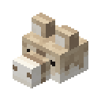 | **Alpaka** | Selten | 4,99 € | Ein Wollknäuel auf vier Beinen, das gern etwas für dich trägt. |
|  | **Pelikan** | Selten | 4,99 € | In seinen Kehlsack passt mehr, als man denkt. |
|  | **Igel** | Selten | 4,99 € | Trippelt schnüffelnd hinter dir her und rollt sich zur Stachelkugel ein. |
|  | **Flamingo** | Selten | 4,99 € | Lange Beine, große Schritte. Steht beim Warten gern auf einem Bein. |
| 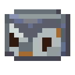 | **Pinguin** | Selten | 4,99 € | Watschelt dir überallhin nach. |
| 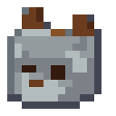 | **Waschbär** | Selten | 4,99 € | Neugierig bis in die Schwanzspitze. Sammelt alles, was glitzert. |
|  | **Roter Panda** | Selten | 4,99 € | Klettert auf alles und kommt trotzdem immer sanft wieder herunter. |
| 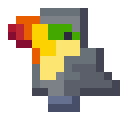 | **Tukan** | Selten | 4,99 € | Pickt mit seinem großen, bunten Schnabel auf, was herumliegt. |
| 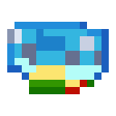 | **Libelle** | Selten | 4,99 € | Eine Große Königslibelle in Blau und Grün, die im Licht schimmert. |
| 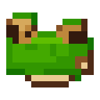 | **Laubfrosch** | Selten | 4,99 € | Springt auf langen Hinterbeinen und quakt mit seinem Kehlsack. |
|  | **Lama Dolly** | Episch | 6,99 € | Stolz, flauschig und immer bereit, dein Gepäck zu tragen. |
| 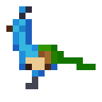 | **Pfau** | Episch | 6,99 € | Schlägt sein Rad, sobald jemand hinschaut. |
|  | **Hund** | Episch | 6,99 € | Geht mit dir spazieren, apportiert und macht Männchen. Das Grundmodell ist ein Corgi. |
| 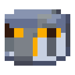 | **Falke** | Episch | 6,99 € | Stößt aus der Höhe herab und bringt dir zurück, was er findet. |
| 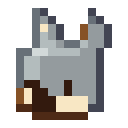 | **Wolfswelpe** | Episch | 6,99 € | Heult den Mond an, jagt seinen eigenen Schwanz und bringt dir, was herumliegt. |
|  | **Katze** | Episch | 6,99 € | Spielt mit einem Wollknäuel, streckt sich und putzt sich die Pfoten. Das Grundmodell ist eine Hauskatze. |
| 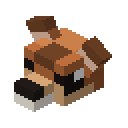 | **Rehkitz** | Legendär | 9,99 € | Trabt mit hohen Knien, lauscht in den Wald und rollt sich zum Schlafen ein. |
|  | **Otter** | Legendär | 9,99 € | Galoppiert in Sprüngen, schüttelt sich trocken und jongliert einen Kiesel. |
|  | **Kolibri** | Legendär | 9,99 € | Schwirrt auf der Stelle, schießt ruckartig vor und trinkt Nektar im Schwebeflug. |

Weitere gewöhnliche Pets sollen später mit den [Quests](../sb/quests.md) kommen.


**Stand: November 2026.** Preise können sich ändern – maßgeblich ist immer der [Shop](https://shop.megabuild.de/).


## Skins

Ein Skin gibt deinem Pet ein anderes Aussehen. Er ändert nur das Aussehen, sonst nichts. Jeder Skin kostet **1,99 €**.

| Bild | Skin | Für das Pet | Preis |
| ---- | ---- | ----------- | ----- |
| 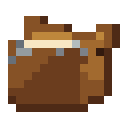 | **Baby** | Capybara | 1,99 € |
|  | **Ingwer** | Capybara | 1,99 € |
| 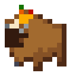 | **Yuzu** | Capybara | 1,99 € |
|  | **Jolly** | Lama Dolly | 1,99 € |
| 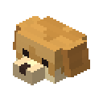 | **Golden Retriever** | Hund | 1,99 € |
|  | **Malinois** | Hund | 1,99 € |
| 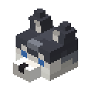 | **Husky** | Hund | 1,99 € |
|  | **Dackel** | Hund | 1,99 € |
|  | **Siamkatze** | Katze | 1,99 € |
|  | **Maine Coon** | Katze | 1,99 € |
| 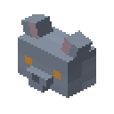 | **Britisch Kurzhaar** | Katze | 1,99 € |

Beim **Hund** und bei der **Katze** sind die Rassen Skins: Du hast einen Hund und gestaltest ihn als Corgi, Golden Retriever, Malinois, Husky oder Dackel. Die Katze ist ohne Skin eine Hauskatze, mit Skin eine Siamkatze, Maine Coon oder Britisch Kurzhaar. Im Shop steht bei Pets mit Skins **„Gestalte dieses Pet mit Skins“**.

Den Skin wählst du auf der Pet-Seite unter **Skins** oder mit `/pet skin`. `/pet skin default` holt das Standard-Aussehen zurück.

## Pet-Shop und Vorschau

Im **Pet-Shop** (`/pet shop`) siehst du alle Pets mit Seltenheit, Preis und Skins.

* **Linksklick** auf ein Pet zeigt dir die Vorschau und den Shop-Link im Chat. Auf Bedrock lassen sich Links im Chat nicht anklicken – dort steht die Adresse `megabuild.de/shop`.
* **Vorschau:** Das Pet erscheint **30 Sekunden** neben dir, **nur du siehst es**. Danach wartest du 10 Sekunden bis zur nächsten Vorschau. Das geht auch mit `/pet preview <Pet>` und mit Skins.
* **Nach dem Kauf** auf [shop.megabuild.de](https://shop.megabuild.de/) steht das Pet bei deinen Pets, auf allen Servern nach spätestens etwa 10 Sekunden. Du musst beim Kauf nicht online sein.

Pets und Skins gehören zu deinem Account. Handeln lassen sie sich nicht.

## Gutscheine aus Rängen

Jeder [Rang](rang.md) bringt **zwei Pet-Gutscheine** mit, und sie zählen zusammen:

| Rang | Gutscheine | zusammen |
| ---- | ---------- | -------- |
| **Gold** | 2 bis Selten | 2 |
| **Platin** | 2 weitere bis Episch | 4 |
| **Titan** | 2 weitere bis Legendär | 6 |

Kaufst du gleich einen höheren Rang, bekommst du die Gutscheine der Ränge darunter mit.

* Ein Gutschein holt ein **Pet oder einen Skin seiner Stufe oder darunter**. Einen Skin gibt es nur für ein Pet, das dir schon gehört.
* Verbraucht wird immer der **kleinste passende** Gutschein – so bleibt der höhere für ein selteneres Pet.
* **Einlösen:** `/pet vouchers` oder der Knopf **Pet-Gutscheine** oben im Pet-Menü. Linksklick löst ein (mit Rückfrage), Rechtsklick zeigt die Vorschau. Das lässt sich nicht rückgängig machen.
* Hast du offene Gutscheine, erinnert dich beim Einloggen eine Zeile im Chat.

## Was noch kommt


Pets sollen später **kämpfen**, **Perks** bekommen und durch Spielen im **Level** aufsteigen. Bis dahin sind sie reine Begleiter: Kein Pet bringt dir einen Vorteil im Spiel.


## Verwandte Seiten

* [Ränge](rang.md)
* [Warpetts](../sb/warpetts.md)
* [Befehle](befehle.md)
