# Pets

Pets sind kleine Begleiter, die dir überallhin folgen. Sie gelten im **ganzen Netzwerk**: in der Lobby und auf allen Inseln. Wechselst du den Server, ist dein Pet mit demselben Namen und Skin wieder bei dir.

Auf den **Spielservern**, also überall, wo du Skyblock spielst, kann dein Pet mehr: Es [kämpft](#kampf) gegen Monster, hat einen [Perk](#perks) und steigt im [Level](#level) auf. In der **Lobby** bleibt es ein reiner Begleiter.

Mit den [Warpetts](../sb/warpetts.md) haben Pets nichts zu tun.


**Das Capybara bekommt jeder gratis.** Öffne `/pet` und ruf es unter **Meine Pets**.


## Das Pet-Menü

`/pet` (auch `/pets`) öffnet das Menü:

| Knopf | Was er tut |
| ----- | ---------- |
| **Meine Pets** | Alle Pets, die dir gehören. Linksklick ruft ein Pet oder schickt es weg, Rechtsklick öffnet seine Pet-Seite |
| **Dein Pet** | Das Pet, das gerade bei dir ist – ein Klick öffnet seine Pet-Seite |
| **Pet-Shop** | Neue Pets und Skins ansehen und vorher ausprobieren |
| **Einstellungen** | Pets anderer Spieler ausblenden oder dein Pet wegschicken |
| **Pet-Gutscheine** | Nur, wenn du Gutscheine aus deinem [Rang](#gutscheine-aus-rängen) hast |

Auf der **Pet-Seite** rufst du das Pet oder schickst es weg, gibst ihm einen Namen und wählst seinen Skin. Außerdem siehst du dort:

* sein **Level** und wie viele XP bis zum nächsten Level fehlen,
* seine **Leben** (oder wann es nach einem k. o. zurückkommt),
* seine **Kampfart** und seinen **Perk** mit dem Wert, den er gerade hat.

Der Knopf **Kampfmodus** wechselt den [Modus](#kampfmodus), er gilt für alle deine Pets. Hat das Pet den Perk Packesel, öffnet der Knopf **Packesel** seine [Lagerplätze](#packesel). In der Lobby steht auf der Pet-Seite, dass Kämpfen, Perks und Level nur auf den Spielservern gelten.

**Dein eigenes Pet anklicken:** Auf Java öffnet ein Rechtsklick seine Pet-Seite. Auf **Bedrock** sneakst du dafür **zweimal kurz** hintereinander neben deinem Pet. Klickst du das Pet eines anderen an, siehst du, wem es gehört.

## Befehle

| Befehl | Was er macht |
| ------ | ------------ |
| `/pet` | Das Pet-Menü. Auch `/pets` |
| `/pet call <Pet>` | Ein Pet rufen. Ohne Pet: deine Pets |
| `/pet dismiss` | Dein Pet nach Hause schicken |
| `/pet rename <Name>` | Dein Pet umbenennen. Ohne Name: Name zurücksetzen |
| `/pet skin [Skin\|default]` | Skin deines Pets wählen. Ohne Skin: das Skin-Menü, `default` das Standard-Aussehen |
| `/pet preview <Pet>` | 30 Sekunden Vorschau, nur für dich |
| `/pet hide` | Pets anderer Spieler aus- und einblenden |
| `/pet shop` | Der Pet-Shop |
| `/pet vouchers` | Gratis-Pets aus deinem Rang einlösen |
| `/pet mode [Modus]` | [Kampfmodus](#kampfmodus) wählen: `protect`, `support` oder `passive`. Ohne Modus: zum nächsten wechseln |
| `/pet backpack` | Den [Packesel](#packesel) deines Pets öffnen. Auch `/pet bp` |
| `/pet help` | Alle Pet-Befehle |

Die Befehle sind für alle gleich auf Englisch, die Texte im Spiel kommen in deiner Sprache.

## Dein Pet unterwegs

* Es ist immer **ein Pet** bei dir. Rufst du ein anderes, geht das alte nach Hause.
* Bist du mehr als 3 Blöcke weg, läuft es dir hinterher. Ab 12 Blöcken springt es direkt neben dich.
* Stehst du 20 Sekunden still, setzt es sich.
* Im Zuschauermodus und an manchen Orten sind keine Pets erlaubt. Dein Pet kommt dann wieder mit, sobald es geht.
* Spieler können dein Pet nie schlagen oder verletzen. Auf den Spielservern können **Monster** es treffen, siehe [Leben, k. o. und Heilen](#leben-k-o-und-heilen).

### Umbenennen

Auf der Pet-Seite klickst du **Umbenennen** und schreibst den neuen Namen in den Chat – oder du nutzt `/pet rename <Name>`.

* Höchstens **24 Zeichen**: Buchstaben, Ziffern, Leerzeichen und ein paar Satzzeichen.
* `-` setzt den Namen zurück, `abbrechen` bricht ab.
* Der Name steht dann über deinem Pet.

### Pets anderer ausblenden

Mit `/pet hide` oder unter **Einstellungen** blendest du die Pets anderer Spieler aus. Die Einstellung gilt auf allen Servern.

## Kampf


**Nur auf den Spielservern.** Kämpfen, Perks und Level gibt es überall, wo du Skyblock spielst, aber nicht in der Lobby. Und es gilt immer nur für das **aktive Pet**, also das, das gerade bei dir ist: Nur es kämpft, nur sein Perk wirkt, nur es sammelt XP.


Dein Pet beschützt dich vor Monstern. Es greift **nur Monster** an, nie Spieler, Tiere, Dorfbewohner, NPCs oder andere Pets. **Bosse** (Enderdrache, Wither, Warden, Großwächter) und **Event-Monster** lässt es in Ruhe – die bleiben deine Sache.

### Kampfarten

Jedes Pet hat eine von drei Kampfarten. Welche, steht in der Tabelle [Kampfart, Perk und Lieblingsfutter](#kampfart-perk-und-lieblingsfutter).

| Kampfart | So kämpft es | Leben | Schaden | Takt |
| -------- | ------------ | ----- | ------- | ---- |
| **Wächter** | Nahkampf. Ein Monster, das dich angreift, nimmt danach dein Pet ins Visier | 40 | 2 | alle 1,5 s |
| **Jäger** | Nahkampf, der schnellste Angreifer | 24 | 4 | alle 1,2 s |
| **Schütze** | Greift aus bis zu 8 Blöcken Entfernung an | 16 | 3 | alle 1,5 s |

Die Werte gelten für ein **gewöhnliches Pet auf Level 10**. Je Seltenheitsstufe darüber hat es 10 % mehr Leben und 5 % mehr Schaden, ein legendärer Jäger also 31 Leben und 4,6 Schaden. Auf Level 1 hat ein Pet die Hälfte davon, bis Level 10 wächst es gleichmäßig. Zum Vergleich: Du selbst hast 20 Leben.

### Kampfmodus

Wen dein Pet angreift, stellst du mit `/pet mode` oder dem Knopf **Kampfmodus** auf der Pet-Seite ein. Der Modus gilt für alle deine Pets.

| Modus | Befehl | Was dein Pet tut |
| ----- | ------ | ---------------- |
| **Beschützen** (Standard) | `/pet mode protect` | Greift Monster an, die dich oder dein Pet angreifen |
| **Unterstützen** | `/pet mode support` | Greift zusätzlich Monster an, die du schlägst |
| **Passiv** | `/pet mode passive` | Kämpft nicht und wird nicht angegriffen |

* Dein Pet entfernt sich dabei höchstens **10 Blöcke** von dir. Läuft ein Monster weiter weg, kommt es zurück.
* Bist du auf einer fremden Insel als [Kunde](../sb/chestshop.md#als-kunde-auf-fremden-inseln) oder als [Zuschauer](../sb/reisen.md) unterwegs, ist dein Pet dort nur Begleiter: Es kämpft nicht, und sein Perk wirkt nicht.

### Wem der Kill gehört

| Wer hat getroffen | Drops | Minecraft-XP | Mana, Quests und Statistik | Pet-XP |
| ----------------- | ----- | ------------ | -------------------------- | ------ |
| Du hast in den letzten 5 Sekunden mitgeschlagen | ja | ja | ja, wie dein eigener Kill | 1 XP |
| Nur dein Pet | ja | nein | nein | nein |
| Du bist [AFK](#afk) | nein | nein | nein | nein |

Ein Kill, den dein Pet allein macht, bringt dir also kein Mana. Kämpf mit, dann zählt er.

## Leben, k. o. und Heilen

* Ist dein Pet verletzt, steht über ihm, wie viele Leben es noch hat, zum Beispiel **♥ 18/24**.
* Dein Pet kann nur von Monstern Schaden nehmen, auch durch Explosionen. Von Spielern nie, auch nicht durch deren TNT.
* **Heilen:** Wird es 10 Sekunden lang nicht getroffen, heilt es sich selbst, 1 Leben alle 3 Sekunden.
* **Lieblingsfutter:** Halte das [Lieblingsfutter](#kampfart-perk-und-lieblingsfutter) deines Pets in der Hand und klick es mit Rechtsklick an. Dann ist es sofort wieder voll geheilt. Das kostet ein Item.
* **K. o.:** Bei 0 Leben ist dein Pet k. o. Es verschwindet und kommt nach **60 Sekunden** von selbst zurück. Ein Pet stirbt nie endgültig und verliert nichts, auch kein Level. Solange es k. o. ist, wirkt sein Perk nicht.

## Level

Jedes Pet steigt von **Level 1 bis Level 10** auf. Mit dem Level werden seine Kampfwerte und sein [Perk](#perks) stärker.

| Level | XP gesamt | Spielzeit ohne Kämpfe, etwa |
| ----- | --------- | --------------------------- |
| 1 | 0 | – |
| 2 | 50 | knapp 1 h |
| 3 | 110 | knapp 2 h |
| 4 | 190 | gut 3 h |
| 5 | 300 | 5 h |
| 6 | 450 | 7½ h |
| 7 | 640 | knapp 11 h |
| 8 | 870 | 14½ h |
| 9 | 1150 | gut 19 h |
| 10 | 1500 | 25 h |

So sammelt dein Pet XP:

* **1 XP je Minute**, die es bei dir ist, während du im Überlebensmodus spielst und nicht AFK bist.
* **1 XP je Monster**, das ihr zusammen besiegt (du hast mitgeschlagen), höchstens **20 XP je Stunde**. Wer viel kämpft, ist also etwas schneller.

Jedes Pet hat sein **eigenes Level**. Rufst du ein anderes Pet, fängt das bei seinem eigenen Stand an, das alte behält seins. Level kann man **nicht kaufen** – nur spielen hilft.

### AFK

Als AFK giltst du nach **3 Minuten**, in denen du dich nicht umgesehen, nichts in den Chat geschrieben, keinen Befehl benutzt und nicht ins Inventar geklickt hast. Dann:

* sammelt dein Pet keine XP,
* wehrt es nur noch Monster ab, die dich direkt angreifen,
* lassen Monster, die es besiegt, nichts fallen.

## Perks

Jedes Pet hat einen Perk. Wie stark er ist, hängt von der **Seltenheit** des Pets ab. Die Werte gelten auf **Level 10**:

| Perk | Was er macht | Gewöhnlich | Selten | Episch | Legendär |
| ---- | ------------ | ---------- | ------ | ------ | -------- |
| **Sammler** | Hebt Drops im Umkreis für dich auf | 2 Blöcke | 3 Blöcke | 4 Blöcke | 5 Blöcke |
| **Packesel** | Zusätzliche [Lagerplätze](#packesel) im Pet | 3 Plätze | 5 Plätze | 7 Plätze | 9 Plätze |
| **Laterne** | Dein Pet leuchtet und trägt das Licht mit (eine Fackel hat 14) | Lichtstärke 9 | 11 | 13 | 15 |
| **Wegbegleiter** | Du läufst schneller, nur auf deiner eigenen Insel | +4 % | +6 % | +8 % | +10 % |
| **Federleicht** | Weniger Fallschaden | −12 % | −24 % | −36 % | −48 % |
| **Gelehrt** | Mehr Minecraft-Erfahrung | +5 % | – | – | – |
| **Angelfreund** | Kürzere Wartezeit beim Angeln | −10 % | – | – | – |

* **Level:** Auf Level 1–4 wirkt ein Perk mit einem Drittel seines Werts, auf Level 5–9 mit zwei Dritteln, ab Level 10 voll (abgerundet, mindestens 1). **Laterne**, **Gelehrt** und **Angelfreund** wirken ab Level 1 voll.
* **Gelehrt** und **Angelfreund** gibt es nur bei Gratis-Pets.
* **Sammler** wirkt nur auf deiner eigenen Insel und nicht, solange du AFK bist. Er nimmt nichts, was jemand geworfen hat oder was einem anderen gehört, und nichts, was näher bei einem anderen Spieler liegt.
* **Wegbegleiter** wirkt nur auf deiner eigenen Insel.
* **Federleicht** zählt mit Schutz-Verzauberungen zusammen, und wie in Minecraft gilt höchstens 80 % weniger Schaden.
* Ein Perk wirkt nur, solange dein Pet draußen bei dir ist. Ein Skin ändert nichts an Perk oder Kampfwerten.

## Packesel

Pets mit dem Perk Packesel tragen Items für dich: **Alpaka** und **Pelikan** (selten), **Lama Dolly** (episch) und **Otter** (legendär). Du öffnest ihn mit `/pet backpack` oder dem Knopf **Packesel** auf der Pet-Seite.

| Seltenheit | Level 1–4 | Level 5–9 | Level 10 |
| ---------- | --------- | --------- | -------- |
| Gewöhnlich | 1 Platz | 2 Plätze | 3 Plätze |
| Selten | 1 Platz | 3 Plätze | 5 Plätze |
| Episch | 2 Plätze | 4 Plätze | 7 Plätze |
| Legendär | 3 Plätze | 6 Plätze | 9 Plätze |

* Öffnen kannst du ihn nur auf den **Spielservern** und nur im **Überlebens-** oder **Abenteuermodus**.
* Jedes Packesel-Pet hat seine eigenen Plätze. Der Inhalt ist auf **allen Spielservern derselbe**. Ist dein Packesel gerade auf einem anderen Server offen, bekommst du eine Meldung und versuchst es kurz danach noch einmal.
* **Shulkerkisten** und **Bündel** passen nicht hinein.
* Ist das Packesel-Pet nicht mehr bei dir, öffnet `/pet backpack` die Plätze, in denen noch etwas liegt, nur noch **zum Herausnehmen**. Es geht nichts verloren.

## Alle Pets

Jedes Pet hat eine **Seltenheit**, und die bestimmt den Preis. Pets und Skins kaufst du im [Shop](https://shop.megabuild.de/).

| Bild | Pet | Seltenheit | Preis | So ist es |
| ---- | --- | ---------- | ----- | --------- |
| 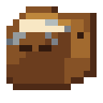 | **Capybara** | Gewöhnlich | gratis | Die Ruhe selbst. Sitzt am liebsten neben dir und schaut zu. |
|  | **Alpaka** | Selten | 4,99 € | Ein Wollknäuel auf vier Beinen, das gern etwas für dich trägt. |
| 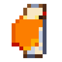 | **Pelikan** | Selten | 4,99 € | In seinen Kehlsack passt mehr, als man denkt. |
| 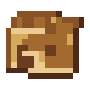 | **Igel** | Selten | 4,99 € | Trippelt schnüffelnd hinter dir her und rollt sich zur Stachelkugel ein. |
| 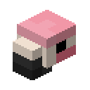 | **Flamingo** | Selten | 4,99 € | Lange Beine, große Schritte. Steht beim Warten gern auf einem Bein. |
|  | **Pinguin** | Selten | 4,99 € | Watschelt dir überallhin nach. |
|  | **Waschbär** | Selten | 4,99 € | Neugierig bis in die Schwanzspitze. Sammelt alles, was glitzert. |
| 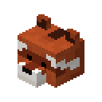 | **Roter Panda** | Selten | 4,99 € | Klettert auf alles und kommt trotzdem immer sanft wieder herunter. |
|  | **Tukan** | Selten | 4,99 € | Pickt mit seinem großen, bunten Schnabel auf, was herumliegt. |
|  | **Libelle** | Selten | 4,99 € | Eine Große Königslibelle in Blau und Grün, die im Licht schimmert. |
|  | **Laubfrosch** | Selten | 4,99 € | Springt auf langen Hinterbeinen und quakt mit seinem Kehlsack. |
| 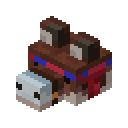 | **Lama Dolly** | Episch | 6,99 € | Stolz, flauschig und immer bereit, dein Gepäck zu tragen. |
|  | **Pfau** | Episch | 6,99 € | Schlägt sein Rad, sobald jemand hinschaut. |
| 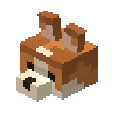 | **Hund** | Episch | 6,99 € | Geht mit dir spazieren, apportiert und macht Männchen. Das Grundmodell ist ein Corgi. |
|  | **Falke** | Episch | 6,99 € | Stößt aus der Höhe herab und bringt dir zurück, was er findet. |
|  | **Wolfswelpe** | Episch | 6,99 € | Heult den Mond an, jagt seinen eigenen Schwanz und bringt dir, was herumliegt. |
| 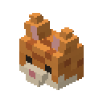 | **Katze** | Episch | 6,99 € | Spielt mit einem Wollknäuel, streckt sich und putzt sich die Pfoten. Das Grundmodell ist eine Hauskatze. |
|  | **Rehkitz** | Legendär | 9,99 € | Trabt mit hohen Knien, lauscht in den Wald und rollt sich zum Schlafen ein. |
| 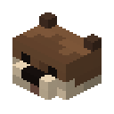 | **Otter** | Legendär | 9,99 € | Galoppiert in Sprüngen, schüttelt sich trocken und jongliert einen Kiesel. |
| 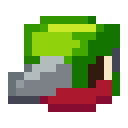 | **Kolibri** | Legendär | 9,99 € | Schwirrt auf der Stelle, schießt ruckartig vor und trinkt Nektar im Schwebeflug. |

Weitere gewöhnliche Pets sollen später mit den [Quests](../sb/quests.md) kommen.


**Stand: November 2026.** Preise können sich ändern – maßgeblich ist immer der [Shop](https://shop.megabuild.de/).


### Kampfart, Perk und Lieblingsfutter

Was jedes Pet auf den Spielservern mitbringt. Der Perk-Wert gilt auf Level 10.

| Pet | Kampfart | Perk auf Level 10 | Lieblingsfutter |
| --- | -------- | ----------------- | --------------- |
| **Capybara** | Wächter | Gelehrt: +5 % Erfahrung | Melonenscheibe |
| **Alpaka** | Wächter | Packesel: 5 Plätze | Weizen |
| **Pelikan** | Wächter | Packesel: 5 Plätze | Roher Kabeljau |
| **Igel** | Wächter | Sammler: 3 Blöcke | Apfel |
| **Flamingo** | Jäger | Wegbegleiter: +6 % | Roher Lachs |
| **Pinguin** | Jäger | Wegbegleiter: +6 % | Roher Kabeljau |
| **Waschbär** | Jäger | Sammler: 3 Blöcke | Süßbeeren |
| **Roter Panda** | Jäger | Federleicht: −24 % | Bambus |
| **Tukan** | Schütze | Sammler: 3 Blöcke | Leuchtbeeren |
| **Libelle** | Schütze | Laterne: Lichtstärke 11 | Spinnenauge |
| **Laubfrosch** | Schütze | Federleicht: −24 % | Schleimball |
| **Lama Dolly** | Wächter | Packesel: 7 Plätze | Strohballen |
| **Pfau** | Wächter | Laterne: Lichtstärke 13 | Weizenkörner |
| **Hund** | Jäger | Wegbegleiter: +8 % | Knochen |
| **Falke** | Schütze | Sammler: 4 Blöcke | Rohes Hühnchen |
| **Wolfswelpe** | Jäger | Sammler: 4 Blöcke | Rohes Rindfleisch |
| **Katze** | Jäger | Federleicht: −36 % | Roher Kabeljau |
| **Rehkitz** | Wächter | Federleicht: −48 % | Karotte |
| **Otter** | Jäger | Packesel: 9 Plätze | Roher Lachs |
| **Kolibri** | Schütze | Wegbegleiter: +10 % | Honigflasche |

## Skins

Ein Skin gibt deinem Pet ein anderes Aussehen. Er ändert nur das Aussehen, sonst nichts – auch nicht Kampfwerte, Perk oder Level. Jeder Skin kostet **1,99 €**.

| Bild | Skin | Für das Pet | Preis |
| ---- | ---- | ----------- | ----- |
|  | **Baby** | Capybara | 1,99 € |
| 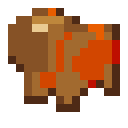 | **Ingwer** | Capybara | 1,99 € |
|  | **Yuzu** | Capybara | 1,99 € |
| 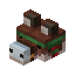 | **Jolly** | Lama Dolly | 1,99 € |
|  | **Golden Retriever** | Hund | 1,99 € |
| 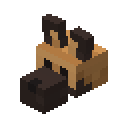 | **Malinois** | Hund | 1,99 € |
|  | **Husky** | Hund | 1,99 € |
| 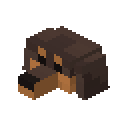 | **Dackel** | Hund | 1,99 € |
| 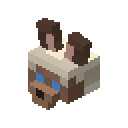 | **Siamkatze** | Katze | 1,99 € |
| 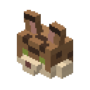 | **Maine Coon** | Katze | 1,99 € |
|  | **Britisch Kurzhaar** | Katze | 1,99 € |

Beim **Hund** und bei der **Katze** sind die Rassen Skins: Du hast einen Hund und gestaltest ihn als Corgi, Golden Retriever, Malinois, Husky oder Dackel. Die Katze ist ohne Skin eine Hauskatze, mit Skin eine Siamkatze, Maine Coon oder Britisch Kurzhaar. Im Shop steht bei Pets mit Skins **„Gestalte dieses Pet mit Skins“**.

Den Skin wählst du auf der Pet-Seite unter **Skins** oder mit `/pet skin`. `/pet skin default` holt das Standard-Aussehen zurück.

## Pet-Shop und Vorschau

Im **Pet-Shop** (`/pet shop`) siehst du alle Pets mit Seltenheit, Preis und Skins.

* **Linksklick** auf ein Pet zeigt dir die Vorschau und den Shop-Link im Chat. Auf Bedrock lassen sich Links im Chat nicht anklicken – dort steht die Adresse `megabuild.de/shop`.
* **Vorschau:** Das Pet erscheint **30 Sekunden** neben dir, **nur du siehst es**. Danach wartest du 10 Sekunden bis zur nächsten Vorschau. Das geht auch mit `/pet preview <Pet>` und mit Skins.
* **Nach dem Kauf** auf [shop.megabuild.de](https://shop.megabuild.de/) steht das Pet bei deinen Pets, auf allen Servern nach spätestens etwa 10 Sekunden. Du musst beim Kauf nicht online sein.

Pets und Skins gehören zu deinem Account. Handeln lassen sie sich nicht.

## Gutscheine aus Rängen

Jeder [Rang](rang.md) bringt **zwei Pet-Gutscheine** mit, und sie zählen zusammen:

| Rang | Gutscheine | zusammen |
| ---- | ---------- | -------- |
| **Gold** | 2 bis Selten | 2 |
| **Platin** | 2 weitere bis Episch | 4 |
| **Titan** | 2 weitere bis Legendär | 6 |

Kaufst du gleich einen höheren Rang, bekommst du die Gutscheine der Ränge darunter mit.

* Ein Gutschein holt ein **Pet oder einen Skin seiner Stufe oder darunter**. Einen Skin gibt es nur für ein Pet, das dir schon gehört.
* Verbraucht wird immer der **kleinste passende** Gutschein – so bleibt der höhere für ein selteneres Pet.
* **Einlösen:** `/pet vouchers` oder der Knopf **Pet-Gutscheine** oben im Pet-Menü. Linksklick löst ein (mit Rückfrage), Rechtsklick zeigt die Vorschau. Das lässt sich nicht rückgängig machen.
* Hast du offene Gutscheine, erinnert dich beim Einloggen eine Zeile im Chat.

## Was noch kommt


Später sollen **Mitläufer** dazukommen, also mehrere Pets gleichzeitig, und **Kombos** aus Pets, die zusammenpassen. Bis dahin ist immer ein Pet bei dir.


## Verwandte Seiten

* [Ränge](rang.md)
* [Warpetts](../sb/warpetts.md)
* [Befehle](befehle.md)
