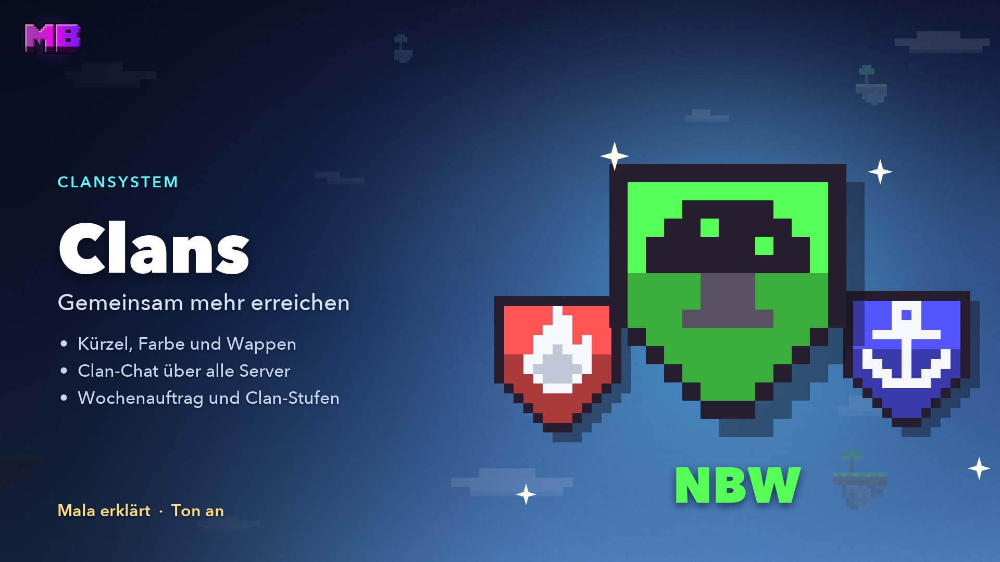

# Clans

On MegaBuild.de, everyone has their own island world on their own server. A clan connects these worlds: **one chat across every server, visits to each other's islands and a shared goal every week.**

<figure><figcaption>
The video “Clans – a first look” – Mala explains, in German
</figcaption></figure>


**Video: Clans – a first look** (1:17, in German, with sound) – Mala explains what your clan brings you.


## The clan menu

`/clan` (also `/clans`) opens the clan menu. You also find it under `/sky` → **Friends & Clan** – in the lobby and on every island – and in your friends (`/friend`) at the top left.

Without a clan you see three ways in: **Found a clan**, the **clan list** and your **invitations**.

## Joining a clan

The clan list shows every clan on the network, sorted by level, activity or name. One click opens the profile with crest, level, members and description. Each clan decides for itself how you get in:

| Joining | How you get in |
| ------- | -------------- |
| **Open** | **Join** in the profile or `/clan join <tag>` – right away, as long as there's room |
| **By application** | **Apply** in the profile or `/clan apply <tag>` – an officer takes you in |
| **Invitation only** | An officer invites you. You accept with one click in chat or with `/clan accept` |

* **One clan per player.**
* Invitations and applications expire after **7 days**. You can have at most **3 applications** open at a time.
* If you're offline, the invitation arrives as a letter in your mail.
* Anyone who leaves a clan or gets removed can't join another one for **24 hours**.

## Founding a clan

You need **5 hours of playtime** on the network and **500 Mana**.



#### Start the founding

`/clan create` or **Found a clan** in the clan menu.



#### Name and tag

You type both into the chat. Each input waits **120 seconds**.



#### Colour, crest and joining

You pick one of 14 colours, one of the 12 starting crests and who may join.



#### Confirm

The summary shows name, tag and cost. **Yes** founds the clan, and you're its **leader**.



| Feature | Rule |
| ------- | ---- |
| **Name** | 3–16 characters: letters (including ä, ö, ü, ß), digits, spaces, hyphens |
| **Tag** | 2–4 characters from A–Z and 0–9, at least one letter. Tags starting with **MB** are blocked |
| **Colour** | 14 colours – every colour code except black and dark blue |
| **Crest** | 12 at the start, 4 more from level 2, 8 more from level 7 |

Name and tag must be free and can be changed at most **every 30 days**.


**The 500 Mana are gone.** You don't get them back, not even if you disband the clan later.


## Roles

| Role | Sign | What it may do |
| ---- | :--: | -------------- |
| **Leader** | ★ | Everything: name, tag, colour, crest, clan banner, joining, appointing officers, handing over leadership, disbanding |
| **Officer** | ☆ | Invite, accept applications, remove recruits and members, promote recruits, description, clan message, newsletter. At most 5 per clan |
| **Member** | | Clan chat, weekly task, calls for help. Inviting, if the leader allows it |
| **Recruit** | + | The first **72 hours** after joining; then they become a member automatically |

* Nobody can remove someone with the same or a higher role.
* **Leaving** works any time with `/clan leave`. The leader first hands over leadership (`/clan transfer <player>`) or disbands the clan.
* **Absent leader:** After 30 days without logging in, the longest-serving officer takes over, otherwise the longest-serving member.
* **Disbanding** is up to the leader alone. They confirm twice and type the clan name. Name and tag stay blocked for 30 days afterwards.

## Clan chat

The clan chat reaches every member on every server – in the lobby, on every island and in Citybuild.

| How you write | What happens |
| ------------- | ------------ |
| `/c <text>` | One line to your clan |
| `/c` | Toggles: every chat line goes to the clan until you switch back |
| `#` in front of a message | Shortcut for one line – handy on Bedrock |

The clan chat uses the same filter and the same mutes as the public chat.

### Tag and crest

Your **tag** shows in your clan colour in front of your name – in the tab list, in chat and above your head. It grows with the clan level:

* **from level 5** with the crest as a small sign in front,
* **from level 9** in bold,
* **at level 10** with a golden sign.

In the public chat, only the coloured tag shows.

## Off to the islands together

* **Visiting:** Left-click in the clan's member list, or `/clan visit <name>` or `/sky visit <name>` – from the lobby too.
* **Back:** `/clan home` or `/sky` → **To your own island**.
* **What you may do there** is set by the owner with the [clan access](members.md#clan-and-friends): nobody, Visitor, Helper or Builder. Recruits come in as visitors at most.
* **Your inventory travels with you.** What you find on another island, you take home. Ender chest and levels stay on each island.
* **Meeting point:** `/clan meet` invites your clan with one click to the island you're standing on. Only those with access there can come in.

Anyone who leaves the clan loses clan access immediately and switches to the lobby.

## The weekly task

Every **Monday at 4 am** (Berlin time), your clan gets three tasks from different groups. Everything you do for them goes into **one shared pot of points** – no matter who's playing what.

| Group | Possible tasks |
| ----- | -------------- |
| **Earth** | Mine ores, chop wood |
| **Nature** | Harvest, fish, breed animals |
| **Adventure** | Defeat monsters, open fresh chests, talk to residents |
| **Community** | Finish daily quests, finish biome quests |

It counts on **every Sky island** – your own and anyone else's – but not in Citybuild. The same rules apply as for [quests](quests.md): survival mode only, blocks you placed yourself don't count, and anyone AFK doesn't count.

### Bronze, silver, gold

The goal grows with the clan: it's calculated per **active member**, with at least 3. Active means logged in within the last 14 days and no longer a recruit.

| Stage | Points per active member | Mana for you | Experience for the clan |
| ----- | -----------------------: | -----------: | ----------------------: |
| **Bronze** | 100 | 30 | 100 |
| **Silver** | 200 | 50 | 150 |
| **Gold** | 300 | 70 | 250 |

**You get Mana** if you've contributed at least **half your share** – 50 points for bronze, 100 for silver, 150 for gold – and have been in the clan for **24 hours** when the stage is reached. That's up to **150 Mana a week**. If you're offline, the Mana arrives next time.


**Example:** Your clan has 3 active members, so bronze needs 300 points. A fish brings 5 points, a monster 2.5. Anyone who contributed 50 points gets 30 Mana at bronze.


* **Together bonus:** If a second clan member is playing on the same server and neither of you is AFK, your contributions count **one and a half times**.
* **Joker:** From level 3, the leader may swap one task a week, as long as nothing has counted for it yet.
* **Pin to the HUD:** In the weekly task menu you pin the progress to your display on the islands.
* You get each stage only once a week, even if you switch clans.

## Calls for help

Stuck on a [biome quest](skilltree.md#biome-quests)? Call your clan.

* **Calling:** in the quest menu (`/quest`) or in the skill tree with a running biome quest, via **Ask your clan for help**. Any member (not a recruit) with the **Skill tree** right on the island may call.
* **Duration:** 3 hours or until the quest is done. After that, there's no new call on the same island for 10 minutes.
* **Helping:** The call shows in the clan chat with **[Visit]** to click. An arrow in the HUD points the way to the nearest island of the biome.
* **Rights for a while:** While the call is on, clan members may do exactly what the quest counts on that island – even if the clan access is lower. They may only break natural blocks, nothing built.
* **Reward:** Once the quest is done, helpers get **25 Mana**, just like island members. You need at least a tenth of the amount and 24 hours in the clan, and the reward comes at most **four times a week**.

Anyone who only came onto the island through the call switches to the lobby when it ends. Recruits can help, but they get neither the rights for a while nor access through the call.

## Clan levels

Your clan earns experience **only from the weekly task**, up to 500 a week. Levels are never lost.

| Level | Experience | New |
| ----: | ---------: | --- |
| 1 | 0 | 10 slots, clan chat, tag and colour, 12 crests, visits, weekly task, calls for help, together bonus, meeting point |
| 2 | 300 | Clan message on login, 4 more crests, newsletter, group jump |
| 3 | 800 | 15 slots, joker, clan banner |
| 4 | 1,500 | Clan island\*, project Arrival square\* |
| 5 | 2,400 | 20 slots, crest sign in tab list and chat, project Grove\* |
| 6 | 3,500 | Clan blessing, project Clan house\* |
| 7 | 5,000 | 25 slots, 8 more crests, project Flower gate\* |
| 8 | 7,000 | Flight trail, project Hostel\* |
| 9 | 9,500 | Shine on the crest, bold tag, project Hall of honour\* |
| 10 | 12,500 | Title “Legendary”, golden crest sign |

\* comes with the clan island, see [Coming soon](#coming-soon).

With gold every week you reach level 4 after 3 weeks and level 10 after 25. In the menu, **Levels and perks** shows what each level brings.

## Everyday perks

| Perk | From level | What it brings |
| ---- | ---------: | -------------- |
| **Meeting point** | 1 | `/clan meet` invites the clan to your island |
| **Newsletter** | 2 | Officers write a letter to all members, at most one a day |
| **Group jump** | 2 | When you buy the Blossom Leap or the Shadow Portal from a [Forestling](forestlings.md), clan members within 8 blocks jump along if they agree. You pay for every jumper. On Bedrock you agree with `/sky groupjump <code>` |
| **Clan banner** | 3 | The leader registers a banner. Members stamp the pattern onto a blank banner of their own in the menu, with one dye per layer. Right-clicking a placed clan banner shows the clan profile |
| **Clan blessing** | 6 | At the weekend (Saturday 4 am to Monday 4 am) **10% more Mana** from [actions](economy.md#from-actions). The daily limit stays |
| **Flight trail** | 8 | Sparks in your clan colour while you glide with elytra. You can switch it off under **My notices** |

Under **My notices** in the clan menu you also set whether you get a message when members come online, call for help or invite you to their meeting point.

## Leaderboard and season

* **Leaderboard:** by week, season or level. **Clan of the week** is the clan with the highest participation among all clans with gold.
* **Season:** one calendar month. The three best clans get a shine on their crest and the title **Season Champions**, **Season Runners-up** or **Season Third** until the end of the next season.
* **Season badge:** Every clan with at least three gold weeks in the month gets the badge in its chronicle.
* In the lobby, a hologram shows the **top clans**.

Because the goals grow with the active members, a big clan has no head start.

## Milestones and chronicle

Milestones are goals for a whole clan lifetime. Each stage is a badge in the profile. With gold you get a **title** the leader can show under the clan name.

| Milestone | What counts | Bronze · Silver · Gold |
| --------- | ----------- | ---------------------- |
| **Golden Weeks** | Weekly tasks with gold | 5 · 15 · 40 |
| **World Builders** | Biomes bought by members | 50 · 200 · 500 |
| **Helping Hands** | Calls for help where a member got the reward | 10 · 50 · 150 |
| **Friends of the Residents** | [Residents](residents.md) who trust a member | 5 · 25 · 75 |
| **Mentors** | New players still in the clan after 30 days who played 10 hours | 3 · 10 · 25 |
| **Master Builders** | Finished clan projects – comes with the clan island | 1 · 3 · 6 |

The **chronicle** in the clan profile records when you were founded, reached levels, completed milestones and won season places.

## Clan achievements

The achievements tab has [achievements](achievements.md#clan) of its own for clans – for example **Stronger Together** for your first clan and **Bronze**, **Silver** and **Gold** for your first weekly task at that stage. If you earn one while you're offline, you get it the next time you enter an island.

## Coming soon


**The clan island and the clan treasury are already built in** and will come once they have a server of their own. Until then they carry a lock in the menu.


* **Clan island:** a whole Sky world that belongs to your clan – with its own skill tree, biome quests and residents. From level 4 with 5 active members. There you build **six clan projects** together: Arrival square, Grove, Clan house, Flower gate, Hostel and Hall of honour.
* **Clan treasury:** a shared **Ruby** account with a log. Mana never goes in.

## Fair for everyone

Clans bring shared goals, cosmetics and convenience – **no bought head start**:

| Clans bring | Clans deliberately don't bring |
| ----------- | ------------------------------ |
| Shared goals and up to 150 Mana a week | No discounts on biomes, residents or skips |
| Crests, banners, titles | No Mana trading between players |
| Help with biome quests | No free items |
| Meeting point, newsletter, group jump | None of it in the shop |

A rank changes nothing about the clan perks.

## All commands

| Command | What it does |
| ------- | ------------ |
| `/clan` | Open the clan menu |
| `/clan create` | Found a clan |
| `/clan list` | Clan list |
| `/clan info [tag or player]` | Clan profile, your own without an argument |
| `/clan join <tag>` | Join an open clan |
| `/clan apply <tag>` | Apply to a clan |
| `/clan accept [tag]`, `/clan deny [tag]` | Accept or decline an invitation |
| `/clan invite <player>` | Invite a player |
| `/clan members` | Members |
| `/clan kick`, `promote`, `demote <player>` | Remove, promote, demote |
| `/clan transfer <player>` | Hand over leadership |
| `/clan leave` | Leave the clan |
| `/clan disband` | Disband the clan |
| `/clan week`, `/clan calls` | Weekly task, calls for help |
| `/clan settings`, `/clan notify` | Clan settings, my notices |
| `/clan visit <player>` | To a player's island |
| `/clan home` | To your own island |
| `/clan meet` | Invite the clan to your meeting point |
| `/c [text]` | Clan chat |
| `/clan help` | Help |

## Related pages

* [Members & rights](members.md)
* [Friends](friends.md)
* [Quests](quests.md)
* [Skill tree & biomes](skilltree.md)
* [Achievements](achievements.md)
* [Discord](discord.md)
