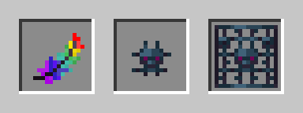
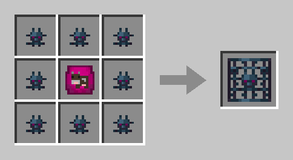

# Feather of Softness


**Coming soon.** The Feather of Softness isn't in the game yet – you can't find or craft it yet. How you get it will follow. Details may still change until then.


With the **Feather of Softness** you mine **spawners**. A normal spawner turns into **spawner fragments**, and fragments plus a filled [Mobplate](mobplates.md) make your own **spawner with that plate's mob** – for example for cows, sheep, zombies or spiders.

<figure><figcaption>
Feather of Softness, Spawner Fragment and Mob Spawner
</figcaption></figure>

## The feather

* **16 uses.** How many are left is shown in the feather's description. The action bar also tells you after every break.
* **Every break that gives you something costs one use.** You mine every other block with it like with an empty hand, and that costs nothing.
* **It falls apart on its last use.**
* **It can't be repaired** – neither in the crafting table nor at an anvil.
* Feathers **don't stack**, because each one counts its own uses.

## What the feather mines

With the feather in your hand, a spawner breaks **instantly**.

| Block | Without the feather | With the feather |
| ----- | ------------------- | ---------------- |
| **Normal spawner** | as usual, only experience | **4 spawner fragments** and experience |
| **Spawner from a Mobplate** | stays where it is | you get it **back**, but no fragments |
| **Trial spawner** | can't be mined | can't be mined with the feather either |
| Anything else | as usual | like with an empty hand, costs no use |

* **You only get fragments in Survival mode**, and not during the intro. Your spawner from a Mobplate, on the other hand, comes back everywhere.
* On other players' islands you need the **Build** right for it. Where you aren't allowed to break blocks, it doesn't cost a use either.


**Mana amethyst later on:** The feather already says that it mines the **Budding Mana Amethyst** and turns it into **Crystallized Mana**. That block doesn't exist yet, though – see [Mana Items](mana-items.md#planned). More once it arrives.


## Spawners from Mobplates

### Recipe

**8 spawner fragments** around a **filled Mobplate** make a **Mob Spawner** with that plate's mob at a crafting table. Eight fragments are two mined normal spawners.

<figure><figcaption>
Filled Mobplate and 8 spawner fragments
</figcaption></figure>

* Which mob is inside is shown in the **first line of the spawner's description**.
* Not every plate makes a spawner – the list is [further down](#which-plates-make-a-spawner).
* Older plates without a description fit the recipe too.
* The recipe unlocks as soon as you have a spawner fragment in your inventory.

### How it works

| | Spawner from a Mobplate | Normal spawner |
| --- | --- | --- |
| Mobs per round | **2** | 4 |
| Pause between rounds | **20–60 seconds** | 10–40 seconds |
| Pauses once this many of its mobs are around it | **4** | 6 |
| Runs when a player is this close | 16 blocks | 16 blocks |

So it manages **about a third** of a normal spawner.

* **Variant:** The mobs come in the plate's variant – a cold cow brings cold cows, a gold rabbit brings gold ones.
* **No matching ground needed:** Cows don't need grass, Mooshrooms don't need mycelium.
* **Light:** Animals appear in any light. Monsters appear during the day too, but not in bright light from torches or lamps.

### At most 8 per island

An island holds at most **8 spawners from Mobplates**, no matter who they belong to. Normal spawners don't count. Once the limit is reached, you can't place another one.

### Protection

* **Only the feather mines it.** Then you get the spawner back with its mob, but **no fragments**. Without the feather it stays where it is.
* **Explosions** from creepers, TNT, beds and respawn anchors can't harm it. **Withers and Endermen** can't change it either.
* **Spawn eggs** don't change it: a cow spawner stays a cow spawner. Normal spawners still accept spawn eggs.

### Mobs from the spawner

* Defeating mobs from the spawner gives **no Mana** and **doesn't count for quests**. That stays true when they transform – for example a zombie that turns into a Drowned in water.
* If lightning strikes a pig from the spawner, it turns into a Zombified Piglin. That one **drops nothing**, though.
* Silverfish from the spawner **don't crawl into stone**.

## Which plates make a spawner

There are **28 plates from 16 mobs**:

| Group | Plates |
| ----- | ------ |
| Undead | Zombie, Husk, Skeleton, Stray, Bogged, Parched |
| Spiders and small critters | Spider, Cave Spider, Silverfish |
| Farm animals | Cow, Pig and Chicken – each normal, cold and warm –, Sheep, Rabbit in 6 colours |
| Special | Mooshroom (red and brown), Armadillo |

### Why not more?

A spawner delivers loot without end. That's why it only exists for mobs whose loot you can easily get anyway – meat, leather, wool, feathers, bones, arrows, string and spider eyes. Among those that make no spawner:

* **Rare or strong loot:** Blaze, Wither Skeleton, Enderman, Ghast, Witch
* **Bulk goods for redstone and tech:** Slime and Creeper – creepers would blow up the island on top of that
* **Gold:** Piglin, Piglin Brute, Zombified Piglin, Hoglin
* **Raids:** Pillager, Vindicator, Evoker
* **Trading and work:** Villager, Iron Golem, Sniffer
* **Breeze and Allay**
* **Mounts, pets and water animals** – such as horse, wolf, cat, bee, goat, frog, axolotl and squid
* the **Killer Bunny**, because it attacks players
* the plates of **Warpetts and Forestlings**

Boss mobs don't have a plate at all.

## Trading

* You can trade **feathers and spawner fragments** in a [ChestShop](chestshop.md).
* **Spawners** – normal ones and those from Mobplates – are blocked there.

## Related pages

* [Mobplates](mobplates.md)
* [Mana Items](mana-items.md)
* [Resources & Farming](farming.md)
* [Members & Permissions](members.md)
* [ChestShops](chestshop.md)
