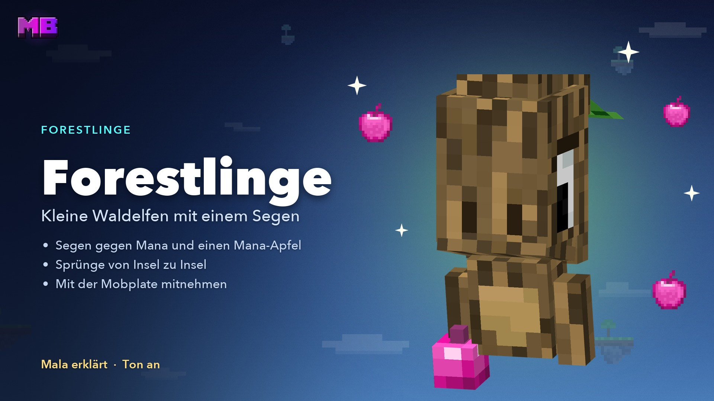

# Forestlings

Forestlings are small, shy **forest elves**. They travel from island to island, to wherever trees grow. For a bit of Mana they grant you a **blessing** – for example a huge leap across the gap to the next island.

<figure><figcaption>
The video “Forestlings” – Mala explains, in German
</figcaption></figure>


**Video: Forestlings** (1:34, in German, with sound) – Mala shows how to get a blessing with a Mana Apple and take a Forestling along in a Mobplate.


Forestlings aren't [AI residents](residents.md): they don't carry “(KI)” and they respond to fixed keywords.


**Mala** shows you your first Forestling on the meeting island. It flies off right away – one of the same kind waits on the next island you find in the direction it flew.


## Where to find them

* Forestlings show up on many islands near you – which kind depends on the biome.
* At most one lives on each island, and after one appears it takes a while until the next.
* Never on your starting island and never on the meeting island.

## Getting a blessing

For a blessing you need **Mana** and a **[Mana Apple](economy.md#mana-orbs)**. You craft the apple from an apple in the middle of the crafting table with **4 Mana orbs** around it. The apple confirms the purchase.



#### Talk to it

Click the Forestling (right-click or hit it). On **Bedrock**, tap it or sneak in front of it.



#### Listen

It introduces itself, names its blessing and asks: *“It costs 20 Mana, you have 57. Would you like it? Then give me a Mana Apple.”*



#### Give it a Mana Apple

Hold the **Mana Apple in your hand** and click the Forestling. It thanks you, holds the apple in its hand, and the blessing takes effect right away. The Mana is charged at that moment.




**No need to wait:** You can give the apple at any time – mid-conversation, while it's still introducing itself, or without talking at all.


* If you type “yes” or “I'll take it”, it asks you for the apple. If you don't have one, it tells you how to craft one.
* **You don't lose the apple:** If the purchase can't happen – not enough Mana, wrong game mode, its blessing is still active on you, or a Forestling without a blessing – you keep it. If it fails afterwards, you get it back, as a parcel the next time you join if need be.
* The Forestling holds the apple until the purchase and for one more minute afterwards.
* Say **how does it work?** and it explains its blessing, **tell me** and it tells you a story; **bye** ends the conversation.
* While you're talking, only it reads along. Put `!` at the start to write to everyone on the server, or use `/g` for the [global chat](messages.md#global-chat).
* If you walk away or don't write anything for a while, the conversation ends.

## All blessings

| Forestling | Blessing | What it does | Price | Duration |
| ---------- | -------- | ------------ | ----: | -------- |
| Oak | **Sky Leap** | Jump with a run-up: a giant leap about 60 blocks straight ahead. Without a run-up, a very high jump boost | 20 Mana | 120 s |
| Spruce | **Wind Run** | Run much faster. Run over the edge and the wind carries you about 75 blocks, then you land gently | 20 Mana | 120 s |
| Birch | **Air Jump** | Jump twice quickly: up to 3 jumps in mid-air, about 20 blocks each, landing without damage | 25 Mana | 120 s |
| Jungle | **Vine Swinger** | Jump twice quickly: a vine pulls you up to 64 blocks to the block you're looking at, 4 vines. Walk into a wall = run up it | 25 Mana | 120 s |
| Acacia | **Desert Wind** | Hop twice in quick succession: a dash about 45 blocks in the direction you're looking, every 2 s | 25 Mana | 120 s |
| Mangrove | **Root Bridge** | As you walk, a 3-block-wide root bridge grows beneath you. Look up and jump: it climbs | 30 Mana | 60 s |
| Pale Oak | **Ghost Step** | Jump twice quickly: fly for 8 s, about 105 blocks, then land gently. 2 charges | 30 Mana | ready for 120 s |
| Bamboo | **Bamboo Catapult** | Jump twice quickly: about 95 blocks far forward, landing without fall damage. 2 charges | 30 Mana | ready for 120 s |
| Cherry | **Blossom Leap** | Takes you instantly to a random island, usually 100–300 blocks away | 30 Mana | instant |
| Dark Oak | **Shadow Portal** | Takes you instantly to a random island, usually 300–500 blocks away | 40 Mana | instant |

* **Only one blessing at a time.** A new one replaces the one that's running – the Forestling tells you before. You can only renew the same blessing in its last 10 seconds.
* Blessings only work in **survival mode**.
* **No safety net:** Air Jump, Ghost Step and the like won't catch every fall, and the Root Bridge only grows while you're walking – it doesn't build downwards.
* The island jumps only land on islands that already exist. If there's none in the range, they jump a bit closer or farther (half to one and a half times the distance). If there's no suitable island at all, nothing is charged.

## Taking Forestlings along

### With a Mobplate

Click the Forestling with an **empty [Mobplate](mobplates.md)** – no fight, no marking. It's then inside the plate, and you can take it to any island.

* **Setting down:** Right-click a block with the filled plate. It needs solid ground and two free blocks above; water doesn't work. **Where you set it down is its new home.**
* At most **6 Forestlings** within 32 blocks. If it doesn't work, you keep the plate.
* The plate shows its kind, for example “Kind: Oak Forestling”. Same kinds stack, different ones don't. In a [ChestShop](chestshop.md) the sign names the kind.
* On other players' islands you need the **Animals** right to catch and set down.
* Not into a plate: a Forestling that's holding your apple for a purchase, and the resident Forestling in a clan island's grove.

### On a lead

Hold a **lead** and click the Forestling. It follows you. **Where you take the lead off is its new home.**

* On other players' islands you need the **Animals** right for this – to put it on a lead and to untie it, whether by hand, at a fence post or with shears.
* Nobody can put the resident Forestling in a clan island's grove on a lead.

## Related pages

* [AI Residents](residents.md)
* [Mana & Ruby](economy.md)
* [Mobplates](mobplates.md)
* [The Island World](world.md)
