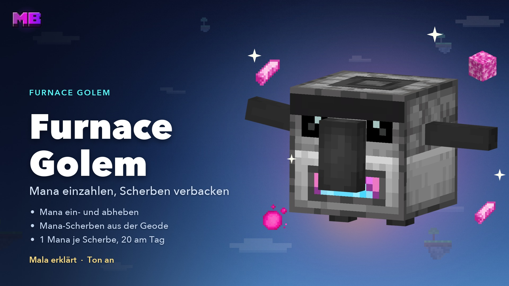
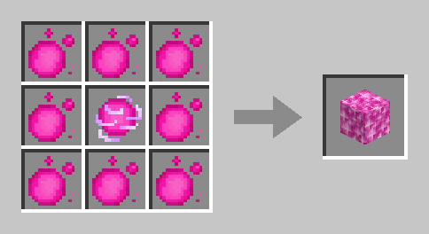
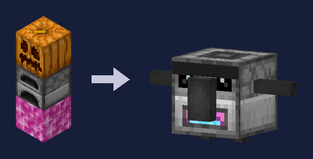
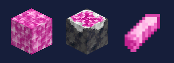

# Furnace Golem & Mana Geode

The **Furnace Golem** puts your Mana into your account. At the golem you deposit your **Mana orbs** and **Mana Blocks**, withdraw Mana as orbs, and it turns **Mana Shards** from the **Mana Geode** into Mana – even while you're offline. You put the shards into a **chest two blocks away from it** – it walks over and fetches them itself. You build it yourself, as many as you like.

<figure><figcaption><p>The video “Furnace Golem” – Mala explains, in German</p></figcaption></figure>


**Video: Furnace Golem** (1:40, in German, with sound) – Mala shows you how to build the golem, deposit and withdraw Mana and turn Mana Shards into Mana.



**The video still shows the earlier golem:** with its arms raised over its head and the chest right next to it. Today its arms stick out sideways, one block of space stays free all around it, and the chest stands **two blocks** away from it – see [Turning shards into Mana](#turning-shards-into-mana).


| | |
| --- | --- |
| **Building** | A Mana Block, a furnace on top, then a carved pumpkin or a jack o'lantern |
| **Deposit** | Mana orbs (1 Mana) and Mana Blocks (17 Mana) |
| **Withdraw** | Only as Mana orbs, as much as fits into your inventory |
| **Shards** | **1 Mana** per Mana Shard, 2 minutes of work per shard – from a chest or barrel two blocks away from it |
| **Daily limit** | **20 shards a day** for all your golems together – new limit at 04:00 |

## The Mana Block

The **Mana Block** is compressed Mana and the base of every Furnace Golem. **8 Mana orbs** around a **Mana Charge** in a crafting table make one Mana Block – that's **17 Mana**.

<figure><figcaption><p>8 Mana orbs around a Mana Charge make a Mana Block</p></figcaption></figure>

* **It can't be crafted back.** Only the Furnace Golem gets anything out of a Mana Block: depositing it puts 17 Mana into your account, and if you need orbs, you withdraw them there.
* **Place** it with a right-click like a normal block. On other islands you need the **Build** right.
* **Mining it with a pickaxe** gives you the block back. With your bare hand it's gone – and with it 17 Mana.
* Explosions leave it standing, and pistons push it.

## Building the golem

Place the **Mana Block**, a **furnace** on top of it and finally a **carved pumpkin** or a **jack o'lantern** as the head. Only the head builds the golem: the three blocks fall apart and the Furnace Golem stands in their place. It faces the way the pumpkin face was pointing.

This is what it looks like: a grey furnace body with eyes, a dark nose and a pink-and-blue mouth, and two short dark arms sticking out sideways.

<figure><figcaption><p>Mana Block, furnace, pumpkin – and the Furnace Golem is ready</p></figcaption></figure>

* **Survival mode only.** On other islands you need the **Build** right; visitors can't build one.
* **One block of space all around:** nothing may stand right next to the Mana Block and the furnace – diagonally at the corners too – except grass and the like. Otherwise the three blocks stay as they are, and a chat line tells you: “A Furnace Golem needs one block of free space all around it. Clear the blocks right next to the mana block and furnace and place the pumpkin again.”
* **The space stays free:** once the golem stands, you can't place anything right next to it or empty a bucket there. A dispenser won't place a block there either, and a piston won't push anything in. The golem needs the space for its walk to the chest. Mining whatever is there still works.
* **Whoever places the head is the builder.** The Mana from the shards belongs to them.
* Whatever was in the furnace drops out.
* **As many golems as you like** – the daily shard limit counts for all of them together.
* It can't be hit, moved or mined like a block. You only take it down through its menu, see [Dismantling](#dismantling).


The **golem on your airship** is a different one: it opens the [skill tree](skilltree.md). You build a Furnace Golem yourself on your island.


## The menu

A **right-click** anywhere on the golem opens its menu, and it greets you. On other islands you need the **Containers** right for that; visitors can't use it.

* **Top:** your Mana account, how many Mana orbs and Mana Blocks you carry, how many orbs you mined yourself and haven't deposited yet, and how many foreign orbs you can still deposit today.
* **Second row – Deposit** (green buttons): one orb, a stack, all orbs, one Mana Block or all Mana Blocks. The number on the button shows how many one click deposits right now.
* **Third row – Withdraw** (gold buttons): 1, 16 or 64 orbs.
* **Bottom:** the **Mana shards** in the chests within its reach – if there's none, the card tells you where one goes –, its **Work** – who built it, how far the shard is and why it's taking a break – and the **Daily limit**. Plus **Dismantle** and **Close**.

### Deposit

A Mana orb is **1 Mana**, a Mana Block **17 Mana**. The Mana goes into your account right away, and the golem is happy for you.

* **Survival mode only.**
* **Orbs you mined yourself** always go in completely, even if you only drop by every few days.
* **Foreign orbs** – from other players – go in up to **100 a day**. A Mana Block counts as 17. Anything above that stays in your inventory, and a chat line tells you how much and why.
* There's no command for depositing – you go to the golem for that.


**Older orbs:** orbs you mined before 28.09.2026 count as foreign – 100 of them go in per day. Everything you've mined since then goes in completely.


### Withdraw

Here you get Mana from your account back as **Mana orbs** (1, 16 or 64) – for example for a new golem or to craft a [Mobplate](mobplates.md). **You can't withdraw Mana Blocks** – if you need one, craft it from 8 orbs and a Mana Charge.

* **Survival mode only**, and only as much as fits into your inventory and your account covers.
* Withdrawing has **no daily limit**.
* Orbs you withdraw count as **mined by you**: if you deposit them again, they don't count towards the limit for foreign orbs. If you give them away, they're foreign orbs for the receiver.

## The Mana Geode

<figure><figcaption><p>Mana Block, Budding Mana Amethyst and Mana Shard</p></figcaption></figure>

The **Mana Shards** for the golem grow in the caves of the main islands – on **Budding Mana Amethyst**, similar to amethyst on budding amethyst.

* **Where:** on the floor of the [island caves](world.md#caves), most likely in an amethyst geode. At most two per main island, on average about two on every three main islands. The starter island, side islands, settlements and stepping stones don't have any.
* **Growing:** a **mana crystal** grows upward on it in four stages – small, medium, large, full-grown. Each stage takes **about 10 minutes** on average, so one shard takes about 40 minutes. It only grows **while the island is loaded**, and only if the block above it is free.
* **Harvesting:** you mine the crystal equally fast with any tool or by hand. **Only the full-grown crystal gives a Mana Shard** – a bud gives nothing, let it grow. A new one grows afterwards.
* Shards only drop in survival mode. On other islands you need the **Build** right.


**Don't mine the Budding Mana Amethyst.** It drops nothing – and then nothing grows there any more. Pistons don't move it. Later you'll be able to move it with the [Feather of Softness](feather.md) – coming soon.


## Turning shards into Mana

### The chest two blocks away

Put a **chest**, a **trapped chest** or a **barrel** exactly **two blocks** away from the golem and put your Mana Shards in it – the golem does the rest.

* **Straight to one side:** in front of it, behind it, to its left or right, not diagonally.
* **At its height:** on the same level as its feet, not one block higher or lower.
* **The space in between is free** – two blocks high – with solid ground below. That's where it walks.

```
 .  .  C  .  .
 .  ○  ○  ○  .      G  the Furnace Golem
 C  ○  G  ○  C      ○  stays free, it walks here
 .  ○  ○  ○  .      C  the chest may stand here
 .  .  C  .  .
```

* **A chest right next to it doesn't count** – that space stays free anyway.
* Shop containers, clan project chests and a double chest whose other half isn't loaded or is locked don't count as shard chests.
* You can put a chest on all four sides – if one is empty, it fetches the shards from the next.
* If sand or gravel falls between it and the chest, clear it away – otherwise it can't get there.

If no chest stands in the right place, its menu says at the shards: “No chest and no barrel within reach. Put one two blocks from him, at his height, with the space in between free.”

### How it bakes

1. The golem fetches **one shard**: it walks to the chest, turns sideways, opens the lid and reaches in. Then it walks back to its spot.
2. It works on it for **2 minutes** – its furnace mouth glows pink, a bright strand rises above its head, and pink mana dust winds its way up around it, with a soft amethyst chime.
3. Then the **builder gets 1 Mana** in their account, even while offline. After that the golem fetches the next shard.

* **Daily limit: 20 shards** per builder and day, across all their golems and islands. When it's full, the golem dozes until the daily reset at **04:00**. This doesn't touch the daily limit for actions.
* **It only works while the island is loaded.** Without a chest in reach or without a shard it waits and looks around.
* Anyone who may open the chest may put shards into it – the Mana always goes to the builder.


**Golem from before the update?** A chest right next to it doesn't count any more – move it two blocks out, or it takes a break. Whatever already stands right next to it may stay – only the space between it and its chest has to be free. If you had shards in the chest on its head, they lie on top of it after the update and don't despawn – pick them up and put them into the chest.


## Dismantling

Click **Dismantle** in the menu and confirm.

* Only with the **Build** right, not as a visitor, and in survival or creative mode.
* In survival mode you get the **head, furnace and Mana Block** back.
* **A shard it's working on** always drops to the ground – in creative mode too. It lands right at the golem and doesn't scatter, so nothing falls into the void at the edge of the island.
* The chest two blocks away stays as it is.
* If it's settling a shard right now, try again a moment later.
* Dismantling doesn't change your account.

## The special quest with Mala

Once, **Mala** shows you a Furnace Golem – with voice and subtitles.

* **When:** after your first resident, that is once you've found them and Mala has introduced them to you. If there's no first resident on your island yet, she waits 15 minutes at most.
* **Who:** once per player and only for the island's own players – the owner, members with **Join** and, on a clan island, the clan. Guests and spectators don't get it, see [Travel & Watching](travel.md#residents-on-other-islands).
* **Where:** on the starting island, 5 to 12 blocks from the spawn. A chat line tells you the direction and coordinates, and the arrow in the quest box shows you the way.

Mala waits there with a **borrowed golem** and a chest two blocks away from it. Once you're within 6 blocks, she explains in seven lines:

1. She introduces the Furnace Golem.
2. You put Mana Shards into a chest two blocks away from it – a shard floats from Mala into the chest, and the golem walks over and fetches it.
3. It bakes each shard for a while and credits you with Mana for it.
4. It's also where you deposit your Mana orbs into your account.
5. How to build your own: on a small **shrine**, a **Mana Block, a furnace and a carved pumpkin** appear one on top of the other, each right when Mala names it.
6. You craft the Mana Block from eight Mana orbs around a Mana Charge.
7. The golem was only on loan and vanishes in pink sparks.

After that the quest is done, and a chat line sums up once more how to build your own golem and where its chest goes.

* If you walk **more than 24 blocks** away in the middle of it, the quest stops. When you come back, it starts over.
* **Only you see it all:** Mala, the golem, the chest, the shrine and the shard. The chest vanishes with the golem; nothing changes on the island.

## Trading

* **Mana Blocks and Mana Shards** are blocked in [ChestShops](chestshop.md), just like Mana orbs and Mana Charges. [AI residents](residents.md) don't buy them either.
* Mana Blocks, Mana Shards and Budding Mana Amethyst can't go into the backpack.

## Achievement

| Achievement | How |
| ----------- | --- |
| **Banked** | Deposit Mana orbs or Mana Blocks at the Furnace Golem |

More under [Achievements](achievements.md).

## Related pages

* [Mana & Ruby](economy.md)
* [Mana Items](mana-items.md)
* [The Island World](world.md)
* [Members & Permissions](members.md)
