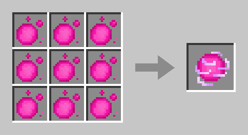
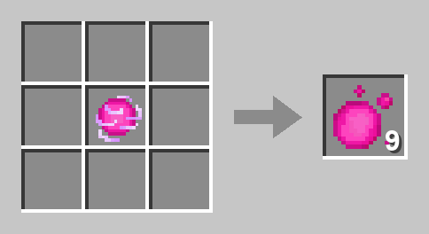
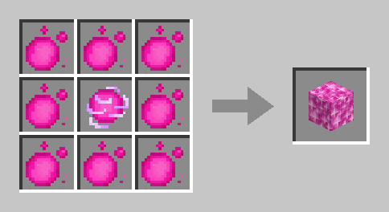
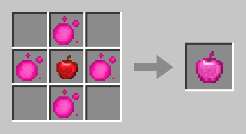
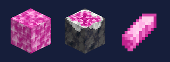

# Mana Items

[Mana ore](economy.md#mana-ore) doesn't put Mana straight into your account – it drops **Mana orbs** into your inventory. You bring them into your account at the [Furnace Golem](furnace-golem.md). At the crafting table you turn those orbs into further Mana items.

<figure><figcaption>
Mana orb, Mana Charge and Mana Apple
</figcaption></figure>

| Item | Where from | What for | In ChestShops |
| ---- | ---------- | -------- | ------------- |
| [Mana orb](#mana-orb) | Mining Mana ore | Paying into your account, ingredient for everything else | blocked |
| [Mana Charge](#mana-charge) | 9 orbs | Storing orbs compactly | blocked |
| [Mana Block](#mana-block) | 8 orbs around a Mana Charge | Base of the [Furnace Golem](furnace-golem.md), depositing 17 Mana at once | blocked |
| [Mana Apple](#mana-apple) | 4 orbs around an apple | Buying [Forestling](forestlings.md) blessings, weakening marked mobs for a [Mobplate](mobplates.md) | tradable |
| [Empty Mobplate](mobplates.md#empty-mobplate) | 8 orbs around a Pale Sherd | Catching mobs | tradable |
| [Mana Shard](#mana-shard) | Full-grown mana crystal in the [Mana Geode](furnace-golem.md#the-mana-geode) | Turned into Mana at the Furnace Golem | blocked |

## Mana orb

A **sparkling pink orb**. One orb is **one Mana**, a stack holds 64.

* **Where from:** Mining [Mana ore](economy.md#mana-ore) drops **3–5 orbs**, up to 20 with Fortune III. Mana ore has a daily limit of 200 Mana.
* **Into your account:** Orbs are deposited at the [Furnace Golem](furnace-golem.md#deposit). Only then does your balance go up. You can also withdraw Mana as orbs there.
* **Passing them on:** You can give orbs to other players, by hand or in a chest. Orbs you mined yourself always count in full, **other players' orbs only up to 100 a day**.
* Orbs, Charges, Mana Blocks, Mana Shards and Mana Apples can't be sold to [AI residents](residents.md).

## Mana Charge

**9 Mana orbs** filling the whole crafting grid make one **Mana Charge**. That way 576 Mana fit into one stack instead of 64.

<figure><figcaption>
9 Mana orbs make one Mana Charge
</figcaption></figure>

You can **split a Charge back up at any time**: put it alone into the grid – your inventory grid works too – and you get the 9 orbs back. No Mana is lost and none is created.

<figure><figcaption>
One Mana Charge gives 9 Mana orbs
</figcaption></figure>

## Mana Block

**8 Mana orbs** around a **Mana Charge** make one **Mana Block** – that's **17 Mana** in one block. It's the base of every [Furnace Golem](furnace-golem.md).

<figure><figcaption>
8 Mana orbs around a Mana Charge make a Mana Block
</figcaption></figure>

* **It can't be crafted back.** You deposit a Mana Block at the Furnace Golem – that puts 17 Mana into your account. If you need orbs, you withdraw them there.
* **Place** it with a right-click like a normal block. On other islands you need the **Build** right.
* **Mining it with a pickaxe** gives you the block back. With your bare hand it's gone – and with it 17 Mana.
* Explosions leave it standing, and pistons push it.

## Mana Apple

**4 Mana orbs** around an ordinary **apple** make one **Mana Apple**. The corners stay empty.

<figure><figcaption>
Apple in the middle, 4 Mana orbs around it
</figcaption></figure>

You can't eat it. It has two jobs:

### Buying a Forestling blessing

Hold the Mana Apple and click a [Forestling](forestlings.md) – on Bedrock tap it or sneak in front of it. That's your **yes** to its blessing. It works at any time, even in the middle of a conversation. The Forestling takes the apple, holds it for a while and blesses you.

* The blessing **still costs its Mana price** – the apple only confirms the purchase.
* If the purchase can't go through, for example because you don't have enough Mana or the Forestling has no blessing, you keep the apple. If something goes wrong after that, you get it back – if you've already left, as a parcel the next time you join an island server.

### Weakening mobs for a Mobplate

Once you've marked a mob with an empty [Mobplate](mobplates.md), right-clicking it with a Mana Apple takes away **half of its hearts**. This works once per mob and only on your own marked mob. On an unmarked mob you only get a hint and keep the apple.

## Mana Shard

<figure><figcaption>
Mana Block, Budding Mana Amethyst and Mana Shard
</figcaption></figure>

Mana Shards grow in the **Mana Geode**: a mana crystal grows in four stages on **Budding Mana Amethyst** on the cave floor. Only the **full-grown crystal** gives a Mana Shard when you mine it – that takes about 40 minutes on average.

Put the shards into the chest on a [Furnace Golem](furnace-golem.md#turning-shards-into-mana)'s head – or into a chest or barrel next to it. It turns each shard into **1 Mana** for its builder in 2 minutes, up to 20 shards a day. Where the geode is and what to watch out for is under [Furnace Golem & Mana Geode](furnace-golem.md#the-mana-geode).

## Trading

* **Mana Apples** can be bought and sold for Ruby in [ChestShops](chestshop.md).
* **Mana orbs, Mana Charges, Mana Blocks and Mana Shards** are **blocked** in ChestShops, also inside a shulker box or a bundle.
* Your Mana **balance** can never be sent – only Ruby works with `/pay`.

## Achievements

| Achievement | How |
| ----------- | --- |
| **Condensed** | Craft a Mana Charge |
| **Magic Fruit** | Craft a Mana Apple |
| **Banked** | Deposit Mana orbs or Mana Blocks at the [Furnace Golem](furnace-golem.md) |

More under [Achievements](achievements.md).


**Recipe book:** The recipes unlock as soon as a Mana orb or Charge is in your inventory. You can craft them without unlocking too.


## Related pages

* [Mana & Ruby](economy.md)
* [Furnace Golem & Mana Geode](furnace-golem.md)
* [Forestlings](forestlings.md)
* [Mobplates](mobplates.md)
* [ChestShops](chestshop.md)
