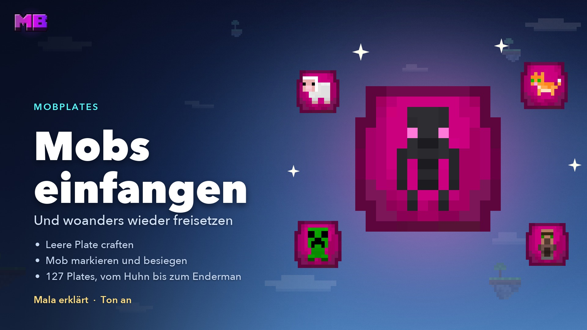
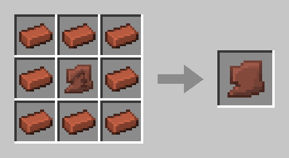
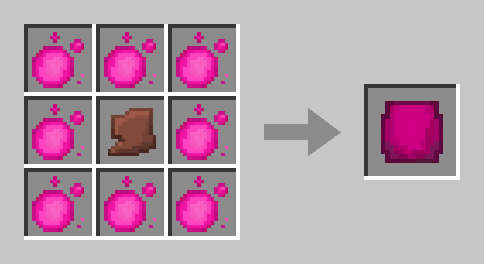
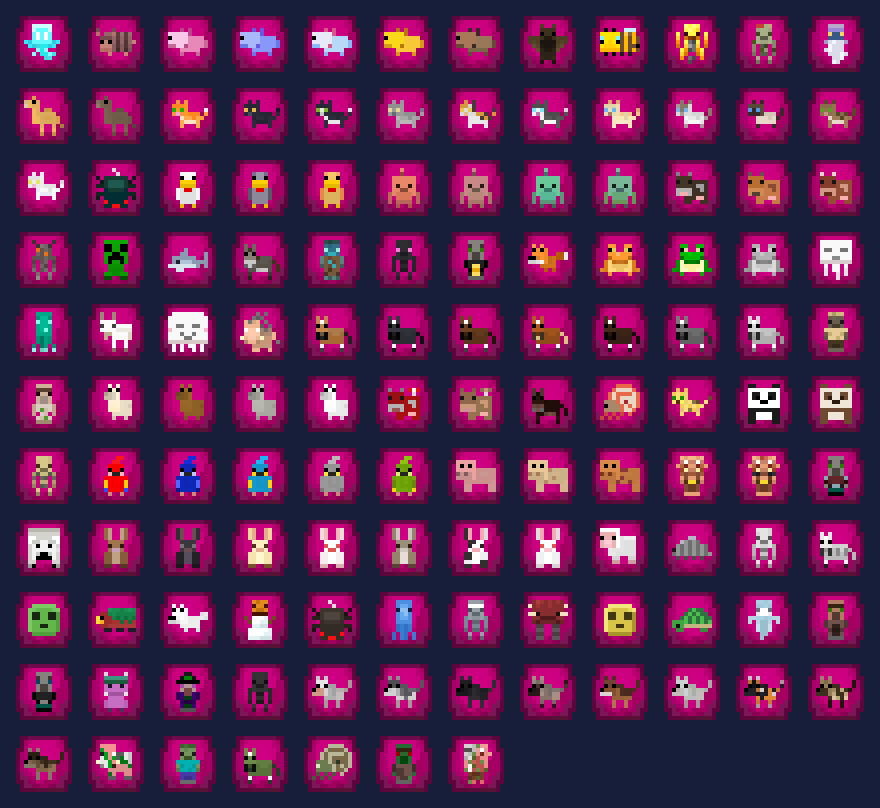

# Mobplates

With a **Mobplate** you catch a mob and release it somewhere else – on your island, on another one, or you sell it in a ChestShop. There are **127 filled plates**, from the chicken to the Enderman.

<figure><figcaption>
The video “Mobplates” – Mala explains, in German
</figcaption></figure>


**Video: Mobplates** (1:56, in German, with sound) – Mala shows you how to catch mobs and release them again.


## Crafting a Mobplate

First you craft a **Pale Sherd**, and from it the **empty Mobplate**, both at a crafting table.

### Pale Sherd

Any **pottery sherd** in the middle, surrounded by **8 bricks**.

<figure><figcaption>
Pottery sherd and 8 bricks
</figcaption></figure>

### Empty Mobplate

The **Pale Sherd** in the middle, surrounded by **8 [Mana orbs](economy.md#mana-orbs)**.

<figure><figcaption>
Pale Sherd and 8 Mana orbs
</figcaption></figure>

## Catching a mob



#### Mark

**Right-click** a mob with the empty plate. That uses up the plate, the mob gives off pink particles, and you have **10 minutes**.



#### Weaken (optional)

**Right-click** your marked mob with a [Mana Apple](mana-items.md#mana-apple). It loses **half of its hearts** – 20 become 10. This works once per mob.



#### Kill

When you kill the mob, the **filled plate goes straight into your inventory**. The loot drops as usual.



#### Release

**Right-click** a block or water with the filled plate, just like with a spawn egg. On chests, doors and other blocks that react to a click, this only works while **sneaking**.



You take the filled plate along to other islands, like your whole inventory.


**Villagers enter the plate without a fight:** the first click catches them. The **Zombie Villager** has to be killed like any other mob.


## Collecting Warpetts

A placed [Warpett](warpetts.md) goes into a plate too, with no fight and no mark – and its **flower travels along**.

* **Collecting:** Click the Warpett with the empty plate. On Bedrock, as usual with Warpetts, sneaking next to it is enough; the plate must be in your main hand.
* **Setting down:** Right-click a block, with solid ground and free space. Not in water, lava or fire, not on a cactus or magma, not under a low ceiling and not on an egg. The Warpett immediately rejoins its flower's network in that world; it eats nothing and doesn't set off. If that doesn't work there, you keep the plate.
* **On another island** it connects to the Warpetts with the same flower there.
* **Flower:** The plate says which one is inside. Warpetts without a flower go in too, and after being set down they roam freely like freshly hatched ones.
* **In a ChestShop:** The sign, messages and menu name the flower, for example “Warpett: Mohn”. The sign shortens long names.

The Warpett on the airship and the one on your starting island stay where they are.

## If it goes wrong

You get the **empty plate back** if

* the 10 minutes are up,
* the mob dies some other way,
* it transforms – say, a pig struck by lightning –,
* or it disappears.

If you're not around, the plate drops next to the mob. If you merely leave the island, the mark stays.

If no mob can appear at the spot when releasing, you keep the plate. Only one player at a time can mark a mob.

## Rules

* **No reward:** Released mobs count neither for [Mana](economy.md#what-doesnt-give-mana) nor for [quests](quests.md).
* **Babies** give the normal plate, and an adult always comes out.
* **Other players' tamed animals** can't be marked. [Residents](residents.md), [Forestlings](forestlings.md) and the crew don't fit into a plate either.
* **Trading:** You can trade Mana Apples, empty and filled plates and the Pale Sherd in a [ChestShop](chestshop.md). Mana orbs and Mana Charges stay blocked there. Plates and Mana Apples can't go into the backpack.
* **Stacks:** Mobplates and Pale Sherds stack to 64. Warpett plates only stack with the same flower; all plates without a flower count as one kind.

### On other players' islands

| What you do | Right you need |
| ----------- | -------------- |
| Mark, catch, Mana Apple | **Animals** – for monsters too |
| Release | **Build** |
| Collect and set down a Warpett | **Warpetts** |

More under [Members & rights](members.md#the-rights).

## Achievements

Two [achievements](achievements.md#mobplates) belong to the Mobplates: **First Catch** for your first mob in a plate and **Moved In** for the first mob you place again. Both count for Warpetts too.

## Which mobs there are

<figure><figcaption>
All 127 filled plates
</figcaption></figure>

Only what looks permanently different gets a plate of its own. These mobs have several plates:

| Mob | Plates |
| --- | -----: |
| Cat | 11 |
| Wolf | 9 |
| Horse, Rabbit | 7 each |
| Axolotl, Parrot | 5 each |
| Copper Golem, Llama | 4 each |
| Chicken, Cow, Frog, Pig | 3 each |
| Mooshroom, Panda | 2 each |

Some mobs deliberately have just one plate:

* **Sheep:** Every colour gives the same plate, and a white one always comes out.
* **Villager:** without professions and biomes.
* **Warpett:** one image for all flowers; the plate says which flower it carries.

All mobs with one plate

Allay, Armadillo, Bat, Bee, Blaze, Bogged, Breeze, Camel, Camel Husk, Cave Spider, Creaking, Creeper, Dolphin, Donkey, Drowned, Enderman, Evoker, Fox, Ghast, Glow Squid, Goat, Happy Ghast, Hoglin, Husk, Iron Golem, Mule, Nautilus, Ocelot, Parched, Piglin, Piglin Brute, Pillager, Polar Bear, Sheep, Silverfish, Skeleton, Skeleton Horse, Slime, Sniffer, Snow Fox, Snow Golem, Spider, Squid, Stray, Strider, Sulfur Cube, Turtle, Vex, Villager, Vindicator, Warpett, Witch, Wither Skeleton, Zoglin, Zombie, Zombie Horse, Zombie Nautilus, Zombie Villager, Zombified Piglin

### Mobs without a plate

* **Boss mobs:** Ender Dragon, Wither, Warden, Elder Guardian
* **Also:** Giant, Illusioner, Phantom, Guardian, Ravager, Shulker, Tadpole, Wandering Trader, Trader Llama, Cod, Salmon, Tropical Fish, Pufferfish, Endermite, Magma Cube

## Related pages

* [Mana & Ruby](economy.md)
* [Members & rights](members.md)
* [Achievements](achievements.md)
* [Warpetts](warpetts.md)
* [Resources & farming](farming.md)
