# Pets

Pets are small companions that follow you everywhere. They work across the **whole network**: in the lobby and on every island. When you switch servers, your pet is with you again, with the same name and skin.

On the **game servers**, meaning everywhere you play Skyblock, your pet can do more: it [fights](#combat) monsters, has a [perk](#perks) and [levels up](#levels). In the **lobby** it stays a pure companion.

Pets have nothing to do with the [Warpetts](warpetts.md).


**Everyone gets the Capybara for free.** Open `/pet` and call it under **My pets**.


## The pet menu

`/pet` (also `/pets`) opens the menu:

| Button | What it does |
| ------ | ------------ |
| **My pets** | All the pets you own. Left-click calls a pet or sends it away, right-click opens its pet page |
| **Your pet** | The pet that is with you right now – a click opens its pet page |
| **Pet shop** | Browse new pets and skins and try them out first |
| **Settings** | Hide other players' pets or send your pet away |
| **Pet vouchers** | Only if you have vouchers from your [rank](#vouchers-from-ranks) |

On the **pet page** you call your pet or send it away, give it a name and pick its skin. It also shows:

* its **level** and how many XP are missing to the next level,
* its **health** (or when it comes back after a knockout),
* its **fighting style** and its **perk** with the value it has right now.

The **Combat mode** button switches the [mode](#combat-mode); it applies to all your pets. If the pet has the Pack mule perk, the **Pack mule** button opens its [storage slots](#pack-mule). In the lobby, the pet page says that fighting, perks and levels only work on the game servers.

**Clicking your own pet:** On Java, a right-click opens its pet page. On **Bedrock**, **sneak twice quickly** next to your pet instead. If you click someone else's pet, you see who it belongs to.

## Commands

| Command | What it does |
| ------- | ------------ |
| `/pet` | The pet menu. Also `/pets` |
| `/pet call <pet>` | Call a pet. Without a pet: your pets |
| `/pet dismiss` | Send your pet home |
| `/pet rename <name>` | Rename your pet. Without a name: reset the name |
| `/pet skin [skin\|default]` | Pick your pet's skin. Without a skin: the skin menu, `default` the default look |
| `/pet preview <pet>` | 30-second preview, only for you |
| `/pet hide` | Hide or show other players' pets |
| `/pet shop` | The pet shop |
| `/pet vouchers` | Redeem free pets from your rank |
| `/pet mode [mode]` | Pick the [combat mode](#combat-mode): `protect`, `support` or `passive`. Without a mode: switch to the next one |
| `/pet backpack` | Open your pet's [pack mule](#pack-mule). Also `/pet bp` |
| `/pet help` | All pet commands |

The commands are the same in English for everyone; the texts in the game come in your language.

## Your pet on the move

* You always have **one pet** with you. If you call another one, the old one goes home.
* If you are more than 3 blocks away, it runs after you. From 12 blocks, it jumps right next to you.
* If you stand still for 20 seconds, it sits down.
* Pets aren't allowed in spectator mode and in some places. Your pet comes back as soon as it can.
* Players can never hit or hurt your pet. On the game servers, **monsters** can hit it, see [Health, knockouts and healing](#health-knockouts-and-healing).

### Renaming

On the pet page, click **Rename** and type the new name in chat – or use `/pet rename <name>`.

* At most **24 characters**: letters, digits, spaces and a few punctuation marks.
* `-` resets the name, `abbrechen` cancels.
* The name then shows above your pet.

### Hiding other players' pets

With `/pet hide` or under **Settings** you hide other players' pets. The setting applies on every server.

## Combat


**Only on the game servers.** Fighting, perks and levels work everywhere you play Skyblock, but not in the lobby. And they only ever apply to your **active pet**, the one that is with you right now: only it fights, only its perk works, only it collects XP.


Your pet protects you from monsters. It attacks **only monsters**, never players, animals, villagers, NPCs or other pets. It leaves **bosses** (Ender Dragon, Wither, Warden, Elder Guardian) and **event monsters** alone – those are up to you.

### Fighting styles

Every pet has one of three fighting styles. Which one is in the table [Fighting style, perk and favourite food](#fighting-style-perk-and-favourite-food).

| Fighting style | How it fights | Health | Damage | Rate |
| -------------- | ------------- | ------ | ------ | ---- |
| **Guardian** | Melee. A monster that attacks you targets your pet afterwards | 40 | 2 | every 1.5 s |
| **Hunter** | Melee, the fastest attacker | 24 | 4 | every 1.2 s |
| **Archer** | Attacks from up to 8 blocks away | 16 | 3 | every 1.5 s |

These values are for a **common pet at level 10**. Each rarity tier above that adds 10 % health and 5 % damage, so a legendary Hunter has 31 health and 4.6 damage. At level 1 a pet has half of that, and it grows evenly up to level 10. For comparison: you have 20 health yourself.

### Combat mode

You choose whom your pet attacks with `/pet mode` or the **Combat mode** button on the pet page. The mode applies to all your pets.

| Mode | Command | What your pet does |
| ---- | ------- | ------------------ |
| **Protect** (default) | `/pet mode protect` | Attacks monsters that attack you or your pet |
| **Support** | `/pet mode support` | Also attacks monsters you hit |
| **Passive** | `/pet mode passive` | Does not fight and is not attacked |

* Your pet moves at most **10 blocks** away from you. If a monster runs further, it comes back.
* If you are on someone else's island as a [customer](chestshop.md#as-a-customer-on-other-islands) or as a [spectator](travel.md), your pet is only a companion there: it doesn't fight, and its perk doesn't work.

### Who gets the kill

| Who hit it | Drops | Minecraft XP | Mana, quests and stats | Pet XP |
| ---------- | ----- | ------------ | ---------------------- | ------ |
| You hit it within the last 5 seconds | yes | yes | yes, like your own kill | 1 XP |
| Only your pet | yes | no | no | no |
| You are [AFK](#afk) | no | no | no | no |

So a kill your pet makes on its own gives you no mana. Join the fight, and it counts.

## Health, knockouts and healing

* When your pet is hurt, its remaining health shows above it, for example **♥ 18/24**.
* Your pet can only take damage from monsters, explosions included. Never from players, not even from their TNT.
* **Healing:** If it isn't hit for 10 seconds, it heals itself, 1 health every 3 seconds.
* **Favourite food:** Hold your pet's [favourite food](#fighting-style-perk-and-favourite-food) and right-click it. It is fully healed at once. This costs one item.
* **Knockout:** At 0 health your pet is knocked out. It disappears and comes back on its own after **60 seconds**. A pet never dies for good and loses nothing, not even a level. While it is knocked out, its perk doesn't work.

## Levels

Every pet levels up from **level 1 to level 10**. With each level its combat values and its [perk](#perks) get stronger.

| Level | Total XP | Playtime without fighting, about |
| ----- | -------- | -------------------------------- |
| 1 | 0 | – |
| 2 | 50 | just under 1 h |
| 3 | 110 | just under 2 h |
| 4 | 190 | just over 3 h |
| 5 | 300 | 5 h |
| 6 | 450 | 7½ h |
| 7 | 640 | just under 11 h |
| 8 | 870 | 14½ h |
| 9 | 1150 | just over 19 h |
| 10 | 1500 | 25 h |

This is how your pet collects XP:

* **1 XP per minute** it is with you while you play in survival mode and aren't AFK.
* **1 XP per monster** you defeat together (you joined in), at most **20 XP per hour**. So if you fight a lot, you're a bit faster.

Every pet has its **own level**. If you call another pet, it starts at its own level, and the old one keeps its own. Levels **can't be bought** – only playing helps.

### AFK

You count as AFK after **3 minutes** in which you haven't looked around, written in chat, used a command or clicked in your inventory. Then:

* your pet collects no XP,
* it only fends off monsters that attack you directly,
* monsters it defeats drop nothing.

## Perks

Every pet has a perk. How strong it is depends on the pet's **rarity**. The values apply at **level 10**:

| Perk | What it does | Common | Rare | Epic | Legendary |
| ---- | ------------ | ------ | ---- | ---- | --------- |
| **Collector** | Picks up drops around you for you | 2 blocks | 3 blocks | 4 blocks | 5 blocks |
| **Pack mule** | Extra [storage slots](#pack-mule) in your pet | 3 slots | 5 slots | 7 slots | 9 slots |
| **Lantern** | Your pet glows and carries the light along (a torch has 14) | Light level 9 | 11 | 13 | 15 |
| **Companion** | You walk faster, only on your own island | +4 % | +6 % | +8 % | +10 % |
| **Feather light** | Less fall damage | −12 % | −24 % | −36 % | −48 % |
| **Scholar** | More Minecraft experience | +5 % | – | – | – |
| **Angler's friend** | Shorter wait when fishing | −10 % | – | – | – |

* **Level:** At level 1–4 a perk works at a third of its value, at level 5–9 at two thirds, from level 10 in full (rounded down, at least 1). **Lantern**, **Scholar** and **Angler's friend** work in full from level 1.
* **Scholar** and **Angler's friend** only come with free pets.
* **Collector** only works on your own island and not while you're AFK. It takes nothing someone threw or that belongs to someone else, and nothing that lies closer to another player.
* **Companion** only works on your own island.
* **Feather light** adds up with protection enchantments, and as in Minecraft, damage is reduced by at most 80 %.
* A perk only works while your pet is out with you. A skin changes nothing about the perk or the combat values.

## Pack mule

Pets with the Pack mule perk carry items for you: the **Alpaca** and the **Pelican** (rare), **Llama Dolly** (epic) and the **Otter** (legendary). You open it with `/pet backpack` or the **Pack mule** button on the pet page.

| Rarity | Level 1–4 | Level 5–9 | Level 10 |
| ------ | --------- | --------- | -------- |
| Common | 1 slot | 2 slots | 3 slots |
| Rare | 1 slot | 3 slots | 5 slots |
| Epic | 2 slots | 4 slots | 7 slots |
| Legendary | 3 slots | 6 slots | 9 slots |

* You can only open it on the **game servers** and only in **survival** or **adventure mode**.
* Every pack mule pet has its own slots. The contents are **the same on every game server**. If your pack mule is open on another server right now, you get a message and try again a moment later.
* **Shulker boxes** and **bundles** don't go in.
* If the pack mule pet is no longer with you, `/pet backpack` opens the slots that still hold something, **only to take things out**. Nothing gets lost.

## All pets

Every pet has a **rarity**, and the rarity sets the price. You buy pets and skins in the [shop](https://shop.megabuild.de/).

| Icon | Pet | Rarity | Price | What it's like |
| ---- | --- | ------ | ----- | -------------- |
| 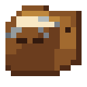 | **Capybara** | Common | free | Calm itself. Likes to sit next to you and watch. |
| 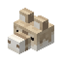 | **Alpaca** | Rare | €4.99 | A ball of wool on four legs that likes to carry things for you. |
| 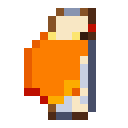 | **Pelican** | Rare | €4.99 | More fits into its throat pouch than you would think. |
| 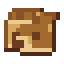 | **Hedgehog** | Rare | €4.99 | Trots after you sniffing and rolls up into a spiky ball. |
| 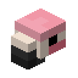 | **Flamingo** | Rare | €4.99 | Long legs, long strides. Likes to stand on one leg while waiting. |
| 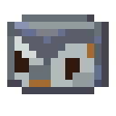 | **Penguin** | Rare | €4.99 | Waddles after you everywhere. |
| 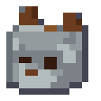 | **Raccoon** | Rare | €4.99 | Curious to the tip of its tail. Collects anything that glitters. |
| 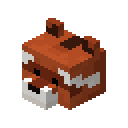 | **Red Panda** | Rare | €4.99 | Climbs everything and still always comes down gently. |
| 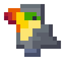 | **Toucan** | Rare | €4.99 | Picks up whatever lies around with its big, colourful beak. |
|  | **Dragonfly** | Rare | €4.99 | An emperor dragonfly in blue and green that shimmers in the light. |
| 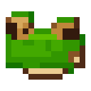 | **Tree Frog** | Rare | €4.99 | Leaps on long hind legs and croaks with its throat sac. |
| 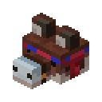 | **Llama Dolly** | Epic | €6.99 | Proud, fluffy and always ready to carry your luggage. |
| 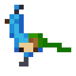 | **Peacock** | Epic | €6.99 | Fans its tail as soon as anyone looks. |
| 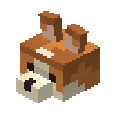 | **Dog** | Epic | €6.99 | Goes for walks with you, fetches and sits up. The base model is a Corgi. |
| 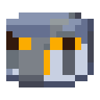 | **Falcon** | Epic | €6.99 | Swoops down from above and brings back whatever it finds. |
| 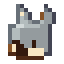 | **Wolf Pup** | Epic | €6.99 | Howls at the moon, chases its own tail and brings you what lies around. |
| 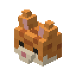 | **Cat** | Epic | €6.99 | Plays with a ball of yarn, stretches and licks its paws clean. The base model is a house cat. |
| 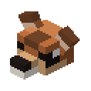 | **Fawn** | Legendary | €9.99 | Trots with high knees, listens to the forest and curls up to sleep. |
| 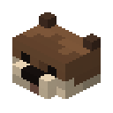 | **Otter** | Legendary | €9.99 | Bounds along, shakes itself dry and juggles a pebble. |
| 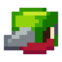 | **Hummingbird** | Legendary | €9.99 | Hovers in place, darts forward and sips nectar mid-air. |

More common pets are meant to come later with the [quests](quests.md).


**As of November 2026.** Prices may change – the [shop](https://shop.megabuild.de/) always has the final word.


### Fighting style, perk and favourite food

What each pet brings along on the game servers. The perk value applies at level 10.

| Pet | Fighting style | Perk at level 10 | Favourite food |
| --- | -------------- | ---------------- | -------------- |
| **Capybara** | Guardian | Scholar: +5 % experience | Melon Slice |
| **Alpaca** | Guardian | Pack mule: 5 slots | Wheat |
| **Pelican** | Guardian | Pack mule: 5 slots | Raw Cod |
| **Hedgehog** | Guardian | Collector: 3 blocks | Apple |
| **Flamingo** | Hunter | Companion: +6 % | Raw Salmon |
| **Penguin** | Hunter | Companion: +6 % | Raw Cod |
| **Raccoon** | Hunter | Collector: 3 blocks | Sweet Berries |
| **Red Panda** | Hunter | Feather light: −24 % | Bamboo |
| **Toucan** | Archer | Collector: 3 blocks | Glow Berries |
| **Dragonfly** | Archer | Lantern: light level 11 | Spider Eye |
| **Tree Frog** | Archer | Feather light: −24 % | Slimeball |
| **Llama Dolly** | Guardian | Pack mule: 7 slots | Hay Bale |
| **Peacock** | Guardian | Lantern: light level 13 | Wheat Seeds |
| **Dog** | Hunter | Companion: +8 % | Bone |
| **Falcon** | Archer | Collector: 4 blocks | Raw Chicken |
| **Wolf Pup** | Hunter | Collector: 4 blocks | Raw Beef |
| **Cat** | Hunter | Feather light: −36 % | Raw Cod |
| **Fawn** | Guardian | Feather light: −48 % | Carrot |
| **Otter** | Hunter | Pack mule: 9 slots | Raw Salmon |
| **Hummingbird** | Archer | Companion: +10 % | Honey Bottle |

## Skins

A skin gives your pet a different look. It only changes the look, nothing else – not the combat values, the perk or the level. Every skin costs **€1.99**.

| Icon | Skin | For the pet | Price |
| ---- | ---- | ----------- | ----- |
| 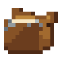 | **Baby** | Capybara | €1.99 |
| 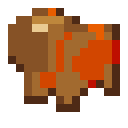 | **Ginger** | Capybara | €1.99 |
| 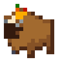 | **Yuzu** | Capybara | €1.99 |
| 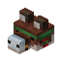 | **Jolly** | Llama Dolly | €1.99 |
| 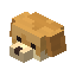 | **Golden Retriever** | Dog | €1.99 |
| 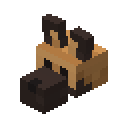 | **Malinois** | Dog | €1.99 |
| 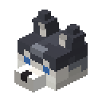 | **Husky** | Dog | €1.99 |
| 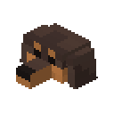 | **Dachshund** | Dog | €1.99 |
| 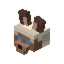 | **Siamese** | Cat | €1.99 |
| 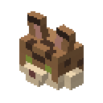 | **Maine Coon** | Cat | €1.99 |
| 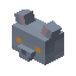 | **British Shorthair** | Cat | €1.99 |

For the **Dog** and the **Cat**, the breeds are skins: you have one dog and make it a Corgi, Golden Retriever, Malinois, Husky or Dachshund. Without a skin the cat is a house cat; with a skin it becomes a Siamese, Maine Coon or British Shorthair. In the shop, pets with skins say **"Customize this pet with skins"**.

Pick the skin on the pet page under **Skins** or with `/pet skin`. `/pet skin default` brings back the default look.

## Pet shop and preview

The **pet shop** (`/pet shop`) shows every pet with its rarity, price and skins.

* **Left-click** a pet to see the preview and get the shop link in chat. On Bedrock, links in chat can't be clicked – the address `megabuild.de/shop` is shown instead.
* **Preview:** The pet appears next to you for **30 seconds**, and **only you can see it**. After that you wait 10 seconds before the next preview. This also works with `/pet preview <pet>` and with skins.
* **After buying** on [shop.megabuild.de](https://shop.megabuild.de/), the pet shows up in your pets, on every server within about 10 seconds. You don't need to be online when you buy.

Pets and skins belong to your account. They can't be traded.

## Vouchers from ranks

Every [rank](ranks.md) comes with **two pet vouchers**, and they add up:

| Rank | Vouchers | total |
| ---- | -------- | ----- |
| **Gold** | 2 up to Rare | 2 |
| **Platin** | 2 more up to Epic | 4 |
| **Titan** | 2 more up to Legendary | 6 |

If you buy a higher rank straight away, you also get the vouchers of the ranks below it.

* A voucher gets a **pet or a skin of its tier or below**. You can only get a skin for a pet you already own.
* The **smallest fitting** voucher is always used first – so the higher one stays for a rarer pet.
* **Redeeming:** `/pet vouchers` or the **Pet vouchers** button at the top of the pet menu. Left-click redeems (after asking), right-click shows the preview. This can't be undone.
* If you have open vouchers, a line in chat reminds you when you log in.

## What's coming


Later on, **followers** are meant to come, meaning several pets at once, and **combos** of pets that go well together. Until then you always have one pet with you.


## Related pages

* [Ranks](ranks.md)
* [Warpetts](warpetts.md)
* [Commands](commands.md)
