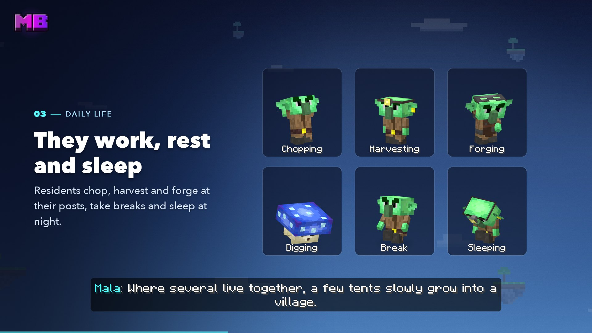

# AI Residents

<figure><figcaption>
From the video “Your island is alive”
</figcaption></figure>


**Video: Your island is alive** (1:23, with sound) – AI residents and Forestlings, introduced by Mala.


**Goblins** and **Shroomlings** live on the islands around you. They build, harvest, forge, take breaks, sleep at night – and talk to you in chat.

Above their heads is a short name with **“(KI)”** (German for AI), for example *Pip (KI)*. Residents aren't players. If you ask them whether they're real, they'll honestly tell you they're AI residents.

## Where you meet residents

| Where | What |
| ----- | ---- |
| **Meeting island** | Your first resident lives on a small island right next to your starting island. The [special quest](start.md#the-special-quest-find-the-first-resident) leads you there |
| **Hermits** | Live alone in their own house on islands you explore – a bit more often further out |
| **Settlements** | A group of 1–5 residents. It starts as a tent camp or with a hut and a field and grows into a small village over time |

Residents never leave their island and can't be taken along. `/residents` shows everyone you already know – with biome and coordinates.

## What residents do

Every resident has a job – farmer, miner, smith, trader or sage (among the Shroomlings they're called mushroom gardener, digger, potter, trader and spore sage). At their post they hoe, harvest, hammer or dig; in between they sit down, and at night they sleep. With every line in chat they make a short sound.

## Talking



#### Start a conversation

A resident you don't know yet talks to you on their own when you come close. Otherwise, click them (Bedrock: sneak in front of them) or type their name in chat, for example *“Pip, what are you doing?”*.



#### Type in chat

During the conversation, your chat lines only go to the resident. You see them in grey as *You → Pip: …* and the reply as *Pip (KI): …* – only you see either.



#### Write to everyone

If you still want to write something in the normal chat, put a **`!`** at the start – the line then goes to everyone on this server, without the `!`. Nothing goes to the whole network from their island, not even with `/g` – you reach the [global chat](messages.md#global-chat) again once you've left the island.



### Island chat

When you're standing on the island of residents you already know, you can write to them **without clicking and without a name** – your chat then goes to them, not to other players. A line in chat lets you know when you arrive and when you leave. Put `!` at the start to write to everyone on the server. Nothing goes to the [global chat](messages.md#global-chat) from here, not even `/g` – but you still see what others on the network write. Once you leave the island, your chat goes to the whole network again.

If you've turned the island chat off in `/ki` or don't know the residents yet, you write there like anywhere else, `/g` included. Clan chat and `/msg` always work.

### What they understand

* **Keywords:** “trade”, “tasks”, “order”, “what's new” and “bye” open the matching menu or end the conversation.
* **Questions:** Residents answer with real game data – what an item costs and where to find it, when you can trade, how far along your order is, where other settlements are, what the weather will be like. They also tell you about themselves.
* If they don't understand you, they say so and suggest two questions.

A conversation ends when you walk away, don't write anything for a while, or say goodbye.

## Trust

The more often you visit a resident, the better they know you. A level you've reached is never lost.

| Level | What's added |
| ----- | ------------ |
| **Stranger** | The resident talks to you |
| **Acquainted** | Chat, look at their stock, **buy provisions** – food for Ruby |
| **Trade partner** | Buy and sell |
| **Open** | The whole stock, swapping, tasks, orders, trading from afar via `/residents` |
| **Trusted** | Personal offers, swap a quest |

* A visit counts at most every 20 minutes – clicking over and over doesn't help.
* Shy residents need a few more visits.
* From **Open** on, you get a small gift now and then.

## Trading

Open trading by typing “trade” in chat or via the **stock chest** at the house or market stall – clicking it opens the trade menu.

* Residents trade for **[Ruby](economy.md#ruby)** – when swapping, also goods for goods, never for real money. What you buy from residents goes into the [market fund](#the-market-fund), and what you sell to them, that fund pays you for.
* **Provisions right from the first meeting:** Food – carrots, potatoes, melon slices, sweet berries, cod and salmon – can be bought from every resident you know, right away, for Ruby. Until *Open*, at most **64 pieces** per food, resident and day. Buying only: selling comes with *Trade partner*, swapping with *Open*.
* Which provisions a resident has depends on their biome – **there's always fish**, even with residents who don't make any food themselves. They catch cod on the side. Bread only comes through **orders**.
* **Selling** gives you Ruby from the market fund up to a daily limit: 3–4 Ruby per resident, at most 10 Ruby a day in total. **Swapping** still works after that.
* **Tasks** (from Open): For Ruby, a resident will for example show you the way to a biome, repair your tool or bring 30 minutes of sunshine or rain to your island – at most 3 tasks a day. The prices are further down.
* **Orders** (from Open): You order goods from a resident – say *bake 16 bread* – and pay Ruby. They make it in the time they tell you. If an order expires, you get your Ruby back.
* **Swap requests:** When a resident needs goods, say 64 cobblestone for the well, they ask you – and give you other goods in return.
* **Swap a quest** (from Trusted) is a second way to [skip](quests.md#skipping) a daily quest and costs the same Mana.
* You'll find your orders, swap requests and deliveries under `/orders`.
* Trading only works in survival mode and only in your own island world.

### The market fund

All the Ruby players spend with residents goes into the **market fund** – a single fund for the whole network. When you sell goods to a resident, this fund pays you in Ruby. So residents only pass on what players left with them before: trading with residents never creates Ruby out of thin air.

| Limit | Ruby per day |
| ----- | -----------: |
| Buying – goods, orders and tasks together | at most 40 |
| Selling to one resident | 3–4 |
| Selling in total | 10 |
| All residents of one island together buy for | 10 |
| The fund pays out across the whole network | 10 % of its balance |

* The fund never goes below zero. Each day it pays out at most 10 % of what was in it at 04:00. Ruby for paid orders that are still open don't count, because they may have to be refunded.
* **Full fund:** If the fund holds more than players pay in over 14 days on average, the three selling limits (per resident, in total and per island) go up with it – up to three times as much. When it empties, they go back down.
* When the fund has paid out everything for today or you've hit a limit, the resident tells you. **Swapping** still works, and the next day there's Ruby again.
* If the fund can't pay right now, you get your goods back. Whatever doesn't fit in your inventory, you pick up under `/orders`.
* If Ruby can't be reached right now, trading pauses and nothing is booked.

### Prices and lots

* **Buying:** Prices are **rounded up** to whole Ruby, at least 1 Ruby. So that nothing gets too expensive, goods come in **lots** that cost about 1 Ruby – at most one stack.
* **Selling:** There are only **whole Ruby**. The resident takes as many pieces as whole Ruby pay for – you keep the rest. If the amount isn't worth a whole Ruby, they tell you to take more. For very cheap goods, that takes more than one stack.


**New accounts** can only spend Ruby after a short wait – 24 hours after their first login and after 20 minutes of playtime (see [Sending Ruby](economy.md#sending-ruby)). With residents, you can still buy for up to **20 Ruby** more than you've sold to them during that time – enough for provisions on your first day.


### Prices for tasks and orders

| What | Who | Ruby |
| ---- | --- | ---: |
| **Guide** – a trail to the nearest island of a biome, visible only to you for 10 minutes | Sages | 3 |
| **Biome lore** – what a biome offers that your island doesn't have yet | Sages | 2 |
| **Sniffer** – finds unlooted chests and pots up to 96 blocks around you, once a day | Sages | 5 |
| **Weather** – 30 minutes of clear skies or rain on your island, never thunderstorms | Sages | 4 |
| **Repair** – a plain tool without enchantments or a name; the more worn, the more expensive | Smith | 3–8 |
| Timed order: 16 bread | Farmer | 1 |
| Timed order: fishing rod | Farmer | 1 |
| Timed order: iron pickaxe | Smith | 2 |
| Timed order: bucket | Smith | 2 |
| Your own order | | at most 40 |

Among the Shroomlings, farmers, smiths and sages are called mushroom gardeners, potters and spore sages.

## Commands

| Command | What it does |
| ------- | ------------ |
| `/residents` | All residents you know – with role, biome, coordinates, trust level and what they're doing right now. From *Open* on, you can trade from afar here |
| `/residents liste` | The same as a list in chat |
| `/ki` | Set what residents may do with you: talking to you, scenes and rumors, sounds, chat conversations – also for individual residents |
| `/ki off` · `/ki on` | Turn talking to you, scenes and chat off or on all at once. Clicking them still works |
| `/ki report` | Marks your messages to residents from the last 30 minutes for review by the team |
| `/orders` | Orders, swap requests and deliveries – this is also where you pick up goods |

These commands only exist on the islands, not in the lobby.

## Tab list

Below the players, the tab list shows a section **“Residents (KI)”** with up to six settlements or hermits you've already talked to – with biome and coordinates. Residents never count as players.


**Bedrock** doesn't show this section. Use `/residents` there.


## Your data

* Residents never ask for your age, where you live or your real name. If you mention something like that, they advise you to keep it to yourself.
* Only counters like encounters and trust level are saved, plus your trades – not the text of your conversations.
* What you write to the residents on an island without using a name isn't logged.
* If you're worried about something, residents point you to the free German helpline Nummer gegen Kummer (116 111).


**Don't pretend to be a resident.** Only residents carry “(KI)” in their name.


## FAQ

Why can't I buy anything yet?

**You can buy food right away** as soon as you know a resident. Everything else only opens up after a few visits. A visit counts at most every 20 minutes, and the whole stock is available at the earliest on the second day you drop by.

If your account is new, during the waiting time you can buy for at most 20 Ruby more than you've sold. And you spend at most 40 Ruby a day with residents.

Can other players read what I write on the island?

No. On the island of residents you know, your chat only goes to them. Put `!` at the start to write to everyone on the server. You reach the [global chat](messages.md#global-chat) again once you've left the island.

A resident keeps talking to me

Turn it off with `/ki` – for everyone or only for individual residents. `/ki off` turns everything off at once.

The residents don't answer

When the residents are taking a break, it says so in chat. The team can switch the residents off for a short time, for example for maintenance.

## Related pages

* [Forestlings](forestlings.md)
* [Getting Started](start.md)
* [The Island World](world.md)
