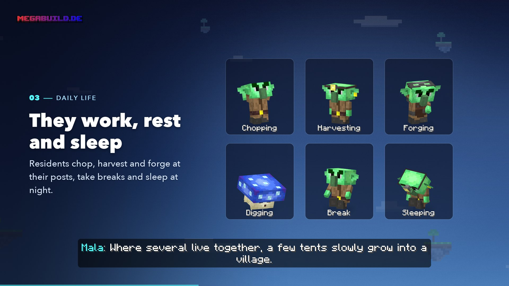

# AI Residents

<figure><figcaption>
From the video “Your island is alive”
</figcaption></figure>


**Video: Your island is alive** (1:22, with sound) – AI residents and Forestlings, introduced by Mala.


**Goblins** and **Shroomlings** live on the islands around you. They build, harvest, forge, take breaks, sleep at night – and talk to you in chat.

Above their heads is a short name with **“(KI)”** (German for AI), for example *Pip (KI)*. Residents aren't players. If you ask them whether they're real, they'll honestly tell you they're AI residents.

## Where you meet residents

| Where | What |
| ----- | ---- |
| **Meeting island** | Your first resident lives on a small island right next to your starting island. The [special quest](start.md#the-special-quest-find-the-first-resident) leads you there |
| **Hermits** | Live alone in their own house on islands you explore – a bit more often further out |
| **Settlements** | A group of 1–5 residents. It starts as a tent camp or with a hut and a field and grows into a small village over time |

Residents never leave their island and can't be taken along. `/residents` shows everyone you already know – with biome and coordinates.

## What residents do

Every resident has a job – farmer, miner, smith, trader or sage (among the Shroomlings they're called mushroom gardener, digger, potter, trader and spore sage). At their post they hoe, harvest, hammer or dig; in between they sit down, and at night they sleep. With every line in chat they make a short sound.

## Talking



#### Start a conversation

A resident you don't know yet talks to you on their own when you come close. Otherwise, click them (Bedrock: sneak in front of them) or type their name in chat, for example *“Pip, what are you doing?”*.



#### Type in chat

During the conversation, your chat lines only go to the resident. You see them in grey as *You → Pip: …* and the reply as *Pip (KI): …* – only you see either.



#### Write to everyone

If you still want to write something in the normal chat, put a **`!`** at the start.



### Island chat

When you're standing on the island of residents you already know, you can write to them **without clicking and without a name** – your chat then goes to them, not to other players. A line in chat lets you know when you arrive and when you leave. Put `!` at the start to write to everyone.

### What they understand

* **Keywords:** “trade”, “tasks”, “order”, “what's new” and “bye” open the matching menu or end the conversation.
* **Questions:** Residents answer with real game data – what an item costs and where to find it, when you can trade, how far along your order is, where other settlements are, what the weather will be like. They also tell you about themselves.
* If they don't understand you, they say so and suggest two questions.

A conversation ends when you walk away, don't write anything for a while, or say goodbye.

## Trust

The more often you visit a resident, the better they know you. A level you've reached is never lost.

| Level | What's added |
| ----- | ------------ |
| **Stranger** | The resident talks to you |
| **Acquainted** | Chat, look at their stock |
| **Trade partner** | Buy and sell |
| **Open** | The whole stock, swapping, tasks, orders, trading from afar via `/residents` |
| **Trusted** | Personal offers, swap a quest |

* A visit counts at most every 20 minutes – clicking over and over doesn't help.
* Shy residents need a few more visits.
* From **Open** on, you get a small gift now and then.

## Trading

Open trading by typing “trade” in chat or via the **stock chest** at the house or market stall – clicking it opens the trade menu.

* You pay with **Mana or goods** – **never with Ruby or real money**.
* **Selling** gives you Mana up to a daily limit: 30–40 Mana per resident, at most 100 Mana a day in total. **Swapping** still works after that.
* **Tasks** (from Open): For Mana, a resident will for example show you the way to a biome, repair your tool or bring 30 minutes of sunshine or rain to your island.
* **Orders** (from Open): You order goods from a resident – say *bake 16 bread* – and pay Mana. They make it in the time they tell you.
* **Swap requests:** When a resident needs goods, say 64 cobblestone for the well, they ask you – and give you other goods in return.
* You'll find your orders, swap requests and deliveries under `/orders`.
* Trading only works in survival mode and only in your own island world.

## Commands

| Command | What it does |
| ------- | ------------ |
| `/residents` | All residents you know – with role, biome, coordinates, trust level and what they're doing right now. From *Open* on, you can trade from afar here |
| `/residents liste` | The same as a list in chat |
| `/ki` | Set what residents may do with you: talking to you, scenes and rumors, sounds, chat conversations – also for individual residents |
| `/ki off` · `/ki on` | Turn talking to you, scenes and chat off or on all at once. Clicking them still works |
| `/ki report` | Marks your messages to residents from the last 30 minutes for review by the team |
| `/orders` | Orders, swap requests and deliveries – this is also where you pick up goods |

These commands only exist on the islands, not in the lobby.

## Tab list

Below the players, the tab list shows a section **“Residents (KI)”** with up to six settlements or hermits you've already talked to – with biome and coordinates. Residents never count as players.


**Bedrock** doesn't show this section. Use `/residents` there.


## Your data

* Residents never ask for your age, where you live or your real name. If you mention something like that, they advise you to keep it to yourself.
* Only counters like encounters and trust level are saved, plus your trades – not the text of your conversations.
* What you write to the residents on an island without using a name isn't logged.
* If you're worried about something, residents point you to the free German helpline Nummer gegen Kummer (116 111).


**Don't pretend to be a resident.** Only residents carry “(KI)” in their name.


## FAQ

Why can't I buy anything yet?

Trading only opens up after a few visits. A visit counts at most every 20 minutes, and the whole stock is available at the earliest on the second day you drop by.

Can other players read what I write on the island?

No. On the island of residents you know, your chat only goes to them. Put `!` at the start to write to everyone.

A resident keeps talking to me

Turn it off with `/ki` – for everyone or only for individual residents. `/ki off` turns everything off at once.

The residents don't answer

When the residents are taking a break, it says so in chat. The team can switch the residents off for a short time, for example for maintenance.

## Related pages

* [Forestlings](forestlings.md)
* [Getting Started](start.md)
* [The Island World](world.md)
