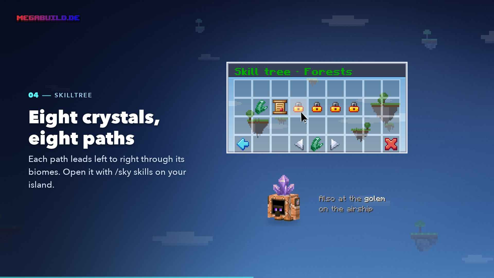

# Skill Tree & Biomes

<figure><figcaption>
From the video “Mana & biomes”
</figcaption></figure>


**Video: Mana & biomes** (1:16) – how you earn Mana and use it to grow your island world.


In the skill tree you unlock **new biomes** for your island. New areas you explore only ever come from biomes your island owns.

Open it **on your island** with `/sky skills` or via `/sky` → **Skill tree**. Clicking the **golem** on your airship opens the skill tree too (Bedrock: sneak next to it).

## Eight crystals, eight paths

The skill tree is made of **eight paths** – each path is a **crystal**. A path leads from left to right through its biomes. The first biome of a path is also the starting biome you get when you choose that path at the start.



Plains → Sunflower Plains → Meadow → Flower Forest → Birch Forest → Cherry Grove

<figure><figcaption>
Cherry Grove
</figcaption></figure>



Forest → Wooded Hills → Taiga → Grove → Old Growth Spruce Taiga → Old Growth Pine Taiga

<figure><figcaption>
Forest
</figcaption></figure>



Snowy Plains → Snowy Beach → Snowy Taiga → Frozen River → Frozen Ocean → Ice Spikes



Windswept Hills → Windswept Forest → Windswept Gravelly Hills → Snowy Slopes → Frozen Peaks → Jagged Peaks



Swamp → Mangrove Swamp → Dark Forest → Old Growth Birch Forest → Mushroom Fields → Pale Garden

<figure><figcaption>
Mushroom Fields at night
</figcaption></figure>

<figure><figcaption>
Pale Garden
</figcaption></figure>



Sparse Jungle → Jungle → Stony Peaks → Bamboo Jungle

<figure><figcaption>
Jungle
</figcaption></figure>



Desert → Savanna → Badlands → Windswept Savanna → Wooded Badlands → Eroded Badlands

<figure><figcaption>
Badlands and savanna
</figcaption></figure>



River → Beach → Stony Shore → Lukewarm Ocean → Cold Ocean → Warm Ocean → Deep Ocean


The **Water** crystal is coming soon. Until then it's locked.




Every path brings its own **custom biomes**, and new crystals add more.

## How to unlock a biome



#### In your own path: the biome quest of the biome before

Every biome has a **biome quest**. You can only buy the next biome of a path once your island owns the biome before it **and** its biome quest is complete. This applies to your starting biome too.



#### In a new path: the crystal quest first

If you want to start another crystal, you first complete its **crystal quest**. After that, the first biome of that path can be bought. All crystal quests run at the same time from the start.



#### Buy

Tapping buys the biome right away at the price shown – without asking again. What you buy stays bought.




**Who can buy:** the owner and members with the **Settings** right. The Mana always comes from the account of **whoever clicks** – and only on the island itself.


## Biome quests

* **Everyone helps.** The HUD shows the progress of the whole island. Every owner and every member who helps gets **25 Mana** when it's completed. Visitors get nothing.
* **Where they count:** A biome quest only counts on islands of that biome – so the quest of your starting biome counts on your starting island and its neighbours. **Crystal quests** count on all your islands.
* **Always fair:** You can do the first quests of a path alone in a few minutes; the later ones take more like an hour.
* **What doesn't count:** The same rules as for quests – blocks you placed yourself, spawner monsters and AFK don't count. Biome quests **can't be skipped**.
* **Progress updates** at 25, 50 and 75% appear in chat.

If you tap a biome in the skill tree that's waiting for a quest, the quest gets pinned to your HUD.

All biome quests at a glance

The number is the biome's position in the path. The quest at position 1 opens position 2, and so on.

| Path | 1 | 2 | 3 | 4 | 5 | 6 |
| ---- | - | - | - | - | - | - |
| Plains | Shear 8 sheep | 48 sunflowers | Breed 5 rabbits | 160 flowers | 288 birch logs | 192 pink petals |
| Forests | 48 oak logs | Loot 5 containers | 96 sweet berries | Breed 3 foxes | 384 spruce logs | Tame 3 wolves |
| Snow & Ice | 96 snow blocks | 32 fish | Tame 2 wolves | 192 ice | 256 packed or blue ice | 16 strays |
| Mountains | 12 ores | 160 logs | 384 gravel | Breed 6 goats | 40 monsters | 640 stone |
| Swamp & Rare | 24 blue orchids | 32 fish | 64 mushrooms | 320 birch logs | Breed 8 mooshrooms | 48 eyeblossoms |
| Jungle | 48 jungle logs | Tame 3 parrots | 32 ores | Breed 3 pandas | – | – |
| Desert & Steppe | 128 sand | Tame 3 horses | Breed 5 armadillos | 256 acacia logs | 384 terracotta | 64 monsters |

| Crystal quest | Task |
| ------------- | ---- |
| Snow & Ice | Catch 32 fish |
| Mountains | Mine 384 stone |
| Forests | Chop 128 logs |
| Plains | Harvest 128 wheat |
| Swamp & Rare | Loot 6 containers |
| Jungle | Breed 16 animals |
| Desert & Steppe | Defeat 40 monsters |

## Prices

The first biome costs **100 Mana**. After that, the price rises slowly:

* **+5%** for every biome your island has already bought
* **+25%** for every position further along the path
* rounded to 5 Mana

| Purchase no. | Position 1 | Position 2 | Position 3 | Position 4 | Position 5 | Position 6 |
| -----------: | ---------: | ---------: | ---------: | ---------: | ---------: | ---------: |
| 1st | 100 | 125 | 150 | 175 | 200 | 225 |
| 10th | 155 | 195 | 235 | 270 | 310 | 350 |
| 20th | 255 | 315 | 380 | 440 | 505 | 570 |
| 39th | 640 | 800 | 960 | 1,115 | 1,275 | 1,435 |

All 39 purchases together cost around **20,900 Mana**. You get the first ten biomes for about 1,400 Mana.

## What a new biome gives you

* **New areas.** A freshly bought biome is **guaranteed to appear in the next new area** you explore.
* **New resources, animals and structures** of the biome – and the quests that go with them.
* **New Forestlings**, depending on the biome.
* **Achievements**, for example *New Land* for your first biome and one achievement for each complete path.

## Favourites

You can mark up to **three** of your biomes as a **favourite**. Favourites appear in new areas **three times as often**. It's free and you can change it at any time: tap a biome in the skill tree that your island already owns.

## What the symbols mean

| In the menu | Meaning |
| ----------- | ------- |
| Biome with glint and ✔ | Belongs to your island |
| ★ | Favourite |
| Price | Can be bought – or it says how much Mana you're missing |
| Lock | Buy the biome before it first |
| Scroll | Waiting for a biome or crystal quest – with task, progress and helpers |
| Clock | Locked (Water) |

Use the arrows at the bottom to flip through the eight crystals.

## Related pages

* [Mana & Ruby](economy.md)
* [Quests](quests.md)
* [The Island World](world.md)
* [Achievements](achievements.md)
