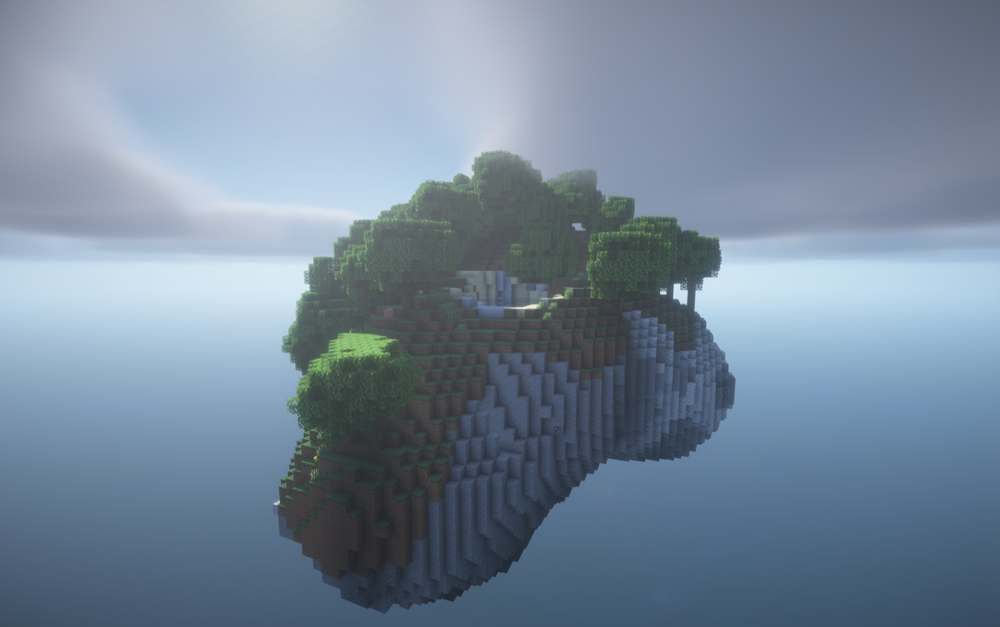

# Custom Skyblock

On MegaBuild.de every player gets **their own island world on their own server**. You create it in the lobby, experience the intro with Captain **Mala** aboard her airship, and a **Warpett** takes you to your starting island.

As you explore, new islands keep appearing around yours – with caves, ores, villages, ruins and **AI residents** who chat and trade with you. You decide which biomes show up: you unlock them with **Mana** in the skill tree.

<figure><figcaption>
A main island with its side islands
</figcaption></figure>

## How it all fits together



#### Explore and mine

Discover new islands, mine ores, farm, fight and meet residents.



#### Earn Mana

Quests, Mana ore, trading with residents and many actions earn you Mana.



#### Complete the biome quest and buy a biome

Every biome has a biome quest. Once it's done, you buy the next biome in the skill tree.



#### Discover new areas

The new biome appears in the next area you explore – with new resources, animals, structures and Forestlings.



## The systems

| System | What it's about |
| ------ | --------------- |
| [Getting started](start.md) | From the lobby to your first resident |
| [Your island](island.md) | Your own server, menus, dying, deleting |
| [The island world](world.md) | How new islands appear – areas, caves, ores, structures |
| [Members & rights](members.md) | Up to 25 fellow players with adjustable rights |
| [Mana & Ruby](economy.md) | Mana for unlocking, Ruby for trading |
| [Quests](quests.md) | Daily, weekly and bonus quests for Mana |
| [Skill tree & biomes](skilltree.md) | Crystal paths full of custom biomes |
| [AI residents](residents.md) | Goblins and Shroomlings who talk, work and trade |
| [Forestlings](forestlings.md) | Forest elves who give you a blessing for Mana |
| [Warpetts](warpetts.md) | Travel through flower networks, hatch eggs |
| [Resources & farming](farming.md) | Ores, Mana ore, generator, animals, monsters |
| [Achievements](achievements.md) | 20 achievements in the "MegaBuild Sky" tab |
| [HUD & statistics](hud.md) | What you see on your screen |
| [Clans (preview)](clans.md) | The planned clan system |


The numbers in this wiki are the server's current values. They may still change with updates.


## Let's go


[start.md](start.md)

