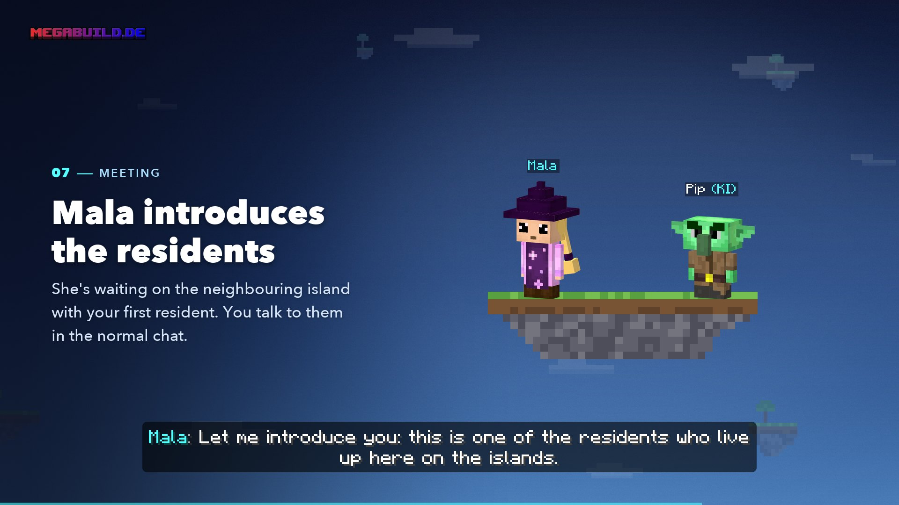

# Getting Started

<figure><figcaption>
From the video "Your start"
</figcaption></figure>


**Video: Your start** (1:34, with sound) – Mala takes you from the lobby to your first resident.


## Creating your island



#### Connect

Join the server via `megabuild.de` (Bedrock: port `19132`). On Java Edition you have to accept the resource pack.


[join.md](join.md)




#### Open the Skyblock menu

You arrive in the lobby. Type `/sky` or click the Skyblock NPC and select **Create Skyblock**.



#### Choose your crystal

The crystal decides how your island begins. **You can't change this choice later.** You unlock all other biomes in-game.

| Crystal | Your starting island | What it looks like |
| ------- | -------------------- | ------------------ |
| Plains | Plains | Wide meadows and sunflowers |
| Forests | Forest | Dense broadleaf and conifer forests |
| Snow & Ice | Snowy Plains | Frosty plains and glaciers |
| Desert & Steppe | Desert | Sand, heat and badlands |
| Jungle | Sparse Jungle | Tropical, green and full of life |
| Mountains | Windswept Hills | Rugged peaks and scree |
| Swamp & Rare | Swamp | Boggy and unusual biomes |

The **Water** crystal is already visible, but still locked – it's **coming soon**.



#### Take off

You're sent straight to an intro server, where the intro plays. Meanwhile your island is built in the background – you don't have to wait in the lobby.

If a lot of players are starting at the same time, the bar above your hotbar shows **"Preparing your intro"** and your place in the queue.



## The intro with Mala

You wake up on the deck of an **airship**. At the helm stands **Mala**, the captain. In about a minute and a half she tells you what happened to the old world – with **voice and subtitles**, in German or English depending on your Minecraft client's language.


**Sound on!** The intro lives on Mala's voice.


* You can move around freely on deck. If you jump overboard, you're caught.
* On the intro server you only see your own ship – other players are hidden.
* Along the way, Mala introduces you to the **Golem** and the **Warpett**.

## Taking the Warpett to your island



#### Pick the dandelion

A dandelion grows in front of the Warpett's house. Pick it.



#### Hold it out to the Warpett

Take the dandelion in your hand and click the Warpett – **right- or left-click**. On **Bedrock**, sneak next to it.



#### Swallowed!

The Warpett eats the dandelion – and you along with it. Everything goes dark for a moment, then its twin spits you out again on your **starting island**.



If your island isn't quite finished at that moment, a bar called **"Final touches …"** shows you what's being built right now. That takes a few minutes at most.

When you arrive, you get the achievement **Touchdown** and a first tip that matches your starting biome.


[warpetts.md](warpetts.md)


## What you find on your starting island

| What | Where |
| ---- | ----- |
| **Island Warpett** | Next to the spawn. It takes you back to the airship at any time |
| **Airship** | It's anchored above your island. The **Golem** stands on board – one click opens the skill tree |
| **Neighbouring islands** | Around the starting island, all in the biome of your starting choice |
| **Water and lava** | If the starting island has neither, it gets both for a cobblestone generator |

The starting island itself has no cave and no ore – you find those on the islands you explore.

## The special quest: find the first resident

On a small neighbouring island, about 100 blocks away, someone has moved in. Three things show you the way – only you can see them:

* an **arrow** in the quest box at the top, with the distance in metres
* a **beacon** on the resident's island
* an **allay**, a helper spirit that flies ahead of you

A **vine staircase** made of leaves leads across. **Mala** is waiting there with your first **AI resident** and introduces them to you – along with a shy **Forestling**. After that, the resident chats with you.


[residents.md](residents.md)


## The first few hours

* **Open your quests.** `/quest` shows your tasks. They're the most reliable source of Mana.
* **Complete the biome quest of your starting biome.** Only then can you buy the next biome of your path. Everyone on the island helps.

  | Starting biome | Biome quest |
  | -------------- | ----------- |
  | Plains | Shear 8 sheep |
  | Forest | Chop 48 oak logs |
  | Snowy Plains | Shovel 96 snow blocks |
  | Desert | Dig 128 sand |
  | Sparse Jungle | Chop 48 jungle logs |
  | Windswept Hills | Mine 12 ores |
  | Swamp | Pick 24 blue orchids |
* **Explore.** The islands around you have caves, ores, villages and, with a bit of luck, more residents.
* **Invite friends.** With members you progress faster – and they get Mana for biome quests too.
* **Buy your first biome.** You start with **1,000 Mana**. The second biome of your starting path costs 125 Mana.


**If you fall into the void,** you keep your inventory and levels. You only lose a little Mana and wake up in your bed – or, if you don't have one, on the deck of the airship.


## Coming back later

The next time you log in, you land straight on your island if it's running. Otherwise you arrive in the lobby and enter your island via `/sky` → **Join Island**.

## Next

* [Your island](island.md)
* [The island world](world.md)
* [Skill tree & biomes](skilltree.md)
* [Commands](commands.md)
