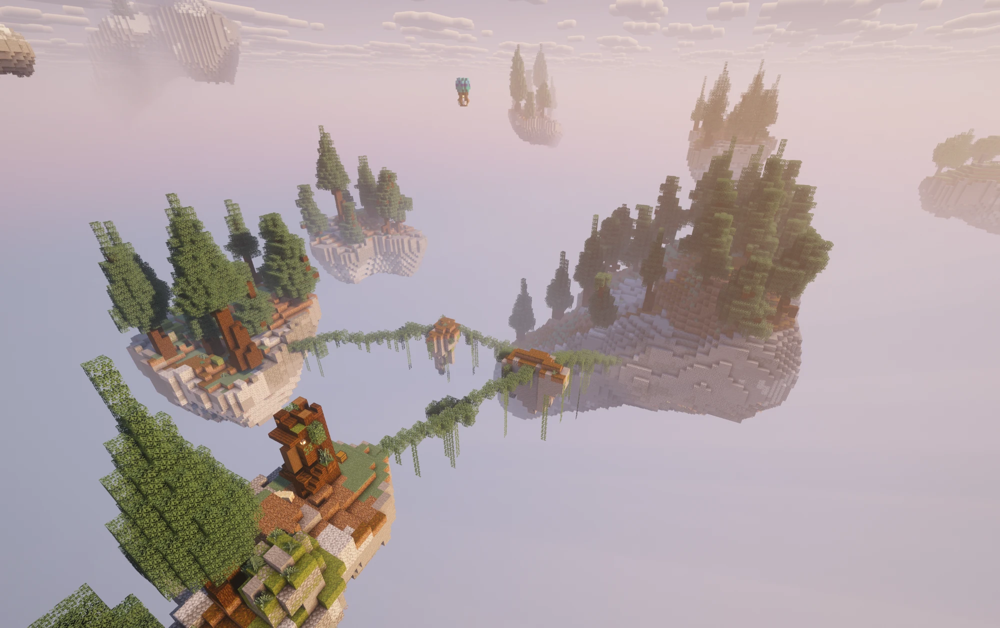
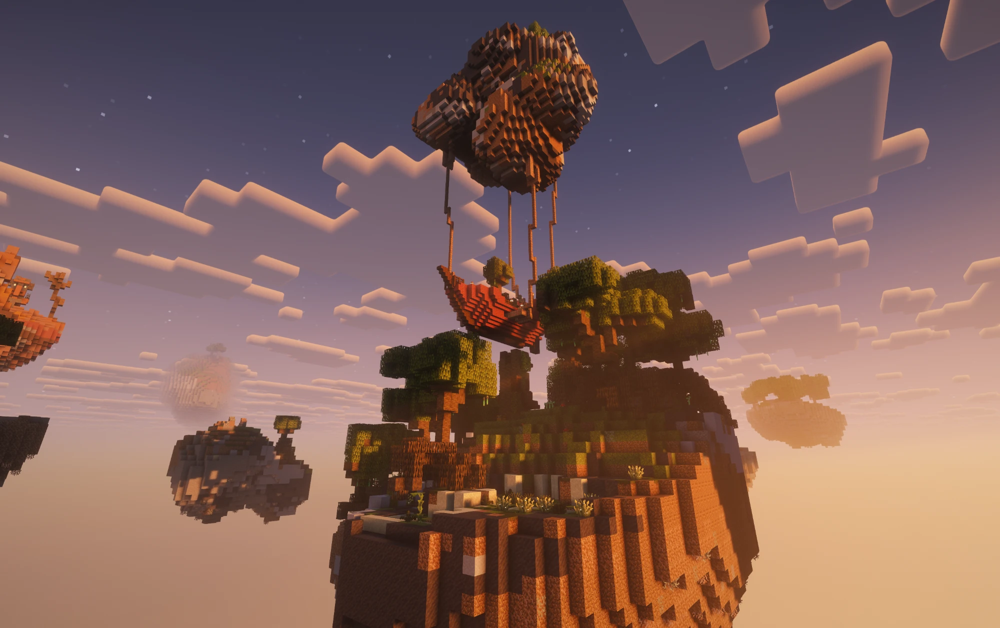
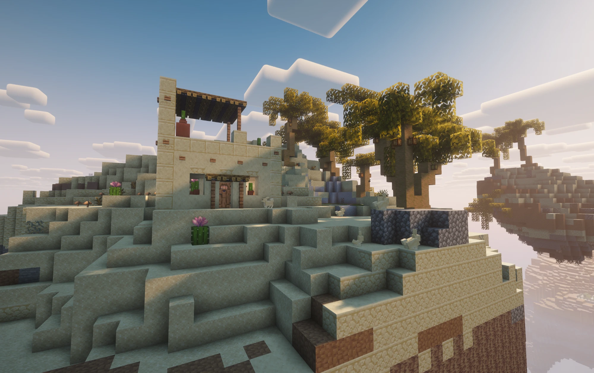
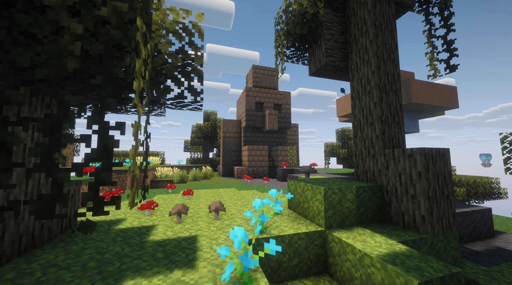

# The Island World

Your island has no fixed upgrade levels. Instead, **the world grows as you explore**: wherever you fly or build, new islands appear – with caves, ores, villages, ruins and residents.

<figure><figcaption>
A main island with its side islands, linked by vine staircases
</figcaption></figure>

## How the world is laid out

| What | How |
| ---- | --- |
| **Grid** | The world is divided into cells of **220 × 220 blocks**. Each cell has one **main island**, slightly offset and at different heights |
| **Side islands** | 2–3 small side islands lie around every main island |
| **Vine staircases** | A small **stepping-stone island** with a staircase of leaves and vines leads to the nearest side islands – you get across without building |
| **Gap fillers** | More small islands fill large gaps between the island groups |
| **Ships in the void** | Airships, balloons and planes hang between the groups |
| **Starting island** | In the middle, with four side islands about 100 blocks away. Your [first resident](residents.md) lives on one of them |

New islands appear **when you get close to them** – the ones in the direction you're looking first. Once something has been generated, it stays. Anyone who only [watches](travel.md) on someone else's island or shops there as a [customer](chestshop.md#as-a-customer-on-other-islands) doesn't make new islands appear there.

<figure><figcaption>
Balloons and airships hang between the islands
</figcaption></figure>

## Biome areas

Islands of the same biome lie in **areas** of about 3 × 3 cells – around 660 blocks across, usually about nine main islands. You fly through a desert area, then through a forest area.

* About **one island in three** is a patch of another of your biomes.
* The area around your starting island always has your **starting biome**.
* **Only biomes your island owns** are generated. You buy new ones in the [skill tree](skilltree.md).
* A freshly bought biome is **guaranteed to appear in the next new area**. After that it's down to chance – your **favourites** appear three times as often.
* An explored area keeps its biome, even if you buy new ones later.


**You find new biomes out there.** Biomes only appear in areas nobody has explored yet. So after buying one, fly in a direction you haven't been yet.


## What's on the islands

### Caves

Every **main island** has a cave system with one to three entrances from above: chambers on up to two levels, passages with loops, a large hall and sometimes a pool. Each chamber has its own style – lush, dripstone, ice, mushrooms, magma or plain rock. Rarely you'll find an **amethyst geode**. On the cave floor, most likely in such a geode, there's sometimes a **Budding Mana Amethyst** – see [Furnace Golem & Mana Geode](furnace-golem.md#the-mana-geode).

The caves are partly lit. Side islands, stepping-stone islands and the starting island have no cave.

### Ores

Ore lies in small **clusters** of one to four blocks throughout the rock, and on its own along the cave walls – where two ores touch at most diagonally. **The deeper, the more.** You can't see the clusters in the rock – you have to dig. No island shows any ore from the outside.

| Island | Ore, roughly |
| ------ | ------------ |
| Main island | around 330 ore blocks, about 11 of them diamonds and 90 iron ore; around 200 of them sit visibly on the cave walls |
| Side island | around 16 ore blocks |
| Starting island | none |

**Iron is as common as coal** – in every biome.

On top of that there's **Mana ore** with its pink veins – 4 to 14 blocks in the caves of every main island.


[economy.md](economy.md)


### Structures

With a bit of luck you'll find on an island:

* **Villages** – from a single house to a small town, with villagers
* **Ruins**
* Pillager **outposts**
* **Standalone buildings** away from the villages
* **Floating structures** above the island – about one main island in eleven has one
* **Portals** floating high above some main islands – see [Portals](#portals)

Side islands have at most one small structure. On top of that there are the houses and camps of the [AI residents](residents.md).

<figure><figcaption>
A village in the desert
</figcaption></figure>

<figure><figcaption>
An old statue in the forest
</figcaption></figure>

### Portals

**Portals** float above some main islands – in the game they're also called *gates*. There are three kinds: **Nether**, **Water** and **End**. Each portal stands on its own small island. For Nether and Water portals, that island's surface, rock and plants match the biome of the main island below.


**Still closed.** The portals don't do anything yet – they'll be unlocked later. You can't put Eyes of Ender into the frame of the End portal yet either. The [dungeon in the End portal](#the-dungeon-in-the-end-portal) is already playable, though.


* **How often:** In every square of 5 × 5 cells (1,100 × 1,100 blocks), one portal of each kind floats above a main island – about one main island in 25. Two portals never share an island, and there's none above the starting island.
* **How far:** The nearest portal of a kind is usually just a few hundred blocks away.
* **How high:** about 20 to 26 blocks above the main island, measured to the bottom of the portal's island. You get up there the same way as to any floating structure – with blocks or ender pearls.
* **Older portals:** Nether and Water portals used to stand down on the main island. The ones already there stay put – so in areas you've already explored, you'll find them on the ground too.
* **Mining:** You can mine and rebuild a portal like any other island block, according to the island's rights. Only the **vaults** in the End portal can't be mined – if you try, the chat tells you that the vault belongs to the gate. But neither the portal nor its island changes by itself: creepers don't blow any of it away, fire doesn't burn any of it, water doesn't freeze over, gravel and sand don't fall down, and endermen don't take anything. Whatever you change or build on it yourself is no longer protected by the portal.

### The dungeon in the End portal

The End portal holds **trial spawners** and **vaults**. They already work, even though the portal itself is still closed.

1. Get within **14 blocks** of one of the trial spawners – you don't need to see it. That starts a run of **1 to 5 waves**. A title announces each wave, such as "Wave 2 of 4", with its name below. From three waves on, the last one is a final wave such as "The Gate Warden".
2. After the last wave the **End Key** drops, along with some loot – the longer the run, the more. If you're not standing at the spawner, both drop at your feet.
3. The End Key opens one **vault**, in any End portal. Each vault opens once for you, and every End portal has its own. It also holds something from the biome of the island below.
4. With a bit of luck you'll find an **Ominous Bottle** in the loot or in the vault. Drink it and come back, and you'll have **Bad Omen**: more and stronger monsters come, and at the end the **Ominous End Key** drops for the ominous vault with the better loot.

* The trial spawners sit high up in the towers. You don't have to climb up: the monsters come to you, and so does your reward.
* If you play together, more monsters come. The loot is rolled anew for every player.
* Zombies and skeletons don't burn in daylight here.
* After giving its reward, a trial spawner rests for 30 minutes. With Bad Omen it starts again right away.
* If nobody is nearby for 5 minutes, the monsters disappear and the run starts over.
* There's also a normal spawner with silverfish at the portal frame. They don't count towards the wave.
* There are no raids on the islands – Bad Omen only has an effect here. A pillager captain also drops the Ominous Bottle.


**Lava in the courtyard.** There's lava in the courtyard of the End portal – watch where you fight.


### Loot

* **Every** container in a structure is filled the first time you open it – chests, barrels, decorated pots and shelves in houses.
* Some islands have **suspicious sand or gravel** on the surface, at most three per island. Use a brush to uncover the loot.
* The loot also includes [Warpett eggs](warpetts.md#warpett-eggs).

### Animals

Which animals live on an island depends on the biome – mooshrooms in the Mushroom Fields, horses and armadillos in the savanna, pandas in the Bamboo Jungle, goats in the mountains, frogs in the swamp.

* The bigger the island, the more animals: one per 250 walkable blocks, at most 16. A main island usually has three or four species.
* **Animals come back.** If an island near you has been eaten empty, it's full again after a few minutes.
* Predators and prey never live on the same island – an island with wolves has no sheep.

### Monsters

Monsters spawn in the dark as usual, but **far fewer** than in normal Minecraft: at most 15 at a time per player. Killed ones are replaced.


**Monster farm?** The farm shares the limit with the islands around it. Light up the islands nearby, otherwise the monsters spawn there instead of in your farm.


## The void

Below **height 0** you die instantly. You keep your inventory and levels and only lose a little Mana. You wake up in your bed – or on the deck of your airship if you don't have one.

## Related pages

* [Skill tree & biomes](skilltree.md)
* [Resources & farming](farming.md)
* [AI residents](residents.md)
* [Forestlings](forestlings.md)
* [Warpetts](warpetts.md)
