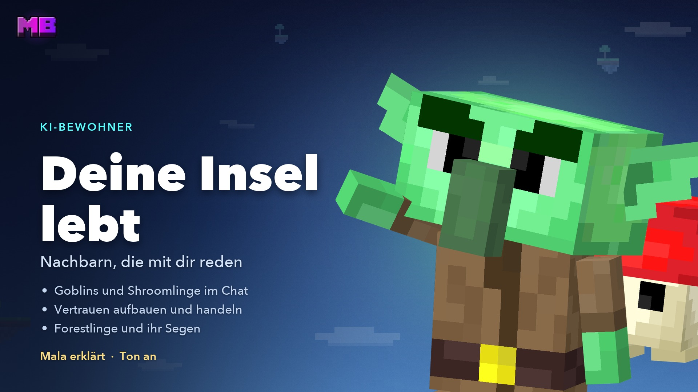

# KI-Bewohner

<figure><figcaption>
Das Video „Deine Insel lebt“ – Mala erklärt, Ton an
</figcaption></figure>


**Video: Deine Insel lebt** (1:22, mit Ton) – KI-Bewohner und Forestlinge, vorgestellt von Mala.



Das Video zeigt noch Preise in Mana. Seit dem 08.11.2026 handeln die Bewohner mit **Ruby** – wie, steht unter [Handeln](#handeln).


Auf den Inseln um dich herum wohnen **Goblins** und **Shroomlinge**. Sie bauen, ernten, schmieden, machen Pause, schlafen nachts – und reden mit dir im Chat.

Über ihrem Kopf steht ein kurzer Name mit **„(KI)“**, zum Beispiel *Pip (KI)*. Bewohner sind keine Spieler. Fragst du sie, ob sie echt sind, sagen sie dir ehrlich, dass sie KI-Bewohner sind.

## Wo du Bewohner triffst

| Wo | Was |
| -- | --- |
| **Begegnungsinsel** | Dein erster Bewohner wohnt auf einer kleinen Insel gleich neben deiner Startinsel. Die [Sonderquest](start.md#die-sonderquest-finde-den-ersten-bewohner) führt dich hin |
| **Einsiedler** | Wohnen allein in einem eigenen Haus auf Inseln, die du erkundest – weiter draußen etwas häufiger |
| **Siedlungen** | Eine Gruppe aus 1–5 Bewohnern. Sie beginnt als Zeltlager oder mit Hütte und Feld und wächst mit der Zeit zu einem kleinen Dorf |

Bewohner verlassen ihre Insel nie und lassen sich nicht mitnehmen. Mit `/bewohner` siehst du alle, die du schon kennst – mit Biom und Koordinaten.

## Was Bewohner tun

Jeder Bewohner hat einen Beruf – Bauer, Grubenarbeiter, Schmied, Händler oder Kundiger (bei den Shroomlingen heißen sie Pilzgärtner, Gräber, Töpfer, Händler und Sporenkundige). Am Posten hacken, ernten, hämmern oder graben sie, dazwischen sitzen sie, und nachts schlafen sie. Zu jeder Zeile im Chat machen sie einen kurzen Laut.

## Reden



#### Ansprechen

Ein Bewohner, den du noch nicht kennst, spricht dich von selbst an, wenn du ihm nahe kommst. Sonst klickst du ihn an (Bedrock: davor schleichen) oder schreibst seinen Namen in den Chat, etwa *„Pip, was machst du?“*.



#### Im Chat schreiben

Während des Gesprächs geht deine Chatzeile nur an den Bewohner. Du siehst sie grau als *Du → Pip: …*, seine Antwort als *Pip (KI): …* – beides nur bei dir.



#### An alle schreiben

Willst du trotzdem etwas in den normalen Chat schreiben, setze ein **`!`** an den Anfang – die Zeile geht dann an alle auf diesem Server, ohne das `!`. Ins ganze Netzwerk geht von ihrer Insel aus nichts, auch nicht mit `/g` – den [Globalchat](../ag/nachrichten.md#globalchat) erreichst du erst wieder, wenn du die Insel verlassen hast.



### Inselchat

Stehst du auf der Insel von Bewohnern, die du schon kennst, schreibst du ihnen **ohne Klick und ohne Namen** – dein Chat geht dann an sie, nicht an andere Spieler. Beim Betreten und Verlassen sagt dir eine Zeile im Chat Bescheid. Mit `!` vorn schreibst du an alle auf dem Server. In den [Globalchat](../ag/nachrichten.md#globalchat) geht von hier nichts, auch `/g` nicht – was andere im Netzwerk schreiben, siehst du aber weiter. Verlässt du die Insel, geht dein Chat wieder ins ganze Netzwerk.

Hast du den Inselchat in `/ki` ausgeschaltet oder kennst die Bewohner noch nicht, schreibst du dort wie überall, auch mit `/g`. Clan-Chat und `/msg` gehen immer.

### Was sie verstehen

* **Stichworte:** „handeln“, „aufgaben“, „auftrag“, „was gibt's“ und „tschüss“ öffnen das passende Menü oder beenden das Gespräch.
* **Fragen:** Bewohner antworten mit echten Spieldaten – was eine Ware kostet und wo es sie gibt, wann ihr handeln könnt, wie weit dein Auftrag ist, wo andere Siedlungen liegen, wie das Wetter wird. Sie erzählen auch von sich.
* Verstehen sie dich nicht, sagen sie es und schlagen dir zwei Fragen vor.

Ein Gespräch endet, wenn du weggehst, eine Weile nichts schreibst oder dich verabschiedest.

## Vertrauen

Je öfter du einen Bewohner besuchst, desto besser kennt er dich. Eine erreichte Stufe geht nie verloren.

| Stufe | Was dazukommt |
| ----- | ------------- |
| **Fremd** | Der Bewohner spricht dich an |
| **Bekannt** | Reden, sein Lager ansehen, **Proviant kaufen** – Essbares gegen Ruby |
| **Handelspartner** | Kaufen und verkaufen |
| **Offen** | Das ganze Lager, Tauschen, Aufgaben, Aufträge, Handel aus der Ferne über `/bewohner` |
| **Vertraut** | Persönliche Angebote, Quest tauschen |

* Ein Besuch zählt höchstens alle 20 Minuten – Dauerklicken hilft nicht.
* Scheue Bewohner brauchen ein paar Besuche mehr.
* Ab **Offen** bekommst du ab und zu ein kleines Geschenk.

## Handeln

Öffne den Handel mit „handeln“ im Chat oder über die **Lagerkiste** am Haus oder Marktstand – ein Klick darauf öffnet das Handelsmenü.

* Bewohner handeln mit **[Ruby](eco.md#ruby)** – beim Tauschen auch Ware gegen Ware, nie gegen Echtgeld. Was du bei Bewohnern kaufst, geht in die [Marktkasse](#die-marktkasse), und was du ihnen verkaufst, bezahlt dir diese Kasse.
* **Proviant schon beim ersten Treffen:** Essbares – Karotten, Kartoffeln, Melonenscheiben, Süßbeeren, Kabeljau und Lachs – kaufst du bei jedem Bewohner, den du kennst, sofort gegen Ruby. Bis *Offen* höchstens **64 Stück** je Essbarem, Bewohner und Tag. Nur kaufen: Verkaufen gibt es ab *Handelspartner*, Tauschen ab *Offen*.
* Was ein Bewohner an Proviant hat, hängt von seinem Biom ab – **Fisch gibt es immer**, auch bei Bewohnern, die selbst nichts Essbares herstellen. Sie fangen nebenbei Kabeljau. Brot kommt nur über **Aufträge**.
* **Verkaufen** bringt Ruby aus der Marktkasse bis zu einem Tageslimit: 3–4 Ruby je Bewohner, zusammen höchstens 10 Ruby am Tag. **Tauschen** geht auch danach weiter.
* **Aufgaben** (ab Offen): Gegen Ruby zeigt dir ein Bewohner zum Beispiel den Weg zu einem Biom, repariert dein Werkzeug oder sorgt 30 Minuten lang für Sonne oder Regen auf deiner Insel – höchstens 3 Aufgaben am Tag. Die Preise stehen weiter unten.
* **Aufträge** (ab Offen): Du bestellst Ware bei einem Bewohner – etwa *16 Brot backen* – und zahlst Ruby. Er stellt sie in der Zeit her, die er dir nennt. Verfällt ein Auftrag, bekommst du deine Ruby zurück.
* **Tauschgesuche:** Braucht ein Bewohner Ware, etwa 64 Bruchstein für den Brunnen, fragt er dich – und gibt dir dafür andere Ware.
* **Quest tauschen** (ab Vertraut) ist ein zweiter Weg zum [Überspringen](quests.md) einer Tagesquest und kostet dasselbe Mana.
* Deine Aufträge, Tauschgesuche und Lieferungen findest du unter `/auftraege`.
* Gehandelt wird nur im Überlebensmodus und nur in deiner eigenen Inselwelt.

### Die Marktkasse

Alle Ruby, die Spieler bei Bewohnern ausgeben, landen in der **Marktkasse** – einer einzigen Kasse für das ganze Netzwerk. Verkaufst du einem Bewohner Ware, zahlt dir diese Kasse Ruby aus. Bewohner geben also nur weiter, was Spieler vorher bei ihnen gelassen haben: Ruby entstehen beim Handel mit Bewohnern nicht aus dem Nichts.

| Grenze | Ruby am Tag |
| ------ | ----------: |
| Einkaufen – Ware, Aufträge und Aufgaben zusammen | höchstens 40 |
| Verkaufen an einen Bewohner | 3–4 |
| Verkaufen insgesamt | 10 |
| Alle Bewohner einer Insel kaufen zusammen an für | 10 |
| Die Kasse zahlt im ganzen Netzwerk aus | 10 % ihres Bestands |

* Die Kasse geht nie ins Minus. Am Tag zahlt sie höchstens 10 % dessen aus, was um 04:00 Uhr in ihr lag. Ruby für bezahlte, noch offene Aufträge zählen dabei nicht mit, weil sie vielleicht erstattet werden müssen.
* **Volle Kasse:** Liegt in der Kasse mehr, als Spieler im Schnitt in 14 Tagen einzahlen, steigen die drei Verkaufsgrenzen (je Bewohner, insgesamt und je Insel) mit – bis aufs Dreifache. Leert sie sich, sinken sie wieder.
* Hat die Kasse für heute alles ausgezahlt oder ist die Grenze erreicht, sagt dir der Bewohner Bescheid. **Tauschen** geht weiter, und am nächsten Tag gibt es wieder Ruby.
* Kann die Kasse gerade nicht zahlen, bekommst du deine Ware zurück. Was nicht ins Inventar passt, holst du unter `/auftraege` ab.
* Ist Ruby gerade nicht erreichbar, ruht der Handel, und es wird nichts gebucht.

### Preise und Lose

* **Kaufen:** Preise werden auf ganze Ruby **aufgerundet**, mindestens 1 Ruby. Damit nichts zu teuer wird, gibt es Ware in **Losen**, die etwa 1 Ruby kosten – höchstens einen Stapel.
* **Verkaufen:** Es gibt nur **ganze Ruby**. Der Bewohner nimmt so viele Stück, wie ganze Ruby bezahlen – den Rest behältst du. Reicht die Menge nicht für einen Ruby, sagt er dir, dass du mehr nehmen sollst. Bei sehr billiger Ware brauchst du dafür mehr als einen Stapel.


**Neue Konten** können Ruby erst nach einer kurzen Wartezeit ausgeben – 24 Stunden nach dem ersten Login und nach 20 Minuten Spielzeit (siehe [Ruby verschicken](eco.md#ruby-verschicken)). Bei Bewohnern darfst du in dieser Zeit trotzdem für bis zu **20 Ruby** mehr einkaufen, als du ihnen verkauft hast – genug für Proviant am ersten Tag.


### Preise für Aufgaben und Aufträge

| Was | Wer | Ruby |
| --- | --- | ---: |
| **Wegweiser** – eine Spur zur nächsten Insel eines Bioms, 10 Minuten nur für dich sichtbar | Kundige | 3 |
| **Biom-Kunde** – was ein Biom bietet, das deine Insel noch nicht hat | Kundige | 2 |
| **Spürnase** – findet ungeplünderte Truhen und Töpfe bis 96 Blöcke um dich, einmal am Tag | Kundige | 5 |
| **Wetter** – 30 Minuten klar oder Regen auf deiner Insel, nie Gewitter | Kundige | 4 |
| **Reparatur** – schlichtes Werkzeug ohne Verzauberung und Namen, je abgenutzter, desto teurer | Schmied | 3–8 |
| Zeitauftrag: 16 Brot | Bauer | 1 |
| Zeitauftrag: Angel | Bauer | 1 |
| Zeitauftrag: Eisenspitzhacke | Schmied | 2 |
| Zeitauftrag: Eimer | Schmied | 2 |
| Eigener Auftrag | | höchstens 40 |

Bei den Shroomlingen heißen Bauer, Schmied und Kundige Pilzgärtner, Töpfer und Sporenkundige.

## Befehle

| Befehl | Was er macht |
| ------ | ------------ |
| `/bewohner` | Alle Bewohner, die du kennst – mit Rolle, Biom, Koordinaten, Vertrauensstufe und was sie gerade tun. Ab *Offen* handelst du hier aus der Ferne |
| `/bewohner liste` | Dasselbe als Liste im Chat |
| `/ki` | Einstellen, was Bewohner bei dir dürfen: dich ansprechen, Szenen und Gerüchte, Laute, Chatgespräche – auch für einzelne Bewohner |
| `/ki aus` · `/ki an` | Ansprechen, Szenen und Chat auf einmal aus- oder einschalten. Anklicken geht weiterhin |
| `/ki melden` | Markiert deine Eingaben an Bewohner der letzten 30 Minuten zur Prüfung durch das Team |
| `/auftraege` | Aufträge, Tauschgesuche und Lieferungen – hier holst du auch Ware ab |

Diese Befehle gibt es nur auf den Inseln, nicht in der Lobby.

## Tablist

Unter den Spielern zeigt die Tablist einen Abschnitt **„Bewohner (KI)“** mit bis zu sechs Siedlungen oder Einsiedlern, mit denen du schon gesprochen hast – mit Biom und Koordinaten. Bewohner zählen nie als Spieler.


**Bedrock** zeigt diesen Abschnitt nicht an. Nutze dort `/bewohner`.


## Deine Daten

* Bewohner fragen nie nach Alter, Wohnort oder echtem Namen. Nennst du so etwas, raten sie dir, es für dich zu behalten.
* Gespeichert werden nur Zähler wie Begegnungen und Vertrauensstufe sowie dein Handel – nicht der Text deiner Gespräche.
* Was du auf einer Insel ohne Namen an die Bewohner schreibst, wird nicht protokolliert.
* Bei Sorgen verweisen Bewohner auf die Nummer gegen Kummer (116 111).


**Gib dich nicht als Bewohner aus.** „(KI)“ im Namen tragen nur Bewohner.


## Häufige Fragen

Warum kann ich noch nichts kaufen?

**Essbares kaufst du sofort**, sobald du einen Bewohner kennst. Alles andere geht erst nach ein paar Besuchen. Ein Besuch zählt höchstens alle 20 Minuten, und das ganze Lager gibt es frühestens am zweiten Tag, an dem du vorbeischaust.

Ist dein Konto neu, kaufst du in der Wartezeit für höchstens 20 Ruby mehr ein, als du verkauft hast. Und am Tag gibst du bei Bewohnern höchstens 40 Ruby aus.

Lesen andere Spieler mit, was ich auf der Insel schreibe?

Nein. Auf der Insel von Bewohnern, die du kennst, geht dein Chat nur an sie. Mit `!` vorn schreibst du an alle auf dem Server. In den [Globalchat](../ag/nachrichten.md#globalchat) kommst du erst wieder, wenn du die Insel verlassen hast.

Ein Bewohner spricht mich ständig an

Stell es mit `/ki` ab – für alle oder nur für einzelne Bewohner. `/ki aus` schaltet alles auf einmal aus.

Die Bewohner antworten nicht

Wenn die Bewohner gerade Pause machen, steht das im Chat. Das Team kann die Bewohner kurzzeitig abschalten, etwa für Wartungen.

## Verwandte Seiten

* [Forestlinge](forestlinge.md)
* [Erste Schritte](start.md)
* [Die Inselwelt](welt.md)
