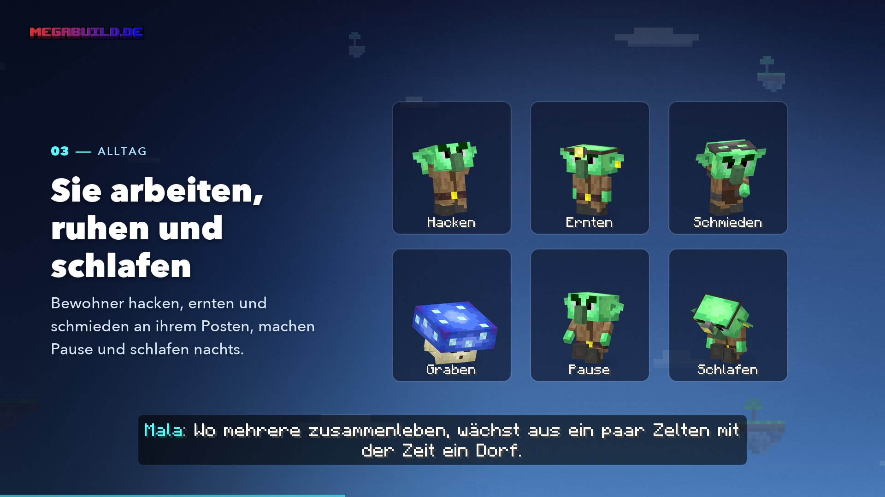

# KI-Bewohner

<figure><figcaption>
Aus dem Video „Deine Insel lebt“
</figcaption></figure>


**Video: Deine Insel lebt** (1:22, mit Ton) – KI-Bewohner und Forestlinge, vorgestellt von Mala.


Auf den Inseln um dich herum wohnen **Goblins** und **Shroomlinge**. Sie bauen, ernten, schmieden, machen Pause, schlafen nachts – und reden mit dir im Chat.

Über ihrem Kopf steht ein kurzer Name mit **„(KI)“**, zum Beispiel *Pip (KI)*. Bewohner sind keine Spieler. Fragst du sie, ob sie echt sind, sagen sie dir ehrlich, dass sie KI-Bewohner sind.

## Wo du Bewohner triffst

| Wo | Was |
| -- | --- |
| **Begegnungsinsel** | Dein erster Bewohner wohnt auf einer kleinen Insel gleich neben deiner Startinsel. Die [Sonderquest](start.md#die-sonderquest-finde-den-ersten-bewohner) führt dich hin |
| **Einsiedler** | Wohnen allein in einem eigenen Haus auf Inseln, die du erkundest – weiter draußen etwas häufiger |
| **Siedlungen** | Eine Gruppe aus 1–5 Bewohnern. Sie beginnt als Zeltlager oder mit Hütte und Feld und wächst mit der Zeit zu einem kleinen Dorf |

Bewohner verlassen ihre Insel nie und lassen sich nicht mitnehmen. Mit `/bewohner` siehst du alle, die du schon kennst – mit Biom und Koordinaten.

## Was Bewohner tun

Jeder Bewohner hat einen Beruf – Bauer, Grubenarbeiter, Schmied, Händler oder Kundiger (bei den Shroomlingen heißen sie Pilzgärtner, Gräber, Töpfer, Händler und Sporenkundige). Am Posten hacken, ernten, hämmern oder graben sie, dazwischen sitzen sie, und nachts schlafen sie. Zu jeder Zeile im Chat machen sie einen kurzen Laut.

## Reden



#### Ansprechen

Ein Bewohner, den du noch nicht kennst, spricht dich von selbst an, wenn du ihm nahe kommst. Sonst klickst du ihn an (Bedrock: davor schleichen) oder schreibst seinen Namen in den Chat, etwa *„Pip, was machst du?“*.



#### Im Chat schreiben

Während des Gesprächs geht deine Chatzeile nur an den Bewohner. Du siehst sie grau als *Du → Pip: …*, seine Antwort als *Pip (KI): …* – beides nur bei dir.



#### An alle schreiben

Willst du trotzdem etwas in den normalen Chat schreiben, setze ein **`!`** an den Anfang.



### Inselchat

Stehst du auf der Insel von Bewohnern, die du schon kennst, schreibst du ihnen **ohne Klick und ohne Namen** – dein Chat geht dann an sie, nicht an andere Spieler. Beim Betreten und Verlassen sagt dir eine Zeile im Chat Bescheid. Mit `!` vorn schreibst du an alle.

### Was sie verstehen

* **Stichworte:** „handeln“, „aufgaben“, „auftrag“, „was gibt's“ und „tschüss“ öffnen das passende Menü oder beenden das Gespräch.
* **Fragen:** Bewohner antworten mit echten Spieldaten – was eine Ware kostet und wo es sie gibt, wann ihr handeln könnt, wie weit dein Auftrag ist, wo andere Siedlungen liegen, wie das Wetter wird. Sie erzählen auch von sich.
* Verstehen sie dich nicht, sagen sie es und schlagen dir zwei Fragen vor.

Ein Gespräch endet, wenn du weggehst, eine Weile nichts schreibst oder dich verabschiedest.

## Vertrauen

Je öfter du einen Bewohner besuchst, desto besser kennt er dich. Eine erreichte Stufe geht nie verloren.

| Stufe | Was dazukommt |
| ----- | ------------- |
| **Fremd** | Der Bewohner spricht dich an |
| **Bekannt** | Reden, sein Lager ansehen |
| **Handelspartner** | Kaufen und verkaufen |
| **Offen** | Das ganze Lager, Tauschen, Aufgaben, Aufträge, Handel aus der Ferne über `/bewohner` |
| **Vertraut** | Persönliche Angebote, Quest tauschen |

* Ein Besuch zählt höchstens alle 20 Minuten – Dauerklicken hilft nicht.
* Scheue Bewohner brauchen ein paar Besuche mehr.
* Ab **Offen** bekommst du ab und zu ein kleines Geschenk.

## Handeln

Öffne den Handel mit „handeln“ im Chat oder über die **Lagerkiste** am Haus oder Marktstand – ein Klick darauf öffnet das Handelsmenü.

* Bezahlt wird mit **Mana oder Ware** – **nie mit Ruby oder Echtgeld**.
* **Verkaufen** bringt Mana bis zu einem Tageslimit: 30–40 Mana je Bewohner, zusammen höchstens 100 Mana am Tag. **Tauschen** geht auch danach weiter.
* **Aufgaben** (ab Offen): Gegen Mana zeigt dir ein Bewohner zum Beispiel den Weg zu einem Biom, repariert dein Werkzeug oder sorgt 30 Minuten lang für Sonne oder Regen auf deiner Insel.
* **Aufträge** (ab Offen): Du bestellst Ware bei einem Bewohner – etwa *16 Brot backen* – und zahlst Mana. Er stellt sie in der Zeit her, die er dir nennt.
* **Tauschgesuche:** Braucht ein Bewohner Ware, etwa 64 Bruchstein für den Brunnen, fragt er dich – und gibt dir dafür andere Ware.
* Deine Aufträge, Tauschgesuche und Lieferungen findest du unter `/auftraege`.
* Gehandelt wird nur im Überlebensmodus und nur in deiner eigenen Inselwelt.

## Befehle

| Befehl | Was er macht |
| ------ | ------------ |
| `/bewohner` | Alle Bewohner, die du kennst – mit Rolle, Biom, Koordinaten, Vertrauensstufe und was sie gerade tun. Ab *Offen* handelst du hier aus der Ferne |
| `/bewohner liste` | Dasselbe als Liste im Chat |
| `/ki` | Einstellen, was Bewohner bei dir dürfen: dich ansprechen, Szenen und Gerüchte, Laute, Chatgespräche – auch für einzelne Bewohner |
| `/ki aus` · `/ki an` | Ansprechen, Szenen und Chat auf einmal aus- oder einschalten. Anklicken geht weiterhin |
| `/ki melden` | Markiert deine Eingaben an Bewohner der letzten 30 Minuten zur Prüfung durch das Team |
| `/auftraege` | Aufträge, Tauschgesuche und Lieferungen – hier holst du auch Ware ab |

Diese Befehle gibt es nur auf den Inseln, nicht in der Lobby.

## Tablist

Unter den Spielern zeigt die Tablist einen Abschnitt **„Bewohner (KI)“** mit bis zu sechs Siedlungen oder Einsiedlern, mit denen du schon gesprochen hast – mit Biom und Koordinaten. Bewohner zählen nie als Spieler.


**Bedrock** zeigt diesen Abschnitt nicht an. Nutze dort `/bewohner`.


## Deine Daten

* Bewohner fragen nie nach Alter, Wohnort oder echtem Namen. Nennst du so etwas, raten sie dir, es für dich zu behalten.
* Gespeichert werden nur Zähler wie Begegnungen und Vertrauensstufe sowie dein Handel – nicht der Text deiner Gespräche.
* Was du auf einer Insel ohne Namen an die Bewohner schreibst, wird nicht protokolliert.
* Bei Sorgen verweisen Bewohner auf die Nummer gegen Kummer (116 111).


**Gib dich nicht als Bewohner aus.** „(KI)“ im Namen tragen nur Bewohner.


## Häufige Fragen

Warum kann ich noch nichts kaufen?

Handeln geht erst nach ein paar Besuchen. Ein Besuch zählt höchstens alle 20 Minuten, und das ganze Lager gibt es frühestens am zweiten Tag, an dem du vorbeischaust.

Lesen andere Spieler mit, was ich auf der Insel schreibe?

Nein. Auf der Insel von Bewohnern, die du kennst, geht dein Chat nur an sie. Mit `!` vorn schreibst du an alle.

Ein Bewohner spricht mich ständig an

Stell es mit `/ki` ab – für alle oder nur für einzelne Bewohner. `/ki aus` schaltet alles auf einmal aus.

Die Bewohner antworten nicht

Wenn die Bewohner gerade Pause machen, steht das im Chat. Das Team kann die Bewohner kurzzeitig abschalten, etwa für Wartungen.

## Verwandte Seiten

* [Forestlinge](forestlinge.md)
* [Erste Schritte](start.md)
* [Die Inselwelt](welt.md)
