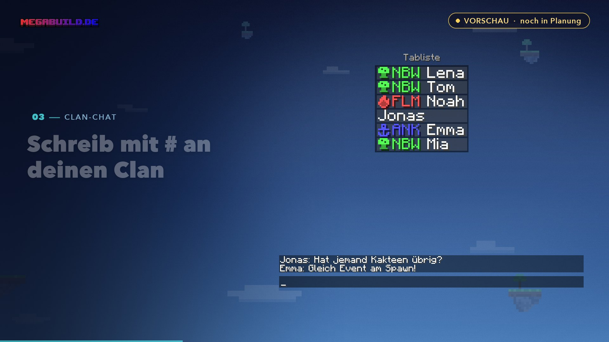

# Clans (Vorschau)


**Noch in Planung.** Clans gibt es auf dem Server noch nicht. Diese Seite zeigt den aktuellen Plan – Zahlen und Details können sich bis zum Start noch ändern.


<figure><figcaption>
Aus dem Video „Clans – ein erster Blick“
</figcaption></figure>


**Video: Clans – ein erster Blick** (1:11) – was das Clansystem bringen soll.


Auf MegaBuild.de hat jeder seine eigene Inselwelt auf einem eigenen Server. Clans sollen diese Welten verbinden: **gemeinsam spielen, gemeinsame Ziele und eine Insel für den ganzen Clan.**

## Was geplant ist

### Dein Clan, dein Wappen

Name, Kürzel, Farbe und Wappen suchst du selbst aus. Mit `/clan` geht es los. Das Kürzel steht in Chat und Tablist.

### Ein Menü für alles

Mitglieder, Clan-Quests, Clan-Insel, Chat und Einstellungen – übersichtlich an einem Ort.

### Clan-Chat überall

Mit `#` vorn schreibst du an deinen Clan – auf jedem Server, in der Lobby und auf den Inseln.

### Zusammen auf die Inseln

Ein Klick bringt dich auf die Insel eines Clan-Mitglieds – mit genau den Rechten, die der Besitzer dem Clan gibt. Dafür sollen Inseln feinere Rechte bekommen: Bauen, Kisten, Türen, Tiere und mehr.

### Der Wochenauftrag

Jede Woche drei Aufgaben und ein gemeinsamer Punkte-Topf. Jeder hilft dort, wo er gerade spielt – und wer seinen Anteil schafft, bekommt dafür Mana.

### Hilferuf

Hängst du an einer [Biomquest](skilltree.md#biomquests) fest? Ruf deinen Clan. Wer mit anpackt, bekommt Mana wie ein Inselmitglied.

### Zusammen aufsteigen

Jeder Wochenauftrag bringt dem Clan Erfahrung. **Zehn Clan-Stufen** schalten mehr Plätze, Wappen, das Clan-Banner und mehr frei.

### Die Clan-Insel

Ab einer höheren Clan-Stufe bekommt ihr eine **eigene Insel für den ganzen Clan** – mit eigenem Skilltree, Bewohnern und gemeinsamen Bauprojekten. Projekt für Projekt, ohne Zeitdruck.

## Fair für alle

Clans bringen gemeinsame Ziele, Kosmetik und Komfort – **keinen Vorsprung**:

| Geplant | Bewusst nicht |
| ------- | ------------- |
| Gemeinsame Quests | Keine Rabatte |
| Wappen, Banner, Titel | Kein Mana-Handel |
| Hilfe bei Biomquests | Keine Gratis-Items |
| Treffpunkt und Rundbrief | Nichts davon im Shop |

## Sag uns deine Meinung

Was hältst du davon? Was fehlt dir? Schreib es uns im [Discord](../ag/discord.md) – das Clansystem wird gerade geplant, und euer Feedback fließt direkt ein.

## Verwandte Seiten

* [Mitglieder & Rechte](mitglieder.md)
* [Freunde](../ag/freunde.md)
* [Discord](../ag/discord.md)
