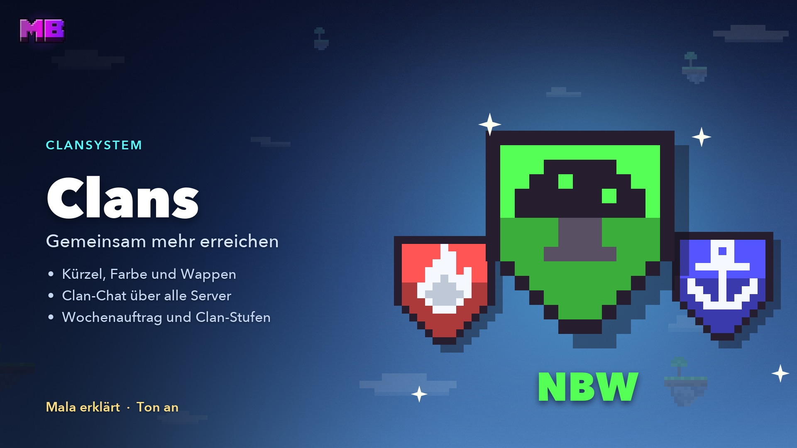

# Clans

Auf MegaBuild.de hat jeder seine eigene Inselwelt auf einem eigenen Server. Ein Clan verbindet diese Welten: **ein Chat über alle Server, Besuche auf den Inseln der anderen und jede Woche ein gemeinsames Ziel.**

<figure><figcaption>
Das Video „Clans – ein erster Blick“ – Mala erklärt, Ton an
</figcaption></figure>


**Video: Clans – ein erster Blick** (1:17, mit Ton) – Mala erklärt, was dein Clan dir bringt.


## Das Clan-Menü

`/clan` (auch `/clans`) öffnet das Clan-Menü. Du findest es auch unter `/sky` → **Freunde & Clan** – in der Lobby und auf jeder Insel – und in den Freunden (`/friend`) oben links.

Ohne Clan siehst du drei Wege: **Clan gründen**, die **Clan-Liste** und deine **Einladungen**.

## Einem Clan beitreten

Die Clan-Liste zeigt alle Clans im Netzwerk, sortiert nach Stufe, Aktivität oder Name. Ein Klick öffnet das Profil mit Wappen, Stufe, Mitgliedern und Beschreibung. Wie du hineinkommst, legt jeder Clan selbst fest:

| Beitrittsart | So kommst du rein |
| ------------ | ----------------- |
| **Offen** | **Beitreten** im Profil oder `/clan join <Kürzel>` – sofort, solange Platz ist |
| **Bewerbung** | **Bewerben** im Profil oder `/clan apply <Kürzel>` – ein Offizier nimmt dich auf |
| **Nur Einladung** | Ein Offizier lädt dich ein. Du nimmst mit einem Klick im Chat an oder mit `/clan accept` |

* **Ein Clan je Spieler.**
* Einladungen und Bewerbungen verfallen nach **7 Tagen**. Du kannst höchstens **3 Bewerbungen** gleichzeitig offen haben.
* Bist du offline, kommt die Einladung als Brief in deine Post.
* Wer einen Clan verlässt oder entfernt wird, kann **24 Stunden** keinem anderen beitreten.

## Einen Clan gründen

Du brauchst **5 Stunden Spielzeit** im Netzwerk und **500 Mana**.



#### Gründung starten

`/clan create` oder im Clan-Menü **Clan gründen**.



#### Name und Kürzel

Beides tippst du in den Chat. Jede Eingabe wartet **120 Sekunden**.



#### Farbe, Wappen und Beitrittsart

Du wählst eine der 14 Farben, eines der 12 Start-Wappen und, wer beitreten darf.



#### Bestätigen

Die Übersicht zeigt Name, Kürzel und Kosten. Mit **Ja** wird der Clan gegründet, und du bist sein **Anführer**.



| Merkmal | Regel |
| ------- | ----- |
| **Name** | 3–16 Zeichen: Buchstaben (auch ä, ö, ü, ß), Ziffern, Leerzeichen, Bindestrich |
| **Kürzel** | 2–4 Zeichen aus A–Z und 0–9, mindestens ein Buchstabe. Kürzel mit **MB** am Anfang sind gesperrt |
| **Farbe** | 14 Farben – alle Farbcodes außer Schwarz und Dunkelblau |
| **Wappen** | 12 zu Beginn, 4 weitere ab Stufe 2, 8 weitere ab Stufe 7 |

Name und Kürzel müssen frei sein und lassen sich höchstens **alle 30 Tage** ändern.


**Die 500 Mana sind weg.** Du bekommst sie nicht zurück, auch nicht, wenn du den Clan später auflöst.


## Rollen

| Rolle | Zeichen | Was sie darf |
| ----- | :-----: | ------------ |
| **Anführer** | ★ | Alles: Name, Kürzel, Farbe, Wappen, Clan-Banner, Beitrittsart, Offiziere ernennen, Leitung übergeben, auflösen |
| **Offizier** | ☆ | Einladen, Bewerbungen annehmen, Neulinge und Mitglieder entfernen, Neulinge befördern, Beschreibung, Clan-Nachricht, Rundbrief. Höchstens 5 je Clan |
| **Mitglied** | | Clan-Chat, Wochenauftrag, Hilferuf. Einladen, wenn der Anführer es erlaubt |
| **Neuling** | + | Die ersten **72 Stunden** nach dem Beitritt, danach wird er von selbst Mitglied |

* Niemand kann jemanden mit gleicher oder höherer Rolle entfernen.
* **Verlassen** geht jederzeit mit `/clan leave`. Der Anführer übergibt vorher die Leitung (`/clan transfer <Spieler>`) oder löst den Clan auf.
* **Abwesender Anführer:** Nach 30 Tagen ohne Einloggen übernimmt der dienstälteste Offizier, sonst das dienstälteste Mitglied.
* **Auflösen** darf nur der Anführer. Er bestätigt zweimal und tippt dabei den Clan-Namen ein. Name und Kürzel bleiben danach 30 Tage gesperrt.

## Clan-Chat

Der Clan-Chat erreicht jedes Mitglied auf jedem Server – in der Lobby, auf jeder Insel und im Citybuild.

| So schreibst du | Was passiert |
| --------------- | ------------ |
| `/c <Text>` | Eine Zeile an deinen Clan |
| `/c` | Schaltet um: Jede Chatzeile geht an den Clan, bis du zurückschaltest |
| `#` vor der Nachricht | Abkürzung für eine Zeile – praktisch auf Bedrock |

Für den Clan-Chat gelten derselbe Filter und dieselben Stummschaltungen wie im öffentlichen Chat.

### Kürzel und Wappen

Dein **Kürzel** steht in Clanfarbe vor deinem Namen – in der Tablist, im Chat und über deinem Kopf. Mit der Clan-Stufe wächst es mit:

* **ab Stufe 5** mit dem Wappen als kleinem Zeichen davor,
* **ab Stufe 9** fett,
* **auf Stufe 10** mit goldenem Zeichen.

Im öffentlichen Chat steht nur das farbige Kürzel.

## Zusammen auf die Inseln

* **Besuchen:** In der Mitgliederliste des Clans ein Linksklick, oder `/clan visit <Name>` bzw. `/sky visit <Name>` – auch aus der Lobby.
* **Zurück:** `/clan home` oder `/sky` → **Zur eigenen Insel**.
* **Was du dort darfst,** stellt der Besitzer mit dem [Clan-Zugang](mitglieder.md#clan-und-freunde) ein: niemand, Besucher, Helfer oder Mitbauer. Neulinge kommen höchstens als Besucher.
* **Dein Inventar reist mit.** Was du auf einer anderen Insel findest, nimmst du mit nach Hause. Endertruhe und Level bleiben auf jeder Insel für sich.
* **Treffpunkt:** `/clan meet` lädt deinen Clan mit einem Klick auf die Insel, auf der du gerade stehst. Hinein kommt nur, wer dort Zugang hat.

Wer den Clan verlässt, verliert den Clan-Zugang sofort und wechselt in die Lobby.

## Der Wochenauftrag

Jeden **Montag um 4 Uhr** bekommt dein Clan drei Aufgaben aus verschiedenen Gruppen. Alles, was ihr dafür tut, landet in **einem gemeinsamen Topf aus Punkten** – egal, wer gerade was spielt.

| Gruppe | Mögliche Aufgaben |
| ------ | ----------------- |
| **Erde** | Erze abbauen, Holz fällen |
| **Natur** | Ernten, Angeln, Tiere züchten |
| **Abenteuer** | Monster besiegen, Frische Truhen öffnen, Mit Bewohnern sprechen |
| **Gemeinschaft** | Tagesquests schaffen, Biomquests schaffen |

Es zählt auf **jeder Sky-Insel** – deiner eigenen und der eines anderen –, nicht im Citybuild. Es gelten dieselben Regeln wie bei den [Quests](quests.md): nur im Überlebensmodus, selbst gesetzte Blöcke zählen nicht, wer AFK ist, zählt nicht.

### Bronze, Silber, Gold

Das Ziel wächst mit dem Clan: Gerechnet wird je **aktivem Mitglied**, mindestens mit 3. Aktiv ist, wer sich in den letzten 14 Tagen eingeloggt hat und kein Neuling mehr ist.

| Stufe | Punkte je aktivem Mitglied | Mana für dich | Erfahrung für den Clan |
| ----- | -------------------------: | ------------: | ---------------------: |
| **Bronze** | 100 | 30 | 100 |
| **Silber** | 200 | 50 | 150 |
| **Gold** | 300 | 70 | 250 |

**Mana bekommst du,** wenn du mindestens **die Hälfte deines Anteils** beigetragen hast – 50 Punkte für Bronze, 100 für Silber, 150 für Gold – und beim Erreichen der Stufe schon **24 Stunden** im Clan bist. Das sind bis zu **150 Mana in der Woche**. Bist du offline, kommt das Mana beim nächsten Mal.


**Beispiel:** Dein Clan hat 3 aktive Mitglieder, also braucht Bronze 300 Punkte. Ein Fisch bringt 5 Punkte, ein Monster 2,5. Wer 50 Punkte beigetragen hat, bekommt bei Bronze 30 Mana.


* **Zusammen-Bonus:** Spielt ein zweites Clanmitglied auf demselben Server und seid ihr beide nicht AFK, zählen eure Beiträge **anderthalbfach**.
* **Joker:** Ab Stufe 3 darf der Anführer einmal je Woche eine Aufgabe tauschen, solange dafür noch nichts gezählt hat.
* **Im HUD anheften:** Im Menü des Wochenauftrags heftest du den Stand an deine Anzeige auf den Inseln.
* Jede Stufe bekommst du je Woche nur einmal, auch wenn du den Clan wechselst.

## Hilferuf

Hängst du an einer [Biomquest](skilltree.md#biomquests) fest? Ruf deinen Clan.

* **Rufen:** im Quest-Menü (`/quest`) oder im Skilltree bei einer laufenden Biomquest mit **Clan um Hilfe bitten**. Rufen darf jedes Mitglied (kein Neuling) mit dem Recht **Skilltree** auf der Insel.
* **Dauer:** 3 Stunden oder bis die Quest geschafft ist. Danach gibt es auf derselben Insel 10 Minuten lang keinen neuen Ruf.
* **Helfen:** Im Clan-Chat steht der Ruf mit **[Besuchen]** zum Anklicken. Ein Pfeil im HUD zeigt dir den Weg zur nächsten Insel des Bioms.
* **Recht auf Zeit:** Solange der Ruf gilt, dürfen Clanmitglieder auf der Insel genau das tun, was die Quest zählt – auch wenn der Clan-Zugang niedriger ist. Abbauen dürfen sie dabei nur natürliche Blöcke, nichts Gebautes.
* **Lohn:** Ist die Quest geschafft, bekommen Helfer **25 Mana** wie Inselmitglieder. Dafür brauchst du mindestens ein Zehntel der Menge, 24 Stunden im Clan, und es gibt den Lohn höchstens **viermal je Woche**.

Wer nur über den Ruf auf die Insel kam, wechselt nach dem Ende in die Lobby. Neulinge helfen mit, bekommen aber weder das Recht auf Zeit noch den Zugang über den Ruf.

## Clan-Stufen

Erfahrung bekommt dein Clan **nur aus dem Wochenauftrag**, bis zu 500 je Woche. Stufen gehen nie verloren.

| Stufe | Erfahrung | Neu |
| ----: | --------: | --- |
| 1 | 0 | 10 Plätze, Clan-Chat, Kürzel und Farbe, 12 Wappen, Besuche, Wochenauftrag, Hilferuf, Zusammen-Bonus, Treffpunkt |
| 2 | 300 | Clan-Nachricht beim Einloggen, 4 Wappen mehr, Rundbrief, Gruppensprung |
| 3 | 800 | 15 Plätze, Joker, Clan-Banner |
| 4 | 1 500 | Clan-Insel\*, Projekt Ankunftsplatz\* |
| 5 | 2 400 | 20 Plätze, Wappen-Zeichen in Tablist und Chat, Projekt Hain\* |
| 6 | 3 500 | Clan-Segen, Projekt Clanhaus\* |
| 7 | 5 000 | 25 Plätze, 8 Wappen mehr, Projekt Blumentor\* |
| 8 | 7 000 | Flugspur, Projekt Herberge\* |
| 9 | 9 500 | Glanz auf dem Wappen, Kürzel fett, Projekt Ehrenhalle\* |
| 10 | 12 500 | Titel „Legendär“, goldenes Wappen-Zeichen |

\* kommt mit der Clan-Insel, siehe [Kommt bald](#kommt-bald).

Mit Gold in jeder Woche erreicht ihr Stufe 4 nach 3 Wochen und Stufe 10 nach 25. Im Menü zeigt **Stufen und Vorteile**, was jede Stufe bringt.

## Vorteile im Alltag

| Vorteil | ab Stufe | Was er bringt |
| ------- | -------: | ------------- |
| **Treffpunkt** | 1 | `/clan meet` lädt den Clan auf deine Insel |
| **Rundbrief** | 2 | Offiziere schreiben einen Brief an alle Mitglieder, höchstens einen am Tag |
| **Gruppensprung** | 2 | Kaufst du bei einem [Forestling](forestlinge.md) den Kirschblütensprung oder das Schattenportal, springen Clanmitglieder im Umkreis von 8 Blöcken mit, wenn sie zustimmen. Du zahlst für jeden Springer. Auf Bedrock stimmst du mit `/sky groupjump <Kennwort>` zu |
| **Clan-Banner** | 3 | Der Anführer meldet ein Banner an. Mitglieder prägen das Muster im Menü auf ein eigenes leeres Banner, mit einem Farbstoff je Schicht. Ein Rechtsklick auf ein gesetztes Clan-Banner zeigt das Clan-Profil |
| **Clan-Segen** | 6 | Am Wochenende (Samstag 4 Uhr bis Montag 4 Uhr) **10 % mehr Mana** aus [Aktionen](eco.md#durch-aktionen). Das Tageslimit bleibt |
| **Flugspur** | 8 | Funken in Clanfarbe, wenn du mit Elytren gleitest. Abschalten kannst du sie unter **Meine Meldungen** |

Unter **Meine Meldungen** im Clan-Menü stellst du auch ein, ob du Meldungen bekommst, wenn Mitglieder online kommen, um Hilfe rufen oder zum Treffpunkt einladen.

## Bestenliste und Saison

* **Bestenliste:** nach Woche, Saison oder Stufe. **Clan der Woche** wird unter allen Clans mit Gold der mit der höchsten Beteiligung.
* **Saison:** ein Kalendermonat. Die drei besten Clans bekommen Glanz auf ihr Wappen und den Titel **Saisonsieger**, **Saisonzweiter** oder **Saisondritter** bis zum Ende der nächsten Saison.
* **Saison-Abzeichen:** Jeder Clan mit mindestens drei Gold-Wochen im Monat bekommt das Abzeichen in seine Chronik.
* In der Lobby zeigt ein Hologramm die **Top-Clans**.

Weil die Ziele mit den aktiven Mitgliedern wachsen, hat ein großer Clan keinen Vorsprung.

## Meilensteine und Chronik

Meilensteine sind Ziele für ein ganzes Clanleben. Jede Stufe ist ein Abzeichen im Profil. Mit Gold bekommt ihr einen **Titel**, den der Anführer unter dem Clan-Namen zeigen kann.

| Meilenstein | Was zählt | Bronze · Silber · Gold |
| ----------- | --------- | ---------------------- |
| **Goldene Wochen** | Wochenaufträge mit Gold | 5 · 15 · 40 |
| **Weltenbauer** | Biome, die Mitglieder kaufen | 50 · 200 · 500 |
| **Helfende Hände** | Hilferufe, bei denen ein Mitglied Lohn bekam | 10 · 50 · 150 |
| **Freunde der Bewohner** | [Bewohner](bewohner.md), die einem Mitglied vertrauen | 5 · 25 · 75 |
| **Lehrmeister** | Neue Spieler, die nach 30 Tagen noch im Clan sind und 10 Stunden gespielt haben | 3 · 10 · 25 |
| **Baumeister** | Fertige Clan-Projekte – kommt mit der Clan-Insel | 1 · 3 · 6 |

Die **Chronik** im Clan-Profil hält fest, wann ihr gegründet wurdet, Stufen erreicht, Meilensteine geschafft und Saison-Plätze geholt habt.

## Clan-Erfolge

Im Erfolgs-Tab gibt es eigene [Erfolge](erfolge.md#clan) für Clans – zum Beispiel **Gemeinsam stark** für deinen ersten Clan und **Bronze**, **Silber** und **Gold** für den ersten Wochenauftrag mit dieser Stufe. Verdienst du einen, während du offline bist, bekommst du ihn beim nächsten Betreten einer Insel.

## Kommt bald


**Clan-Insel und Clan-Kasse sind schon eingebaut** und kommen, sobald sie einen eigenen Server haben. Bis dahin tragen sie im Menü ein Schloss.


* **Clan-Insel:** eine ganze Sky-Welt, die eurem Clan gehört – mit eigenem Skilltree, Biomquests und Bewohnern. Ab Stufe 4 mit 5 aktiven Mitgliedern. Dort baut ihr gemeinsam **sechs Clan-Projekte**: Ankunftsplatz, Hain, Clanhaus, Blumentor, Herberge und Ehrenhalle.
* **Clan-Kasse:** ein gemeinsames **Ruby**-Konto mit Protokoll. Mana kommt nie hinein.

## Fair für alle

Clans bringen gemeinsame Ziele, Kosmetik und Komfort – **keinen gekauften Vorsprung**:

| Clans bringen | Clans bringen bewusst nicht |
| ------------- | --------------------------- |
| Gemeinsame Ziele und bis zu 150 Mana je Woche | Keine Rabatte auf Biome, Bewohner oder Skips |
| Wappen, Banner, Titel | Keinen Mana-Handel zwischen Spielern |
| Hilfe bei Biomquests | Keine Gratis-Items |
| Treffpunkt, Rundbrief, Gruppensprung | Nichts davon im Shop |

Ein Rang ändert an den Clan-Vorteilen nichts.

## Alle Befehle

| Befehl | Was er tut |
| ------ | ---------- |
| `/clan` | Clan-Menü öffnen |
| `/clan create` | Clan gründen |
| `/clan list` | Clan-Liste |
| `/clan info [Kürzel oder Spieler]` | Clan-Profil, ohne Angabe dein eigenes |
| `/clan join <Kürzel>` | Einem offenen Clan beitreten |
| `/clan apply <Kürzel>` | Dich bei einem Clan bewerben |
| `/clan accept [Kürzel]`, `/clan deny [Kürzel]` | Einladung annehmen oder ablehnen |
| `/clan invite <Spieler>` | Spieler einladen |
| `/clan members` | Mitglieder |
| `/clan kick`, `promote`, `demote <Spieler>` | Entfernen, befördern, zurückstufen |
| `/clan transfer <Spieler>` | Leitung übergeben |
| `/clan leave` | Clan verlassen |
| `/clan disband` | Clan auflösen |
| `/clan week`, `/clan calls` | Wochenauftrag, Hilferufe |
| `/clan settings`, `/clan notify` | Clan-Einstellungen, Meine Meldungen |
| `/clan visit <Spieler>` | Auf die Insel eines Spielers |
| `/clan home` | Zur eigenen Insel |
| `/clan meet` | Clan zum Treffpunkt einladen |
| `/c [Text]` | Clan-Chat |
| `/clan help` | Hilfe |

## Verwandte Seiten

* [Mitglieder & Rechte](mitglieder.md)
* [Freunde](../ag/freunde.md)
* [Quests](quests.md)
* [Skilltree & Biome](skilltree.md)
* [Erfolge](erfolge.md)
* [Discord](../ag/discord.md)
