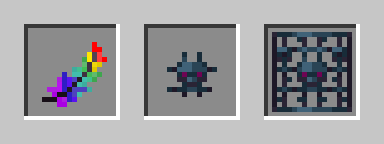
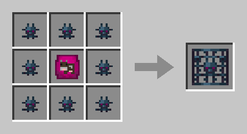

# Feder der Sanftheit


**Kommt bald.** Die Feder der Sanftheit ist noch nicht im Spiel – finden oder craften kannst du sie noch nicht. Wie du sie bekommst, folgt. Was hier steht, kann sich bis dahin noch ändern.


Mit der **Feder der Sanftheit** baust du **Spawner** ab. Aus einem normalen Spawner werden **Spawner-Fragmente**, und aus Fragmenten und einer gefüllten [Mobplate](mobplates.md) entsteht dein eigener **Spawner mit dem Mob dieser Plate** – zum Beispiel für Kühe, Schafe, Zombies oder Spinnen.

<figure><figcaption>
Feder der Sanftheit, Spawner-Fragment und Mob-Spawner
</figcaption></figure>

## Die Feder

* **16 Einsätze.** Wie viele noch übrig sind, steht in der Beschreibung der Feder. Nach jedem Abbau zeigt es dir auch die Aktionsleiste.
* **Jeder Abbau, der etwas ergibt, kostet einen Einsatz.** Alle anderen Blöcke baust du mit ihr ab wie mit der leeren Hand, das kostet nichts.
* **Beim letzten Einsatz zerfällt sie.**
* **Reparieren geht nicht** – weder in der Werkbank noch am Amboss.
* Federn **stapeln nicht**, weil jede ihre eigenen Einsätze zählt.

## Was die Feder abbaut

Mit der Feder in der Hand ist ein Spawner **sofort** abgebaut.

| Block | Ohne Feder | Mit Feder |
| ----- | ---------- | --------- |
| **Normaler Spawner** | wie gewohnt, nur Erfahrung | **4 Spawner-Fragmente** und Erfahrung |
| **Spawner aus einer Mobplate** | bleibt stehen | du bekommst ihn **zurück**, aber keine Fragmente |
| **Prüfungsspawner** | lässt sich nicht abbauen | lässt sich auch mit der Feder nicht abbauen |
| Alles andere | wie gewohnt | wie mit der leeren Hand, kostet keinen Einsatz |

* **Fragmente gibt es nur im Überlebensmodus** und nicht während des Vorspanns. Deinen Spawner aus einer Mobplate bekommst du dagegen überall zurück.
* Auf fremden Inseln brauchst du dafür das Recht **Bauen**. Wo du nicht abbauen darfst, kostet die Feder auch keinen Einsatz.


**Auch für den Mana-Amethyst:** Auf der Feder steht schon, dass sie den **Knospenden Mana-Amethyst** abbaut und daraus **kristallisiertes Mana** macht. Den Block findest du inzwischen am Boden der Höhlen auf den Hauptinseln – siehe [Furnace Golem & Mana-Geode](furnace-golem.md#die-mana-geode). Umsetzen kannst du ihn, sobald die Feder kommt; bis dahin bleibt er, wo er ist.


## Spawner aus Mobplates

### Rezept

**8 Spawner-Fragmente** um eine **gefüllte Mobplate** ergeben an der Werkbank einen **Mob-Spawner** mit dem Mob dieser Plate. Acht Fragmente sind zwei abgebaute normale Spawner.

<figure><figcaption>
Gefüllte Mobplate und 8 Spawner-Fragmente
</figcaption></figure>

* Welcher Mob darin steckt, steht in der **ersten Zeile der Beschreibung** des Spawners.
* Nicht jede Plate ergibt einen Spawner – die Liste steht [weiter unten](#welche-plates-einen-spawner-ergeben).
* Auch ältere Plates ohne Beschreibung passen ins Rezept.
* Das Rezept schaltet sich frei, sobald du ein Spawner-Fragment im Inventar hast.

### So arbeitet er

| | Spawner aus einer Mobplate | Normaler Spawner |
| --- | --- | --- |
| Mobs je Runde | **2** | 4 |
| Pause zwischen den Runden | **20–60 Sekunden** | 10–40 Sekunden |
| Pause, sobald so viele seiner Mobs um ihn stehen | **4** | 6 |
| Er läuft, wenn ein Spieler so nah ist | 16 Blöcke | 16 Blöcke |

Er schafft also **rund ein Drittel** eines normalen Spawners.

* **Abart:** Die Mobs kommen in der Abart der Plate – eine kalte Kuh bringt kalte Kühe, ein goldenes Kaninchen goldene.
* **Kein passender Boden nötig:** Kühe brauchen kein Gras, Mooshrooms kein Myzel.
* **Licht:** Tiere erscheinen bei jedem Licht. Monster erscheinen auch am Tag, aber nicht bei hellem Licht aus Fackeln oder Lampen.

### Höchstens 8 je Insel

Auf einer Insel stehen höchstens **8 Spawner aus Mobplates**, egal wem sie gehören. Normale Spawner zählen nicht mit. Ist die Grenze erreicht, kannst du keinen weiteren setzen.

### Schutz

* **Abbauen nur mit der Feder.** Dann bekommst du den Spawner mit seinem Mob zurück, aber **keine Fragmente**. Ohne Feder bleibt er stehen.
* **Explosionen** von Creepern, TNT, Betten und Seelenankern können ihm nichts. Auch **Wither und Endermen** verändern ihn nicht.
* **Spawn-Eier** ändern ihn nicht: Ein Kuh-Spawner bleibt ein Kuh-Spawner. Normale Spawner nehmen Spawn-Eier weiter an.

### Mobs aus dem Spawner

Mit Mobs aus dem Spawner bekommst du **kein Mana** und **keinen Quest-Fortschritt**, auch nicht in Biom- und Clan-Quests. Das gilt für:

* **Besiegen** – auch wenn sie sich vorher verwandeln, etwa ein Zombie, der im Wasser zum Ertrunkenen wird.
* **Scheren** von Schafen, Mooshrooms und Sumpfskeletten aus dem Spawner. Wolle und Pilze fallen aber wie gewohnt.
* **Züchten**, sobald ein Elternteil aus dem Spawner stammt. Der Nachwuchs zählt dann selbst als Spawner-Tier, auch über viele Generationen.

Küken aus geworfenen Eiern zählen ganz normal, auch wenn das Ei von einem Huhn aus dem Spawner stammt.

Außerdem:

* Trifft der Blitz ein Schwein aus dem Spawner, wird es zum Zombifizierten Piglin. Der lässt aber **nichts fallen**.
* Silberfischchen aus dem Spawner **kriechen nicht in Steine**.

## Welche Plates einen Spawner ergeben

Es sind **28 Plates von 16 Mobs**:

| Gruppe | Plates |
| ------ | ------ |
| Untote | Zombie, Wüstenzombie, Skelett, Eiswanderer, Sumpfskelett, Vertrockneter |
| Spinnen und Kleintier | Spinne, Höhlenspinne, Silberfischchen |
| Nutztiere | Kuh, Schwein und Huhn – je normal, kalt und warm –, Schaf, Kaninchen in 6 Farben |
| Besonderes | Mooshroom (rot und braun), Gürteltier |

### Warum nicht mehr?

Ein Spawner liefert ohne Ende Beute. Darum gibt es ihn nur für Mobs, deren Beute du auch sonst gut bekommst – Fleisch, Leder, Wolle, Federn, Knochen, Pfeile, Fäden und Spinnenaugen. Keinen Spawner ergeben zum Beispiel:

* **Seltene oder starke Beute:** Lohe, Wither-Skelett, Enderman, Ghast, Hexe
* **Massenware für Technik:** Schleim und Creeper – Creeper würden dazu die Insel sprengen
* **Gold:** Piglin, Piglin-Barbar, Zombifizierter Piglin, Hoglin
* **Überfälle:** Plünderer, Diener, Magier
* **Handel und Arbeit:** Dorfbewohner, Eisengolem, Schnüffler
* **Böe und Hilfsgeist**
* **Reittiere, Haustiere und Wassertiere** – etwa Pferd, Wolf, Katze, Biene, Ziege, Frosch, Axolotl und Tintenfisch
* das **Killerkaninchen**, weil es Spieler angreift
* die Plates von **Warpetts und Forestlingen**

Bossmobs haben gar keine Plate.

## Handel

* **Feder und Spawner-Fragmente** kannst du im [ChestShop](chestshop.md) handeln.
* **Spawner** – normale wie solche aus Mobplates – sind dort gesperrt.

## Verwandte Seiten

* [Mobplates](mobplates.md)
* [Mana-Items](mana-items.md)
* [Ressourcen & Farming](farming.md)
* [Mitglieder & Rechte](mitglieder.md)
* [ChestShops](chestshop.md)
