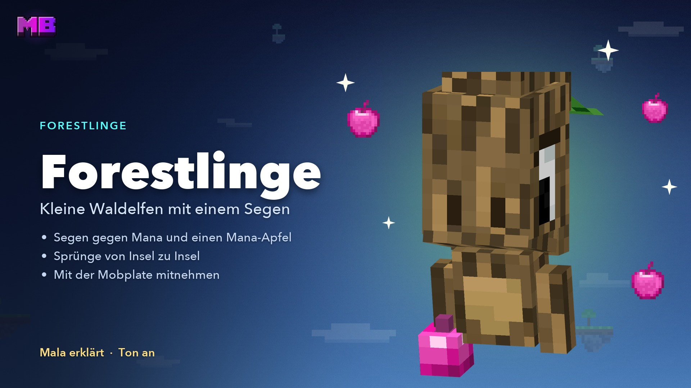

# Forestlinge

Forestlinge sind kleine, scheue **Waldelfen**. Sie ziehen von Insel zu Insel, dorthin, wo Bäume wachsen. Für etwas Mana schenken sie dir einen **Segen** – zum Beispiel einen gewaltigen Sprung über die Lücke zur nächsten Insel.

<figure><figcaption>
Das Video „Forestlinge“ – Mala erklärt, Ton an
</figcaption></figure>


**Video: Forestlinge** (1:34, mit Ton) – Mala zeigt dir, wie du mit dem Mana-Apfel einen Segen bekommst und einen Forestling mit der Mobplate mitnimmst.


Forestlinge sind keine [KI-Bewohner](bewohner.md): Sie tragen kein „(KI)“ und reagieren auf feste Stichworte.


Deinen ersten Forestling zeigt dir **Mala** auf der Begegnungsinsel. Er fliegt gleich davon – einer derselben Art wartet auf der nächsten Insel, die du in seiner Flugrichtung findest.


## Wo du sie findest

* Forestlinge tauchen auf vielen Inseln in deiner Nähe auf – welche Art, hängt vom Biom ab.
* Pro Insel lebt höchstens einer, und nach einem Erscheinen dauert es eine Weile bis zum nächsten.
* Nie auf deiner Startinsel und nie auf der Begegnungsinsel.

## Einen Segen bekommen

Für einen Segen brauchst du **Mana** und einen **[Mana-Apfel](eco.md#mana-kugeln)**. Den Apfel craftest du aus einem Apfel in der Mitte der Werkbank und **4 Mana-Kugeln** darum. Er bestätigt den Kauf – ein „ja“ im Chat reicht nicht mehr.



#### Ansprechen

Klicke den Forestling an (Rechtsklick oder Schlag). Auf **Bedrock** tippst du ihn an oder schleichst vor ihm.



#### Zuhören

Er stellt sich vor, nennt seinen Segen und fragt: *„Er kostet 20 Mana, du hast 57. Magst du ihn? Dann gib mir einen Mana-Apfel.“*



#### Mana-Apfel geben

Nimm den **Mana-Apfel in die Hand** und klicke den Forestling an. Er dankt dir, hält den Apfel in der Hand, und der Segen wirkt sofort. Das Mana wird dabei abgebucht.




**Du musst nicht warten:** Den Apfel kannst du jederzeit geben – mitten im Gespräch, während er sich noch vorstellt, oder ganz ohne Gespräch.


* Schreibst du „ja“ oder „ich nehm ihn“, bittet er dich um den Apfel. Hast du keinen dabei, erklärt er dir, wie du einen craftest.
* **Der Apfel geht nicht verloren:** Klappt der Kauf nicht – zu wenig Mana, falscher Spielmodus, sein Segen wirkt bei dir noch oder ein Forestling ohne Segen –, behältst du ihn. Scheitert es erst danach, bekommst du ihn zurück, notfalls als Paket beim nächsten Betreten.
* Der Forestling hält den Apfel bis zum Kauf und noch eine Minute danach in der Hand.
* Mit **wie geht das?** erklärt er seinen Segen, mit **erzähl** erzählt er dir eine Geschichte, mit **tschüss** beendest du das Gespräch.
* Solange ihr redet, liest nur er mit. Mit `!` vorn schreibst du an alle auf dem Server, mit `/g` in den [Globalchat](../ag/nachrichten.md#globalchat).
* Gehst du weg oder schreibst eine Weile nichts, endet das Gespräch.

## Alle Segen

| Forestling | Segen | Was er tut | Preis | Dauer |
| ---------- | ----- | ---------- | ----: | ----- |
| Eiche | **Himmelsprung** | Mit Anlauf springen: ein Riesensprung rund 60 Blöcke geradeaus. Ohne Anlauf sehr hohe Sprungkraft | 20 Mana | 120 s |
| Fichte | **Windlauf** | Viel schneller laufen. Rennst du über die Kante, trägt dich der Wind rund 75 Blöcke, dann landest du sanft | 20 Mana | 120 s |
| Birke | **Luftsprung** | Zweimal schnell springen: bis zu 3 Sprünge in der Luft, je rund 20 Blöcke, Landung ohne Schaden | 25 Mana | 120 s |
| Dschungel | **Rankenschwinger** | Zweimal schnell springen: eine Ranke zieht dich bis zu 64 Blöcke zum Block in deinem Blick, 4 Ranken. Gegen eine Wand laufen = hochlaufen | 25 Mana | 120 s |
| Akazie | **Wüstenwind** | Zweimal kurz hintereinander hüpfen: ein Satz rund 45 Blöcke in Blickrichtung, alle 2 s | 25 Mana | 120 s |
| Mangrove | **Wurzelbrücke** | Beim Gehen wächst eine 3 Blöcke breite Wurzelbrücke unter dir. Nach oben schauen und springen: Sie steigt | 30 Mana | 60 s |
| Blasseiche | **Geisterschritt** | Zweimal schnell springen: 8 s fliegen, rund 105 Blöcke, danach sanft landen. 2 Ladungen | 30 Mana | 120 s bereit |
| Bambus | **Bambuskatapult** | Zweimal schnell springen: rund 95 Blöcke weit nach vorn, Landung ohne Fallschaden. 2 Ladungen | 30 Mana | 120 s bereit |
| Kirsche | **Kirschblütensprung** | Bringt dich sofort zu einer zufälligen Insel, meist 100–300 Blöcke entfernt | 30 Mana | sofort |
| Schwarzeiche | **Schattenportal** | Bringt dich sofort zu einer zufälligen Insel, meist 300–500 Blöcke entfernt | 40 Mana | sofort |

* **Immer nur ein Segen.** Ein neuer ersetzt den laufenden – der Forestling sagt dir das vorher. Denselben Segen erneuerst du erst in seinen letzten 10 Sekunden.
* Segen wirken nur im **Überlebensmodus**.
* **Kein Rettungsschirm:** Luftsprung, Geisterschritt und Co. fangen nicht jeden Sturz ab, und die Wurzelbrücke wächst nur, solange du gehst – abwärts baut sie nicht.
* Die Inselsprünge landen nur auf Inseln, die es schon gibt. Liegt in der Spanne keine, springen sie etwas näher oder weiter (die halbe bis anderthalbfache Weite). Findet sich gar keine passende, wird nichts abgebucht.

## Forestlinge mitnehmen

### Mit der Mobplate

Klicke den Forestling mit einer **leeren [Mobplate](mobplates.md)** an – ohne Kampf, ohne Markieren. Er steckt dann in der Plate, und du nimmst ihn mit auf jede Insel.

* **Absetzen:** Rechtsklick mit der gefüllten Plate auf einen Block. Er braucht festen Boden und zwei freie Blöcke darüber, ins Wasser geht es nicht. **Wo du ihn absetzt, ist sein neues Zuhause.**
* Höchstens **6 Forestlinge** im Umkreis von 32 Blöcken. Geht es nicht, bleibt die Plate bei dir.
* Auf der Plate steht seine Art, etwa „Art: Eichen-Waldelf“. Gleiche Arten stapeln sich, verschiedene nicht. Im [ChestShop](chestshop.md) nennt das Schild die Art.
* Auf fremden Inseln brauchst du zum Einfangen und Absetzen das Recht **Tiere**.
* Nicht in die Plate: ein Forestling, der gerade deinen Apfel für einen Kauf hält, und der feste Forestling im Hain einer Clan-Insel.

### An der Leine

Nimm eine **Leine** in die Hand und klicke den Forestling an. Er folgt dir. **Wo du die Leine abnimmst, ist sein neues Zuhause.**

## Verwandte Seiten

* [KI-Bewohner](bewohner.md)
* [Mana & Ruby](eco.md)
* [Mobplates](mobplates.md)
* [Die Inselwelt](welt.md)
