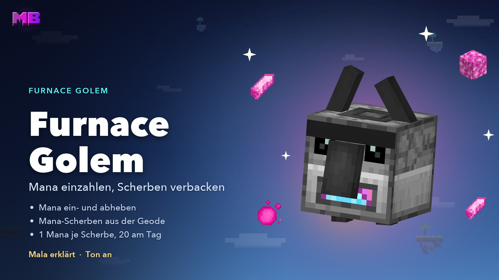
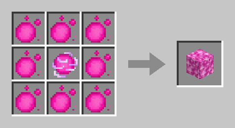
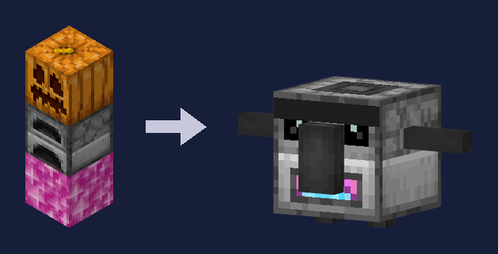
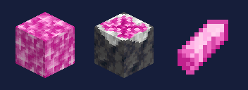

# Furnace Golem & Mana-Geode

Der **Furnace Golem** bringt dein Mana aufs Konto. Bei ihm zahlst du deine **Mana-Kugeln** und **Mana-Blöcke** ein, hebst Mana als Kugeln oder Blöcke wieder ab, und er verbackt **Mana-Scherben** aus der **Mana-Geode** zu Mana – auch wenn du offline bist. Du baust ihn dir selbst, so viele du willst.

<figure><figcaption>
Das Video „Furnace Golem“ – Mala erklärt, Ton an
</figcaption></figure>


**Video: Furnace Golem** (1:41, mit Ton) – Mala zeigt dir, wie du den Golem baust, Mana ein- und abhebst und Mana-Scherben verbackst.


| | |
| --- | --- |
| **Bauen** | Mana-Block, darauf ein Ofen, obendrauf ein geschnitzter Kürbis oder eine Kürbislaterne |
| **Einzahlen** | Mana-Kugeln (1 Mana) und Mana-Blöcke (17 Mana) |
| **Abheben** | Als Mana-Kugeln oder Mana-Blöcke, so viel ins Inventar passt |
| **Scherben** | **1 Mana** je Mana-Scherbe, 2 Minuten Arbeit je Scherbe |
| **Tageslimit** | **20 Scherben am Tag**, für alle deine Golems zusammen – neues Limit um 04:00 Uhr |

## Der Mana-Block

Der **Mana-Block** ist verdichtetes Mana und der Fuß jedes Furnace Golem. **8 Mana-Kugeln** um eine **Mana-Ladung** ergeben an der Werkbank einen Mana-Block – das sind **17 Mana**.

<figure><figcaption>
8 Mana-Kugeln um eine Mana-Ladung ergeben einen Mana-Block
</figcaption></figure>

* **Zurückcraften geht nicht.** Aus einem Mana-Block wird nur am Furnace Golem wieder etwas: Einzahlen bringt 17 Mana aufs Konto, und brauchst du Kugeln, hebst du sie dort ab.
* **Setzen** per Rechtsklick wie einen normalen Block. Auf fremden Inseln brauchst du das Recht **Bauen**.
* **Abbauen mit einer Spitzhacke** gibt dir den Block zurück. Mit der bloßen Hand ist er weg – und mit ihm 17 Mana.
* Explosionen lassen ihn stehen, Kolben schieben ihn mit.

## Den Golem bauen

Setz den **Mana-Block**, darauf einen **Ofen** und zum Schluss einen **geschnitzten Kürbis** oder eine **Kürbislaterne** als Kopf. Erst der Kopf baut den Golem: Die drei Blöcke zerfallen, und an ihrer Stelle steht der Furnace Golem. Er schaut dorthin, wohin das Kürbisgesicht geschaut hat.

<figure><figcaption>
Mana-Block, Ofen, Kürbis – und fertig ist der Furnace Golem
</figcaption></figure>

* **Nur im Überlebensmodus.** Auf fremden Inseln brauchst du das Recht **Bauen**, als Besucher geht es nicht.
* **Wer den Kopf setzt, ist der Erbauer.** Ihm gehört das Mana aus den Scherben.
* Was im Ofen lag, fällt heraus.
* **So viele Golems, wie du willst** – das Tageslimit für Scherben gilt für alle zusammen.
* Schlagen, verschieben oder wie einen Block abbauen lässt er sich nicht. Abgebaut wird er nur über sein Menü, siehe [Abbauen](#abbauen).


Der **Golem auf deinem Luftschiff** ist ein anderer: Er öffnet den [Skilltree](skilltree.md). Einen Furnace Golem baust du dir auf deiner Insel selbst.


## Das Menü

Ein **Rechtsklick** auf den Golem öffnet sein Menü, und er grüßt dich. Auf fremden Inseln brauchst du dafür das Recht **Behälter**, Besucher dürfen ihn nicht benutzen.

* **Oben:** dein Mana-Konto, wie viele Mana-Kugeln und Mana-Blöcke du dabeihast, wie viele Kugeln du selbst abgebaut und noch nicht eingezahlt hast und wie viele fremde Kugeln heute noch gehen.
* **Zweite Reihe – Einzahlen:** eine Kugel, einen Stapel, alle Kugeln, einen Mana-Block oder alle Mana-Blöcke.
* **Dritte Reihe – Abheben:** 1, 16 oder 64 Kugeln, 1 oder 8 Mana-Blöcke.
* **Unten:** die **Mana-Scherben** in den Truhen neben ihm, seine **Arbeit** – wer ihn gebaut hat, wie weit die Scherbe ist und warum er gerade Pause macht – und das **Tageslimit**. Dazu **Abbauen** und **Schließen**.

### Einzahlen

Eine Mana-Kugel ist **1 Mana**, ein Mana-Block **17 Mana**. Das Mana kommt sofort auf dein Konto, und der Golem freut sich mit dir.

* **Nur im Überlebensmodus.**
* **Selbst abgebaute Kugeln** zahlst du immer ganz ein, auch wenn du nur alle paar Tage vorbeikommst.
* **Fremde Kugeln** – von anderen Spielern – gehen bis **100 am Tag**. Ein Mana-Block zählt dabei 17. Was darüber liegt, bleibt in deinem Inventar, und eine Chatzeile sagt dir, wie viel und warum.
* Einen Befehl zum Einzahlen gibt es nicht – dafür gehst du zum Golem.


**Kugeln von früher:** Kugeln, die du vor dem 28.09.2026 abgebaut hast, zählen als fremde – davon gehen 100 am Tag. Alles, was du seitdem abgebaut hast, zahlst du ganz ein.


### Abheben

Mana von deinem Konto bekommst du hier als **Mana-Kugeln** (1, 16 oder 64) oder **Mana-Blöcke** (1 oder 8, je 17 Mana) zurück – zum Beispiel für einen neuen Golem oder um eine [Mobplate](mobplates.md) zu craften.

* **Nur im Überlebensmodus**, und nur so viel, wie in dein Inventar passt und dein Konto hergibt.
* Abheben hat **kein Tageslimit**.
* Abgehobene Kugeln und Blöcke zählen bei dir als **selbst abgebaut**: Zahlst du sie wieder ein, landen sie nicht im Limit für fremde Kugeln. Gibst du sie weiter, sind sie für den Empfänger fremde Kugeln.

## Die Mana-Geode

<figure><figcaption>
Mana-Block, Knospender Mana-Amethyst und Mana-Scherbe
</figcaption></figure>

Die **Mana-Scherben** für den Golem wachsen in den Höhlen der Hauptinseln – auf dem **Knospenden Mana-Amethyst**, ähnlich wie Amethyst auf Knospendem Amethyst.

* **Wo:** auf dem Boden der [Inselhöhlen](welt.md#was-auf-den-inseln-liegt), am ehesten in einer Amethystgeode. Höchstens zwei je Hauptinsel, im Schnitt etwa zwei auf drei Hauptinseln. Die Startinsel, Nebeninseln, Siedlungen und Trittinseln haben keinen.
* **Wachsen:** Auf ihm wächst nach oben ein **Mana-Kristall** in vier Stufen – klein, mittel, groß, ausgewachsen. Jede Stufe dauert im Schnitt **rund 10 Minuten**, eine Scherbe also etwa 40 Minuten. Er wächst nur, **solange die Insel geladen ist**, und nur, wenn der Block darüber frei ist.
* **Ernten:** Den Kristall baust du mit jedem Werkzeug oder der Hand gleich schnell ab. **Nur der ausgewachsene Kristall gibt eine Mana-Scherbe** – eine Knospe gibt nichts, lass sie wachsen. Danach wächst eine neue.
* Scherben gibt es nur im Überlebensmodus. Auf fremden Inseln brauchst du das Recht **Bauen**.


**Bau den Knospenden Mana-Amethyst nicht ab.** Er gibt nichts – und dann wächst dort auch nichts mehr. Kolben bewegen ihn nicht. Umsetzen lässt er sich später mit der [Feder der Sanftheit](feder.md) – die kommt bald.


## Scherben verbacken

Stell eine **Truhe**, eine **Redstone-Truhe** oder ein **Fass** waagerecht **direkt neben den Golem** und leg Mana-Scherben hinein.

1. Der Golem nimmt sich **eine Scherbe** aus der Truhe.
2. Er arbeitet **2 Minuten** daran – mit Flammen am Ofenmaul, Rauch aus dem Schornstein und rosa Mana-Staub.
3. Dann bekommt der **Erbauer 1 Mana** aufs Konto, auch wenn er gerade offline ist. Danach nimmt der Golem die nächste Scherbe.

* **Tageslimit: 20 Scherben** je Erbauer und Tag, über alle seine Golems und Inseln zusammen. Ist es voll, döst der Golem bis zum Tageswechsel um **04:00 Uhr**. Das Limit für Aktionen berührt das nicht.
* **Er arbeitet nur, solange die Insel geladen ist.** Ohne Scherbe oder ohne Truhe wartet er.
* Scherben hineinlegen darf jeder, der an die Truhe darf – das Mana geht immer an den Erbauer.
* Nicht als Scherbenkiste zählen Shop-Behälter, Clan-Projektkisten und eine Doppeltruhe, deren andere Hälfte nicht geladen oder gesperrt ist.

## Abbauen

Im Menü auf **Abbauen** klicken und bestätigen.

* Nur mit dem Recht **Bauen**, nicht als Besucher, und im Überlebens- oder Kreativmodus.
* Im Überlebensmodus bekommst du **Kopf, Ofen und Mana-Block** zurück. Eine Scherbe, an der er gerade arbeitet, fällt immer heraus.
* Rechnet er gerade eine Scherbe ab, versuch es einen Moment später noch einmal.
* An deinem Konto ändert das Abbauen nichts.

## Handel

* **Mana-Blöcke und Mana-Scherben** sind im [ChestShop](chestshop.md) gesperrt, genau wie Mana-Kugeln und Mana-Ladungen. Auch [KI-Bewohner](bewohner.md) kaufen sie nicht.
* In den Rucksack dürfen Mana-Blöcke, Mana-Scherben und der Knospende Mana-Amethyst nicht.

## Erfolg

| Erfolg | Wie |
| ------ | --- |
| **Aufs Konto** | Mana-Kugeln oder Mana-Blöcke beim Furnace Golem einzahlen |

Mehr dazu unter [Erfolge](erfolge.md).

## Verwandte Seiten

* [Mana & Ruby](eco.md)
* [Mana-Items](mana-items.md)
* [Die Inselwelt](welt.md)
* [Mitglieder & Rechte](mitglieder.md)
