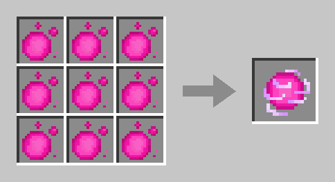
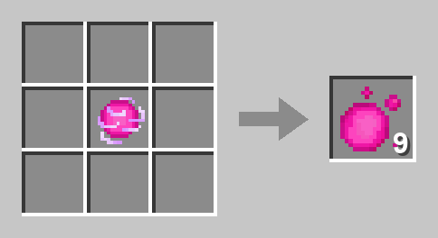
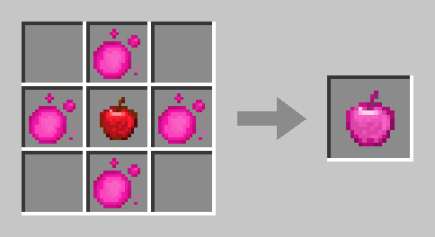

# Mana-Items

Aus [Mana-Erz](eco.md#mana-erz) bekommst du dein Mana nicht direkt aufs Konto, sondern als **Mana-Kugeln** ins Inventar. Aus den Kugeln craftest du an der Werkbank weitere Mana-Items.

<figure><figcaption>
Mana-Kugel, Mana-Ladung und Mana-Apfel
</figcaption></figure>

| Item | Woher | Wofür | Im ChestShop |
| ---- | ----- | ----- | ------------ |
| [Mana-Kugel](#mana-kugel) | Mana-Erz abbauen | Aufs Konto einzahlen, Zutat für alles andere | gesperrt |
| [Mana-Ladung](#mana-ladung) | 9 Kugeln | Kugeln platzsparend aufbewahren | gesperrt |
| [Mana-Apfel](#mana-apfel) | 4 Kugeln um einen Apfel | Segen der [Forestlinge](forestlinge.md) kaufen, markierte Mobs für die [Mobplate](mobplates.md) schwächen | handelbar |
| [Leere Mobplate](mobplates.md#leere-mobplate) | 8 Kugeln um eine Blasse Scherbe | Mobs einfangen | handelbar |

## Mana-Kugel

Eine **pinke, funkelnde Kugel**. Eine Kugel ist **ein Mana**, ein Stapel hält 64.

* **Woher:** Beim Abbau von [Mana-Erz](eco.md#mana-erz) fallen **3–5 Kugeln**, mit Glück III bis zu 20. Für das Erz gilt ein Tageslimit von 200 Mana.
* **Aufs Konto:** Eingezahlt werden die Kugeln beim **Ofen-Golem**. Dein Kontostand steigt erst dann.
* **Weitergeben:** Du kannst Kugeln anderen Spielern geben, etwa per Hand oder in einer Truhe. Selbst abgebaute Kugeln zahlst du immer ganz ein, **fremde Kugeln nur bis 100 am Tag**.
* Kugeln, Ladungen und der Mana-Apfel lassen sich nicht an [KI-Bewohner](bewohner.md) verkaufen.


**Den Ofen-Golem gibt es noch nicht.** Heb deine Mana-Kugeln bis dahin einfach auf – sie gehen nicht verloren.


## Mana-Ladung

**9 Mana-Kugeln** im ganzen Raster der Werkbank ergeben eine **Mana-Ladung**. So passen 576 Mana in einen Stapel statt 64.

<figure><figcaption>
9 Mana-Kugeln ergeben eine Mana-Ladung
</figcaption></figure>

Die Ladung lässt sich **jederzeit wieder zerlegen**: Leg sie allein ins Raster – das geht auch im Inventar – und du bekommst die 9 Kugeln zurück. Dabei geht kein Mana verloren und es entsteht auch keins.

<figure><figcaption>
Eine Mana-Ladung ergibt 9 Mana-Kugeln
</figcaption></figure>

## Mana-Apfel

**4 Mana-Kugeln** um einen gewöhnlichen **Apfel** ergeben einen **Mana-Apfel**. Die Ecken bleiben frei.

<figure><figcaption>
Apfel in der Mitte, 4 Mana-Kugeln darum
</figcaption></figure>

Essen kannst du ihn nicht. Er hat zwei Aufgaben:

### Segen der Forestlinge kaufen

Mit dem Mana-Apfel in der Hand klickst du einen [Forestling](forestlinge.md) an – auf Bedrock antippen oder vor ihm schleichen. Damit sagst du **Ja** zu seinem Segen. Das geht jederzeit, auch mitten im Gespräch. Er nimmt den Apfel, hält ihn eine Weile in der Hand und segnet dich.

* Der Segen kostet **zusätzlich seinen Mana-Preis** – der Apfel bestätigt nur den Kauf.
* Klappt der Kauf nicht, etwa weil dein Mana nicht reicht oder der Forestling keinen Segen hat, behältst du den Apfel. Geht erst danach etwas schief, bekommst du ihn zurück – bist du schon weg, als Paket beim nächsten Besuch auf einem Inselserver.

### Mobs für die Mobplate schwächen

Hast du einen Mob mit einer leeren [Mobplate](mobplates.md) markiert, nimmt ihm ein Rechtsklick mit dem Mana-Apfel die **Hälfte seiner Herzen**. Das geht einmal je Mob und nur bei deinem eigenen markierten Mob. Bei einem unmarkierten Mob bekommst du nur einen Hinweis und behältst den Apfel.

## Handel

* **Mana-Äpfel** kannst du im [ChestShop](chestshop.md) gegen Ruby kaufen und verkaufen.
* **Mana-Kugeln und Mana-Ladungen** sind im ChestShop **gesperrt**, auch in einer Shulkerkiste oder einem Bündel.
* Dein Mana-**Konto** lässt sich nie verschicken – nur Ruby geht mit `/pay`.

## Erfolge

| Erfolg | Wie |
| ------ | --- |
| **Verdichtet** | Eine Mana-Ladung craften |
| **Magische Frucht** | Einen Mana-Apfel craften |
| **Aufs Konto** | Mana-Kugeln beim Ofen-Golem einzahlen – *noch nicht erreichbar* |

Mehr dazu unter [Erfolge](erfolge.md).


**Rezeptbuch:** Die Rezepte schalten sich frei, sobald du eine Mana-Kugel oder Ladung im Inventar hast. Craften kannst du sie auch ohne Freischaltung.


## In Planung


**Noch nicht im Spiel.** Diese Mana-Items werden gerade gebaut. Was hier steht, kann sich bis zum Start noch ändern.


* **Mana-Block** – 8 Mana-Kugeln um eine Mana-Ladung, also 17 Mana. Er lässt sich wieder in 17 Kugeln zerlegen.
* **Knospender Mana-Amethyst** – selten in den Höhlen der Inseln. An ihm wachsen nach und nach **Mana-Kristalle**, ähnlich wie Amethystknospen.
* **Mana-Scherbe** – fällt, wenn du einen ausgewachsenen Mana-Kristall abbaust.
* **Ofen-Golem** – du baust ihn selbst aus einem Mana-Block, einem Ofen und einem geschnitzten Kürbis. Bei ihm zahlst du deine Kugeln ein, und er verwandelt Mana-Scherben aus einer Truhe oder einem Fass neben ihm in Mana für dein Konto.

## Verwandte Seiten

* [Mana & Ruby](eco.md)
* [Forestlinge](forestlinge.md)
* [Mobplates](mobplates.md)
* [ChestShops](chestshop.md)
