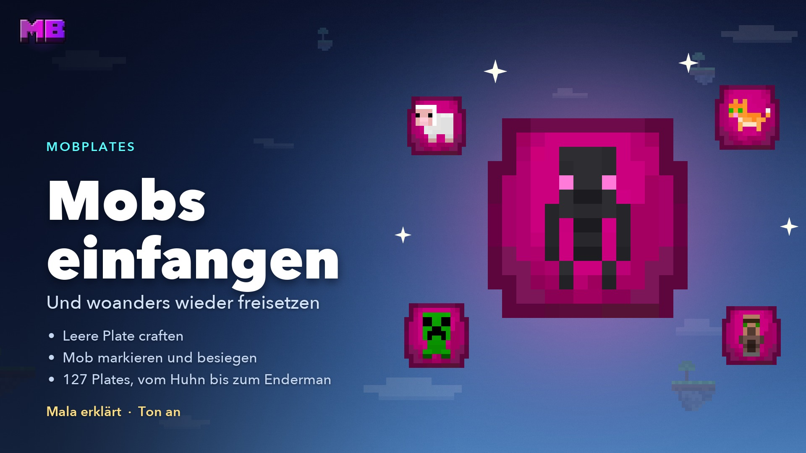
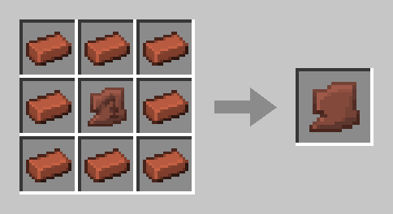
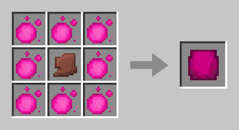
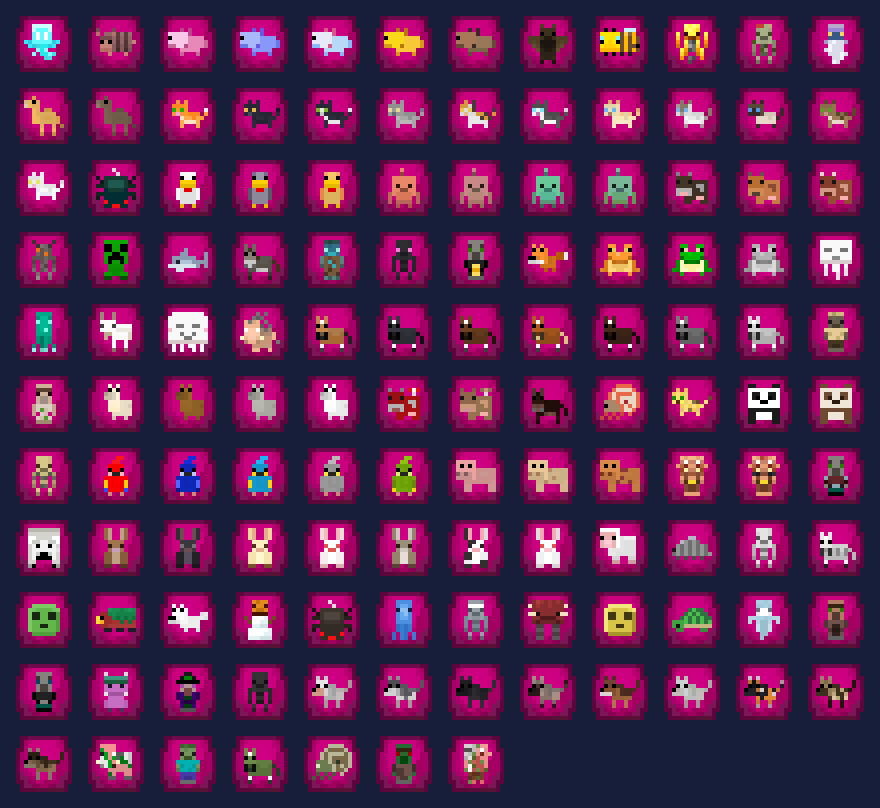

# Mobplates

Mit einer **Mobplate** fängst du einen Mob ein und setzt ihn woanders wieder frei – auf deiner Insel, auf einer anderen oder du verkaufst ihn im ChestShop. Es gibt **127 gefüllte Plates**, vom Huhn bis zum Enderman.

<figure><figcaption>
Das Video „Mobplates“ – Mala erklärt, Ton an
</figcaption></figure>


**Video: Mobplates** (1:56, mit Ton) – Mala zeigt dir, wie du Mobs einfängst und wieder freisetzt.


## Mobplate craften

Du craftest zuerst eine **Blasse Scherbe** und daraus die **leere Mobplate**, beides an der Werkbank.

### Blasse Scherbe

Eine beliebige **Töpferscherbe** in die Mitte, rundum **8 Ziegel**.

<figure><figcaption>
Töpferscherbe und 8 Ziegel
</figcaption></figure>

### Leere Mobplate

Die **Blasse Scherbe** in die Mitte, rundum **8 [Mana-Kugeln](eco.md#mana-kugeln)**.

<figure><figcaption>
Blasse Scherbe und 8 Mana-Kugeln
</figcaption></figure>

## Einen Mob einfangen



#### Markieren

**Rechtsklick** mit der leeren Plate auf einen Mob. Die Plate ist damit verbraucht, der Mob stößt pinke Partikel aus, und du hast **10 Minuten** Zeit.



#### Schwächen (freiwillig)

**Rechtsklick** mit einem [Mana-Apfel](eco.md#mana-kugeln) auf deinen markierten Mob. Er verliert die **Hälfte seiner Herzen** – aus 20 werden 10. Das geht einmal je Mob.



#### Töten

Tötest du den Mob, liegt die **gefüllte Plate direkt in deinem Inventar**. Die Beute fällt wie immer.



#### Freisetzen

**Rechtsklick** mit der gefüllten Plate auf einen Block oder auf Wasser, wie mit einem Spawn-Ei. Auf Truhen, Türen und andere Blöcke, die auf einen Klick reagieren, geht das nur beim **Schleichen**.



Die gefüllte Plate nimmst du wie dein ganzes Inventar mit auf andere Inseln.


**Dorfbewohner kommen ohne Kampf in die Plate:** Der erste Klick fängt sie. Der **Zombiedorfbewohner** muss wie jeder andere Mob getötet werden.


## Warpetts einsammeln

Auch ein aufgestelltes [Warpett](warpetts.md) kommt in die Plate, ohne Kampf und ohne Markierung – die **Blume reist mit**.

* **Einsammeln:** Klick mit der leeren Plate auf das Warpett. Auf Bedrock reicht wie sonst beim Warpett das Schleichen daneben, die Plate muss in der Haupthand sein.
* **Absetzen:** Rechtsklick auf einen Block, mit festem Boden und freiem Platz. Nicht in Wasser, Lava oder Feuer, nicht auf Kaktus oder Magma, nicht unter einer niedrigen Decke und nicht auf einem Ei. Das Warpett gehört sofort wieder zum Netz seiner Blume in dieser Welt, es frisst nichts und reist nicht los. Geht es dort nicht, bleibt die Plate bei dir.
* **Auf einer anderen Insel** verbindet es sich mit den Warpetts derselben Blume dort.
* **Blume:** Welche drinsteckt, steht auf der Plate. Warpetts ohne Blume kommen auch hinein und laufen nach dem Absetzen frei umher wie frisch geschlüpfte.
* **Im ChestShop:** Schild, Meldungen und Menü nennen die Blume, zum Beispiel „Warpett: Mohn“. Das Schild kürzt lange Namen.

Das Warpett auf dem Luftschiff und das auf der Startinsel bleiben stehen.

## Wenn es schiefgeht

Du bekommst die **leere Plate zurück**, wenn

* die 10 Minuten um sind,
* der Mob durch etwas anderes stirbt,
* er sich verwandelt – etwa ein Schwein, das vom Blitz getroffen wird –,
* oder er verschwindet.

Bist du gerade nicht da, fällt die Plate neben den Mob. Verlässt du nur die Insel, bleibt die Markierung bestehen.

Passt beim Freisetzen kein Mob an die Stelle, bleibt die Plate bei dir. Einen Mob kann immer nur ein Spieler markieren.

## Regeln

* **Keine Belohnung:** Freigesetzte Mobs zählen weder für [Mana](eco.md#was-kein-mana-gibt) noch für [Quests](quests.md).
* **Babys** ergeben die normale Plate, heraus kommt immer ein Erwachsener.
* **Fremde gezähmte Tiere** lassen sich nicht markieren. Auch [Bewohner](bewohner.md), [Forestlinge](forestlinge.md) und die Crew passen in keine Plate.
* **Handel:** Mana-Äpfel, leere und gefüllte Plates und die Blasse Scherbe kannst du im ChestShop handeln. Mana-Kugeln und Mana-Ladungen bleiben dort gesperrt. In den Rucksack dürfen Plates und Mana-Äpfel nicht.
* **Stapel:** Mobplates und Blasse Scherben stapeln auf 64. Warpett-Plates stapeln nur bei gleicher Blume, alle Plates ohne Blume sind eine Sorte.

### Auf fremden Inseln

| Was du tust | Recht, das du brauchst |
| ----------- | ---------------------- |
| Markieren, Fangen, Mana-Apfel | **Tiere** – auch bei Monstern |
| Freisetzen | **Bauen** |
| Warpett einsammeln und absetzen | **Warpetts** |

Mehr dazu unter [Mitglieder & Rechte](mitglieder.md#die-rechte).

## Erfolge

Zwei [Erfolge](erfolge.md#mobplates) gehören zu den Mobplates: **Erster Fang** für deinen ersten Mob in einer Plate und **Neu eingezogen** für den ersten Mob, den du wieder platzierst. Beide gelten auch für Warpetts.

## Welche Mobs es gibt

<figure><figcaption>
Alle 127 gefüllten Plates
</figcaption></figure>

Eine eigene Plate bekommt nur, was dauerhaft sichtbar anders aussieht. Diese Mobs haben mehrere Plates:

| Mob | Plates |
| --- | -----: |
| Katze | 11 |
| Wolf | 9 |
| Pferd, Kaninchen | je 7 |
| Axolotl, Papagei | je 5 |
| Kupfergolem, Lama | je 4 |
| Frosch, Huhn, Kuh, Schwein | je 3 |
| Mooshroom, Panda | je 2 |

Einige Mobs haben bewusst nur eine Plate:

* **Schaf:** Jede Farbe ergibt dieselbe Plate, heraus kommt immer ein weißes.
* **Dorfbewohner:** ohne Berufe und Biome.
* **Warpett:** ein Bild für alle Blumen, die Blume steht auf der Plate.

Alle Mobs mit einer Plate

Biene, Böe, Creeper, Delfin, Diener, Dorfbewohner, Dromedar, Eisbär, Eisengolem, Eiswanderer, Enderman, Ertrunkener, Esel, Fledermaus, Fuchs, Ghast, Glücklicher Ghast, Gürteltier, Hexe, Hilfsgeist, Hoglin, Höhlenspinne, Knarz, Leuchttintenfisch, Lohe, Magier, Maultier, Nautilus, Ozelot, Piglin, Piglin-Barbar, Plagegeist, Plünderer, Schaf, Schildkröte, Schleim, Schneefuchs, Schneegolem, Schnüffler, Schreiter, Schwefelwürfel, Silberfischchen, Skelett, Skelettpferd, Spinne, Sumpfskelett, Tintenfisch, Vertrockneter, Warpett, Wither-Skelett, Wüstenzombie, Ziege, Zoglin, Zombie, Zombiedorfbewohner, Zombiedromedar, Zombienautilus, Zombiepferd, Zombifizierter Piglin

### Mobs ohne Plate

* **Bossmobs:** Enderdrache, Wither, Wärter, Großer Wächter
* **Außerdem:** Riese, Illusionist, Phantom, Wächter, Verwüster, Shulker, Kaulquappe, Fahrender Händler, Händlerlama, Kabeljau, Lachs, Tropenfisch, Kugelfisch, Endermite, Magmawürfel

## Verwandte Seiten

* [Mana & Ruby](eco.md)
* [Mitglieder & Rechte](mitglieder.md)
* [Erfolge](erfolge.md)
* [Warpetts](warpetts.md)
* [Ressourcen & Farming](farming.md)
