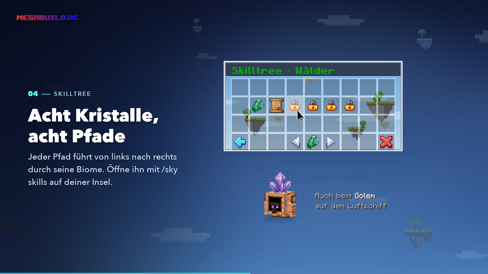
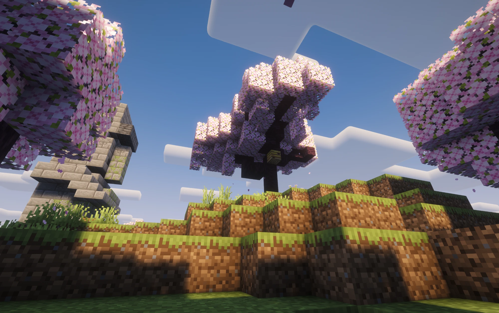
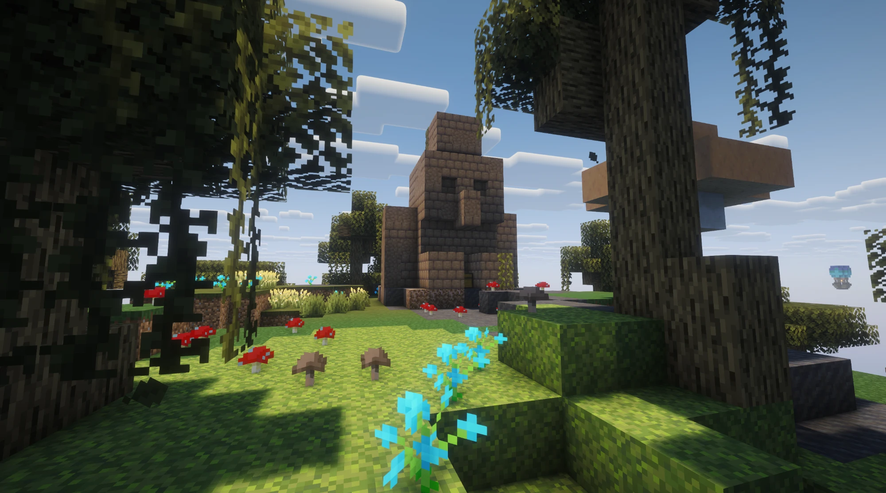
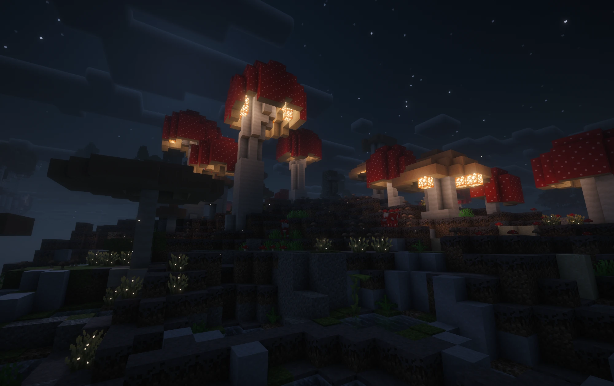
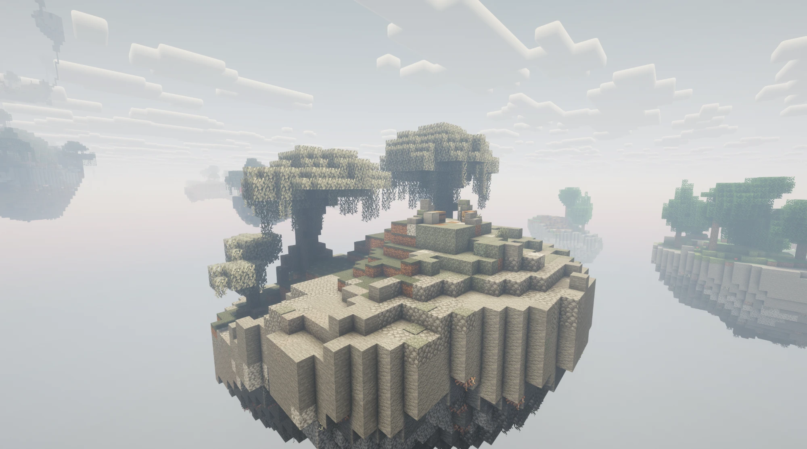
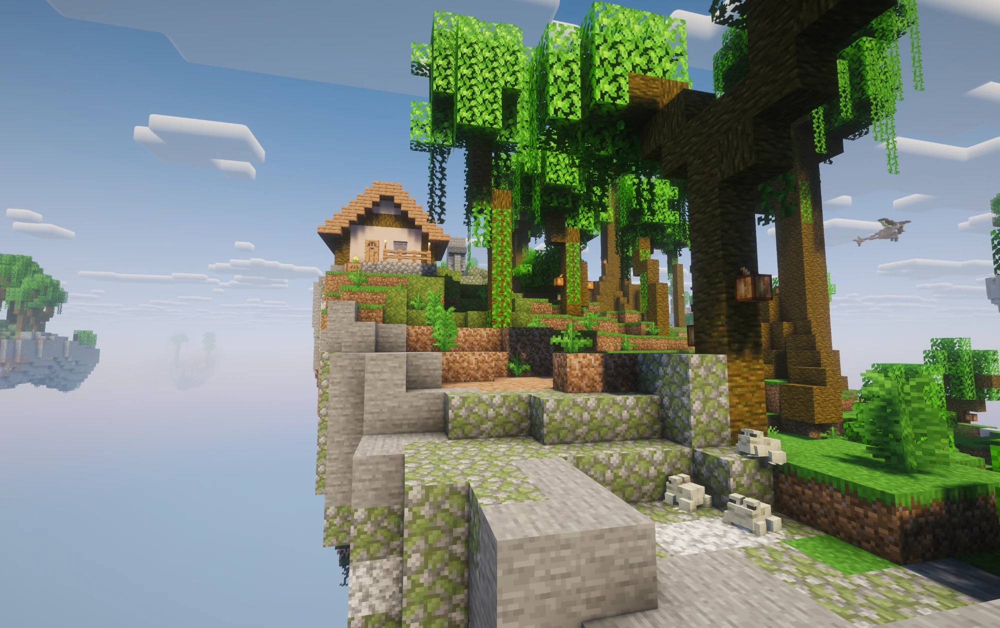
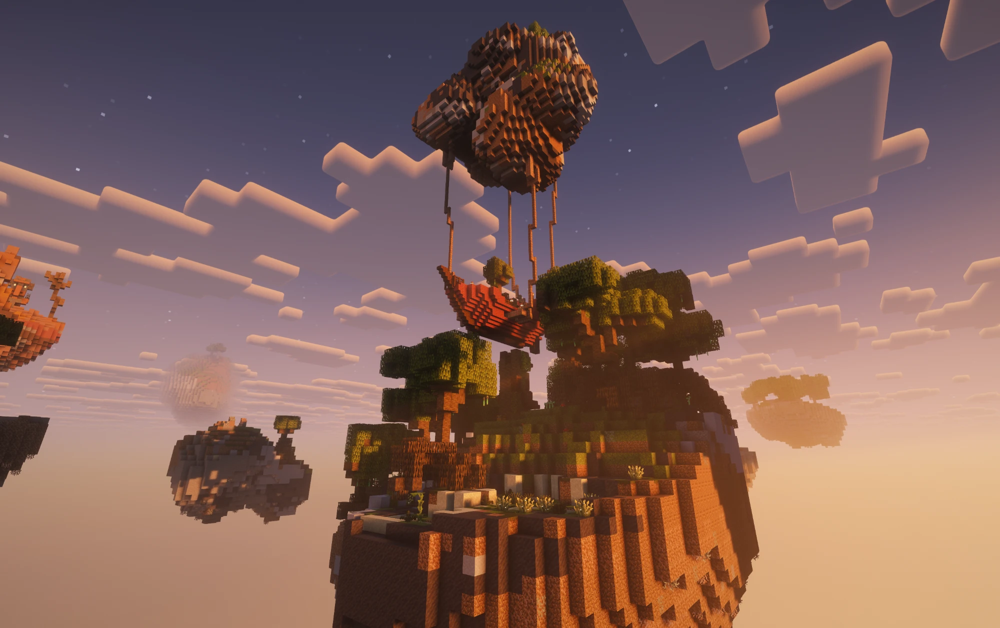

# Skilltree & Biome

<figure><figcaption>
Aus dem Video „Mana & Biome“
</figcaption></figure>


**Video: Mana & Biome** (1:16) – wie du Mana verdienst und damit deine Inselwelt wachsen lässt.


Im Skilltree schaltest du **neue Biome** für deine Insel frei. Neue Gegenden entstehen beim Erkunden nur aus Biomen, die deiner Insel gehören.

Öffne ihn **auf deiner Insel** mit `/sky skills` oder über `/sky` → **Skilltree**. Genauso öffnet ein Klick auf den **Golem** auf deinem Luftschiff den Skilltree (Bedrock: daneben schleichen).

## Acht Kristalle, acht Pfade

Der Skilltree besteht aus **acht Pfaden** – jeder Pfad ist ein **Kristall**. Ein Pfad führt von links nach rechts durch seine Biome. Das erste Biom eines Pfads ist zugleich das Startbiom, das du bei der Startwahl bekommst.



Ebene → Sonnenblumenebene → Wiese → Blumenwald → Birkenwald → Kirschhain

<figure><figcaption>
Kirschhain
</figcaption></figure>



Wald → Bewaldete Hügel → Taiga → Hain → Fichten-Urtaiga → Kiefern-Urtaiga

<figure><figcaption>
Wald
</figcaption></figure>



Verschneite Ebene → Verschneiter Strand → Verschneite Taiga → Vereister Fluss → Vereister Ozean → Eiszapfentundra



Windschliff-Hügel → Windschliff-Wald → Windschliff-Kieshügel → Verschneite Hänge → Vereiste Gipfel → Zerklüftete Gipfel



Sumpf → Mangrovensumpf → Dunkler Wald → Birkenurwald → Pilzland → Blasser Garten

<figure><figcaption>
Pilzland bei Nacht
</figcaption></figure>

<figure><figcaption>
Blasser Garten
</figcaption></figure>



Lichter Dschungel → Dschungel → Steinige Gipfel → Bambusdschungel

<figure><figcaption>
Dschungel
</figcaption></figure>



Wüste → Savanne → Tafelberge → Zerzauste Savanne → Bewaldete Tafelberge → Abgetragene Tafelberge

<figure><figcaption>
Tafelberge und Savanne
</figcaption></figure>



Fluss → Strand → Steinküste → Lauwarmer Ozean → Kalter Ozean → Warmer Ozean → Tiefsee


Der Kristall **Gewässer** kommt bald. Bis dahin ist er gesperrt.




Jeder Pfad bringt seine eigenen **Custom-Biome** mit, und mit neuen Kristallen kommen weitere dazu.

## So schaltest du ein Biom frei



#### Im eigenen Pfad: Biomquest des Bioms davor

Jedes Biom hat eine **Biomquest**. Das nächste Biom eines Pfads kannst du erst kaufen, wenn dir das Biom davor gehört **und** seine Biomquest geschafft ist. Das gilt auch für dein Startbiom.



#### In einem neuen Pfad: zuerst die Kristallquest

Willst du einen anderen Kristall beginnen, schaffst du zuerst seine **Kristallquest**. Danach ist das erste Biom dieses Pfads kaufbar. Kristallquests laufen von Anfang an alle gleichzeitig.



#### Kaufen

Antippen kauft das Biom sofort zum angezeigten Preis – ohne weitere Nachfrage. Gekauftes bleibt gekauft.




**Kaufen dürfen** der Besitzer und Mitglieder mit dem Recht **Einstellungen**. Bezahlt wird immer vom Konto **dessen, der klickt** – und nur auf der Insel selbst.


## Biomquests

* **Alle helfen mit.** Im HUD siehst du den Stand der ganzen Insel. Jeder Besitzer und jedes Mitglied, das mithilft, bekommt beim Abschluss **25 Mana**. Gäste bekommen nichts.
* **Wo sie zählen:** Eine Biomquest zählt nur auf Inseln dieses Bioms – die Quest deines Startbioms also auf deiner Startinsel und ihren Nachbarn. **Kristallquests** zählen auf allen deinen Inseln.
* **Immer gleich fair:** Die ersten Quests eines Pfads schaffst du allein in wenigen Minuten, die hinteren dauern eher eine Stunde.
* **Was nicht zählt:** Dieselben Regeln wie bei den Quests – selbst gesetzte Blöcke, Spawner-Monster und AFK zählen nicht. Biomquests lassen sich **nicht überspringen**.
* **Zwischenstände** bei 25, 50 und 75 % stehen im Chat.

Tippst du im Skilltree auf ein Biom, das auf eine Quest wartet, wird die Quest im HUD angeheftet.

Alle Biomquests im Überblick

Die Zahl ist die Stelle des Bioms im Pfad. Die Quest an Stelle 1 öffnet Stelle 2 und so weiter.

| Pfad | 1 | 2 | 3 | 4 | 5 | 6 |
| ---- | - | - | - | - | - | - |
| Ebenen | 8 Schafe scheren | 48 Sonnenblumen | 5 Kaninchen züchten | 160 Blumen | 288 Birkenstämme | 192 Blütenblätter |
| Wälder | 48 Eichenstämme | 5 Container plündern | 96 Süßbeeren | 3 Füchse züchten | 384 Fichtenstämme | 3 Wölfe zähmen |
| Schnee & Eis | 96 Schneeblöcke | 32 Fische | 2 Wölfe zähmen | 192 Eis | 256 Pack- oder Blaueis | 16 Eiswanderer |
| Gebirge | 12 Erze | 160 Stämme | 384 Kies | 6 Ziegen züchten | 40 Monster | 640 Gestein |
| Sumpf & Selten | 24 Blaue Orchideen | 32 Fische | 64 Pilze | 320 Birkenstämme | 8 Pilzkühe züchten | 48 Augenblüten |
| Dschungel | 48 Tropenbaumstämme | 3 Papageien zähmen | 32 Erze | 3 Pandas züchten | – | – |
| Wüste & Steppe | 128 Sand | 3 Pferde zähmen | 5 Gürteltiere züchten | 256 Akazienstämme | 384 Terrakotta | 64 Monster |

| Kristallquest | Aufgabe |
| ------------- | ------- |
| Schnee & Eis | 32 Fische angeln |
| Gebirge | 384 Gestein abbauen |
| Wälder | 128 Stämme fällen |
| Ebenen | 128 Weizen ernten |
| Sumpf & Selten | 6 Container plündern |
| Dschungel | 16 Tiere züchten |
| Wüste & Steppe | 40 Monster besiegen |

## Preise

Das erste Biom kostet **100 Mana**. Danach steigt der Preis langsam:

* **+5 %** für jedes Biom, das deine Insel schon gekauft hat
* **+25 %** für jede Stelle weiter hinten im Pfad
* gerundet auf 5 Mana

| Kauf Nr. | Stelle 1 | Stelle 2 | Stelle 3 | Stelle 4 | Stelle 5 | Stelle 6 |
| -------: | -------: | -------: | -------: | -------: | -------: | -------: |
| 1. | 100 | 125 | 150 | 175 | 200 | 225 |
| 10. | 155 | 195 | 235 | 270 | 310 | 350 |
| 20. | 255 | 315 | 380 | 440 | 505 | 570 |
| 39. | 640 | 800 | 960 | 1.115 | 1.275 | 1.435 |

Alle 39 Käufe zusammen kosten rund **20.900 Mana**. Die ersten zehn Biome bekommst du für etwa 1.400 Mana.

## Was ein neues Biom bringt

* **Neue Gegenden.** Ein frisch gekauftes Biom erscheint **sicher in der nächsten neuen Gegend**, die du erkundest.
* **Neue Ressourcen, Tiere und Bauwerke** des Bioms – und die passenden Quests.
* **Neue Forestlinge**, je nach Biom.
* **Erfolge**, zum Beispiel *Neues Land* für dein erstes Biom und einen Erfolg für jeden ganzen Pfad.

## Lieblinge

Bis zu **drei** deiner Biome kannst du als **Liebling** markieren. Lieblinge erscheinen in neuen Gegenden **dreimal so oft**. Das kostet nichts und lässt sich jederzeit ändern: Tippe im Skilltree auf ein Biom, das dir schon gehört.

## Was die Symbole bedeuten

| Im Menü | Bedeutung |
| ------- | --------- |
| Biom mit Glanz und ✔ | Gehört deiner Insel |
| ★ | Liebling |
| Preis | Kaufbar – oder es steht dabei, wie viel Mana dir fehlt |
| Schloss | Erst das Biom davor kaufen |
| Schriftrolle | Wartet auf eine Biom- oder Kristallquest – mit Aufgabe, Fortschritt und Helfern |
| Uhr | Gesperrt (Gewässer) |

Mit den Pfeilen unten blätterst du durch die acht Kristalle.

## Verwandte Seiten

* [Mana & Ruby](eco.md)
* [Quests](quests.md)
* [Die Inselwelt](welt.md)
* [Erfolge](erfolge.md)
