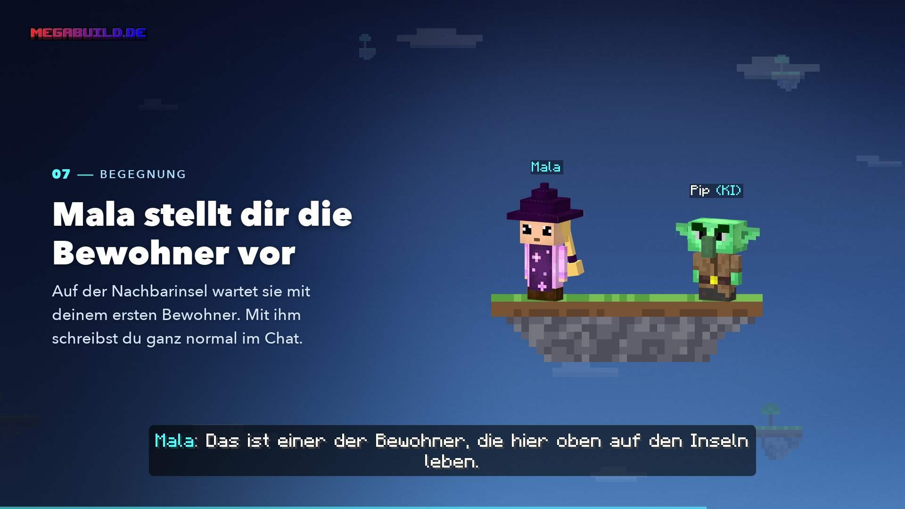

# Erste Schritte

<figure><figcaption>
Aus dem Video „Dein Start“
</figcaption></figure>


**Video: Dein Start** (1:34, mit Ton) – Mala begleitet dich von der Lobby bis zu deinem ersten Bewohner.


## Deine Insel erstellen



#### Verbinden

Betritt den Server über `megabuild.de` (Bedrock: Port `19132`). Auf der Java Edition musst du das Resourcepack annehmen.


[join.md](../ag/join.md)




#### Skyblock-Menü öffnen

Du landest in der Lobby. Gib `/sky` ein oder klicke den Skyblock-NPC an und wähle **Skyblock erstellen**.



#### Kristall wählen

Der Kristall bestimmt, womit deine Insel beginnt. **Diese Wahl kannst du später nicht mehr ändern.** Alle weiteren Biome schaltest du im Spiel frei.

| Kristall | Deine Startinsel | So sieht es aus |
| -------- | ---------------- | --------------- |
| Ebenen | Ebene | Weite Wiesen und Sonnenblumen |
| Wälder | Wald | Dichte Laub- und Nadelwälder |
| Schnee & Eis | Verschneite Ebene | Frostige Ebenen und Gletscher |
| Wüste & Steppe | Wüste | Sand, Hitze und Badlands |
| Dschungel | Lichter Dschungel | Tropisch, grün und voller Leben |
| Gebirge | Windschliff-Hügel | Schroffe Gipfel und Geröll |
| Sumpf & Selten | Sumpf | Moorige und ungewöhnliche Biome |

Der Kristall **Gewässer** ist schon zu sehen, aber noch **bald verfügbar**.



#### Abflug

Du wirst sofort auf einen Intro-Server gebracht und erlebst dort den Vorspann. Deine Insel entsteht währenddessen im Hintergrund – du musst nicht in der Lobby warten.

Starten gerade sehr viele Spieler gleichzeitig, zeigt dir die Leiste über der Schnellleiste **„Intro wird vorbereitet“** und deinen Platz in der Warteschlange.



## Der Vorspann mit Mala

Du wachst an Deck eines **Luftschiffs** auf. Am Ruder steht **Mala**, die Kapitänin. Sie erzählt dir in rund eineinhalb Minuten, was mit der alten Welt passiert ist – mit **Stimme und Untertiteln**, auf Deutsch oder Englisch, je nach Sprache deines Minecraft-Clients.


**Ton an!** Der Vorspann lebt von Malas Stimme.


* Du kannst dich an Deck frei bewegen. Springst du über Bord, wirst du aufgefangen.
* Auf dem Intro-Server siehst du nur dein eigenes Schiff – andere Spieler sind ausgeblendet.
* Mala stellt dir unterwegs den **Golem** und das **Warpett** vor.

## Mit dem Warpett auf deine Insel



#### Löwenzahn pflücken

Vor dem Haus des Warpetts wächst ein Löwenzahn. Pflück ihn.



#### Dem Warpett hinhalten

Nimm den Löwenzahn in die Hand und klicke das Warpett an – **Rechts- oder Linksklick**. Auf **Bedrock** schleichst du daneben.



#### Verschluckt!

Das Warpett frisst den Löwenzahn – und dich gleich mit. Kurz wird es dunkel, dann spuckt dich sein Zwilling auf deiner **Startinsel** wieder aus.



Ist deine Insel in diesem Moment noch nicht ganz fertig, zeigt dir eine Leiste **„Letzter Feinschliff …“**, woran gerade gebaut wird. Das dauert höchstens ein paar Minuten.

Bei der Ankunft bekommst du den Erfolg **Gelandet** und einen ersten Tipp passend zu deinem Startbiom.


[warpetts.md](warpetts.md)


## Was du auf deiner Startinsel findest

| Was | Wo |
| --- | -- |
| **Insel-Warpett** | Neben dem Spawn. Es bringt dich jederzeit zurück aufs Luftschiff |
| **Luftschiff** | Es ankert über deiner Insel. Dort steht der **Golem** – ein Klick öffnet den Skilltree |
| **Nachbarinseln** | Rund um die Startinsel, alle im Biom deiner Startwahl |
| **Wasser und Lava** | Hat die Startinsel keins, bekommt sie beides für einen Bruchstein-Generator |

Die Startinsel selbst hat keine Höhle und kein Erz – das findest du auf den Inseln, die du erkundest.

## Die Sonderquest: Finde den ersten Bewohner

Auf einer kleinen Nachbarinsel, rund 100 Blöcke entfernt, ist jemand eingezogen. Drei Dinge zeigen dir den Weg – sie sind nur für dich sichtbar:

* ein **Pfeil** im Questkasten oben, mit der Entfernung in Metern
* ein **Leuchtfeuer** auf der Insel des Bewohners
* ein **Hilfsgeist**, der vorausfliegt

Eine **Rankentreppe** aus Blättern führt hinüber. Dort wartet **Mala** mit deinem ersten **KI-Bewohner** und stellt ihn dir vor – und einen scheuen **Forestling** gleich dazu. Danach redet der Bewohner im Chat mit dir.


[bewohner.md](bewohner.md)


## Die ersten Stunden

* **Quests öffnen.** Mit `/quest` siehst du deine Aufgaben. Sie sind die verlässlichste Mana-Quelle.
* **Die Biomquest deines Startbioms erledigen.** Erst danach ist das nächste Biom deines Pfads kaufbar. Alle auf der Insel helfen mit.

  | Startbiom | Biomquest |
  | --------- | --------- |
  | Ebene | 8 Schafe scheren |
  | Wald | 48 Eichenstämme fällen |
  | Verschneite Ebene | 96 Schneeblöcke schaufeln |
  | Wüste | 128 Sand graben |
  | Lichter Dschungel | 48 Tropenbaumstämme fällen |
  | Windschliff-Hügel | 12 Erze abbauen |
  | Sumpf | 24 Blaue Orchideen pflücken |
* **Erkunden.** Die Inseln um dich herum haben Höhlen, Erze, Dörfer und mit etwas Glück weitere Bewohner.
* **Freunde einladen.** Mit Mitgliedern kommst du schneller voran – und sie bekommen für Biomquests ebenfalls Mana.
* **Erstes Biom kaufen.** Du startest mit **1.000 Mana**. Das zweite Biom deines Startpfads kostet 125 Mana.


**Fällst du in die Leere,** behältst du Inventar und Level. Du verlierst nur ein paar Mana und wachst in deinem Bett auf – oder, wenn du keins hast, an Deck des Luftschiffs.


## Später wiederkommen

Beim nächsten Einloggen landest du direkt auf deiner Insel, wenn sie gerade läuft. Sonst kommst du in die Lobby und betrittst deine Insel über `/sky` → **Insel betreten**.

## Weiter

* [Deine Insel](insel.md)
* [Die Inselwelt](welt.md)
* [Skilltree & Biome](skilltree.md)
* [Befehle](../ag/befehle.md)
