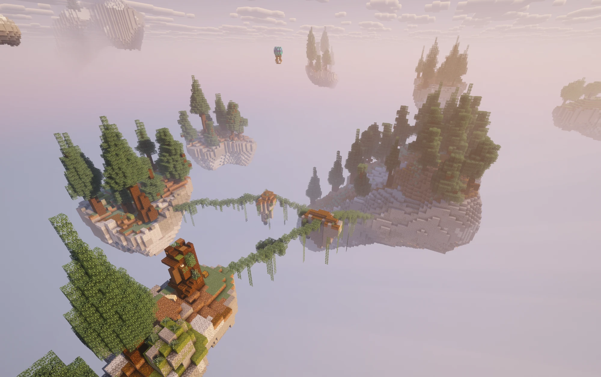
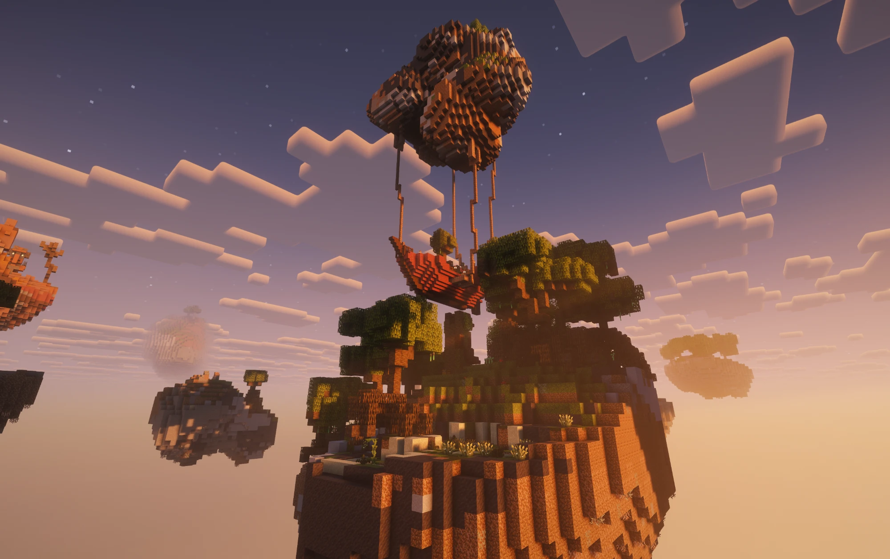
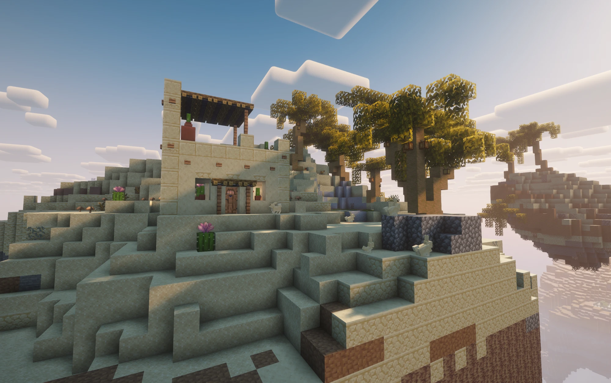
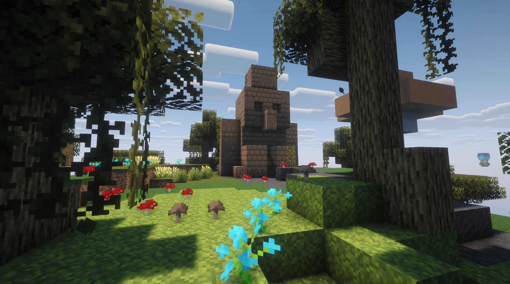

# Die Inselwelt

Deine Insel hat keine festen Ausbaustufen. Stattdessen **wächst die Welt, während du erkundest**: Wo du hinfliegst oder hinbaust, entstehen neue Inseln – mit Höhlen, Erzen, Dörfern, Ruinen und Bewohnern.

<figure><figcaption>
Eine Hauptinsel mit ihren Nebeninseln, verbunden über Rankentreppen
</figcaption></figure>

## Wie die Welt aufgebaut ist

| Was | Wie |
| --- | --- |
| **Raster** | Die Welt ist in Felder von **220 × 220 Blöcken** eingeteilt. Jedes Feld hat eine **Hauptinsel**, leicht versetzt und in unterschiedlicher Höhe |
| **Nebeninseln** | Um jede Hauptinsel liegen 2–3 kleine Nebeninseln |
| **Rankentreppen** | Zu den nächsten Nebeninseln führt eine kleine **Trittinsel** mit einer Treppe aus Blättern und Ranken – ohne Bauen hinüber |
| **Lückenfüller** | Große Löcher zwischen den Inselgruppen füllen weitere kleine Inseln |
| **Schiffe im Leeren** | Zwischen den Gruppen hängen Luftschiffe, Ballons und Flugzeuge |
| **Startinsel** | In der Mitte, mit vier Nebeninseln in rund 100 Blöcken Abstand. Auf einer davon wohnt dein [erster Bewohner](bewohner.md) |

Neue Inseln entstehen, **wenn du in ihre Nähe kommst** – in Blickrichtung zuerst. Was einmal entstanden ist, bleibt. Wer auf einer fremden Insel nur [zuschaut](reisen.md) oder als [Kunde](chestshop.md#als-kunde-auf-fremden-inseln) einkauft, lässt dort keine neuen Inseln entstehen.

<figure><figcaption>
Zwischen den Inseln hängen Ballons und Luftschiffe
</figcaption></figure>

## Biom-Gegenden

Inseln gleichen Bioms liegen in **Gegenden** von etwa 3 × 3 Feldern – rund 660 Blöcke breit, meist um die neun Hauptinseln. Du fliegst durch eine Gegend Wüste, dann durch eine Gegend Wald.

* Etwa **jede dritte Insel** ist ein Einsprengsel aus einem anderen deiner Biome.
* Die Gegend um die Startinsel hat immer dein **Startbiom**.
* Es entstehen **nur Biome, die deiner Insel gehören**. Neue kaufst du im [Skilltree](skilltree.md).
* Ein frisch gekauftes Biom kommt **sicher in der nächsten neuen Gegend**. Danach entscheidet der Zufall – deine **Lieblinge** kommen dreimal so oft.
* Eine erkundete Gegend behält ihr Biom, auch wenn du später neue kaufst.


**Neue Biome findest du draußen.** Biome entstehen nur in Gegenden, die noch niemand erkundet hat. Flieg nach dem Kauf also in eine Richtung, in der du noch nicht warst.


## Was auf den Inseln liegt

### Höhlen

Jede **Hauptinsel** hat ein Höhlensystem mit ein bis drei Einstiegen von oben: Kammern auf bis zu zwei Stockwerken, Gänge mit Rundwegen, eine große Halle und manchmal ein Becken. Jede Kammer hat ihre Art – üppig bewachsen, Tropfstein, Eis, Pilze, Magma oder einfacher Fels. Selten findest du eine **Amethystgeode**. Am Höhlenboden, am ehesten in so einer Geode, liegt manchmal ein **Knospender Mana-Amethyst** – siehe [Furnace Golem & Mana-Geode](furnace-golem.md#die-mana-geode).

Die Höhlen sind zum Teil beleuchtet. Nebeninseln, Trittinseln und die Startinsel haben keine Höhle.

### Erze

Erz liegt in kleinen **Nestern** von ein bis vier Blöcken im ganzen Fels und einzeln an den Höhlenwänden – dort berühren sich zwei Erze höchstens über Eck. **Je tiefer, desto mehr.** Die Nester im Fels siehst du nicht – du musst graben. Von außen siehst du an keiner Insel Erz.

| Insel | Erz ungefähr |
| ----- | ------------ |
| Hauptinsel | rund 330 Erzblöcke, davon etwa 11 Diamanten und 90 Eisenerz; rund 200 davon sitzen sichtbar an den Höhlenwänden |
| Nebeninsel | rund 16 Erzblöcke |
| Startinsel | keins |

**Eisen ist so häufig wie Kohle** – in jedem Biom.

Dazu kommt das **Mana-Erz** mit seinen pinken Adern – 4 bis 14 Stück in den Höhlen jeder Hauptinsel.


[eco.md](eco.md)


### Bauwerke

Mit etwas Glück findest du auf einer Insel:

* **Dörfer** – von einem Haus bis zu einem kleinen Ort, mit Dorfbewohnern
* **Ruinen**
* **Außenposten** der Plünderer
* **Einzelne Bauten** abseits der Dörfer
* **Schwebende Bauwerke** über der Insel – etwa jede elfte Hauptinsel hat eins
* **Portale**, die hoch über manchen Hauptinseln schweben – siehe [Portale](#portale)

Nebeninseln haben höchstens ein kleines Bauwerk. Dazu kommen die Häuser und Lager der [KI-Bewohner](bewohner.md).

<figure><figcaption>
Ein Dorf in der Wüste
</figcaption></figure>

<figure><figcaption>
Eine alte Statue im Wald
</figcaption></figure>

### Portale

Über manchen Hauptinseln schweben **Portale** – im Spiel heißen sie auch *Tore*. Es gibt drei Arten: **Nether**, **Wasser** und **End**. Jedes Portal steht auf seiner eigenen kleinen Insel. Bei Nether- und Wasser-Portalen passen Oberfläche, Fels und Pflanzen dieser Insel zum Biom der Hauptinsel darunter.


**Noch geschlossen.** Die Portale haben noch keine Funktion, sie werden erst später freigeschaltet. Auch Enderaugen lassen sich noch nicht in den Rahmen des End-Portals setzen. Den [Dungeon im End-Portal](#der-dungeon-im-end-portal) kannst du aber schon spielen.


* **Wie oft:** In jedem Gebiet aus 5 × 5 Feldern (1.100 × 1.100 Blöcke) schwebt von jeder Art ein Portal – also etwa über jeder 25. Hauptinsel. Zwei Portale teilen sich nie eine Insel, und über der Startinsel steht keins.
* **Wie weit:** Bis zum nächsten Portal einer Art fliegst du meist nur ein paar hundert Blöcke.
* **Wie hoch:** rund 20 bis 26 Blöcke über der Hauptinsel, gemessen bis zur Unterkante der Portalinsel. Hinauf kommst du wie zu jedem schwebenden Bauwerk – mit Blöcken oder Enderperlen.
* **Ältere Portale:** Früher standen Nether- und Wasser-Portale unten auf der Hauptinsel. Die schon stehen, bleiben dort – in Gegenden, die du schon erkundet hast, findest du sie also auch am Boden.
* **Abbauen:** Ein Portal baust du ab und um wie jeden anderen Inselblock, nach den Rechten der Insel. Nur die **Tresore** im End-Portal lassen sich nicht abbauen – versuchst du es, sagt dir der Chat, dass der Tresor zum Tor gehört. Von selbst verändert sich ein Portal samt seiner Insel aber nicht: Creeper sprengen nichts davon weg, Feuer verbrennt nichts, Wasser friert nicht zu, Kies und Sand fallen nicht herunter, und Endermen nehmen nichts mit. Was du selbst daran veränderst oder hinbaust, schützt das Portal nicht mehr.

### Der Dungeon im End-Portal

Im End-Portal stehen **Prüfungsspawner** und **Tresore**. Sie arbeiten schon, obwohl das Portal selbst noch geschlossen ist.

1. Komm einem der Prüfungsspawner auf **14 Blöcke** nahe – sehen musst du ihn nicht. Dann beginnt ein Lauf aus **1 bis 5 Wellen**. Jede Welle kündigt ein Titel an, etwa „Welle 2 von 4“, darunter ihr Name. Ab drei Wellen ist die letzte eine Schlusswelle wie „Der Torwächter“.
2. Nach der letzten Welle fällt der **End-Schlüssel**, dazu etwas Beute – je länger der Lauf, desto mehr. Stehst du nicht beim Spawner, fällt beides vor deine Füße.
3. Mit dem End-Schlüssel öffnest du einen **Tresor**, und zwar in jedem End-Portal. Jeder Tresor öffnet sich für dich einmal, jedes End-Portal hat eigene. Darin liegt auch etwas aus dem Biom der Insel darunter.
4. Mit etwas Glück findest du in der Beute oder im Tresor eine **Unheilvolle Flasche**. Trinkst du sie und kommst wieder, hast du **Bad Omen** (Böses Omen): Es kommen mehr und stärkere Monster, und am Ende fällt der **Unheilvolle End-Schlüssel** für den unheilvollen Tresor mit der besseren Beute.

* Die Prüfungsspawner sitzen oben in den Türmen. Hinauf musst du nicht: Die Monster kommen zu dir, und dein Lohn auch.
* Spielt ihr zu mehreren, kommen mehr Monster. Die Beute wird für jeden Spieler neu ausgewürfelt.
* Zombies und Skelette verbrennen hier bei Tag nicht.
* Nach seinem Lohn ruht ein Prüfungsspawner 30 Minuten. Mit Bad Omen geht es sofort weiter.
* Ist 5 Minuten lang niemand in der Nähe, verschwinden die Monster, und der Lauf fängt von vorn an.
* Am Portalrahmen sitzt außerdem ein normaler Spawner mit Silberfischen. Sie zählen nicht zur Welle.
* Überfälle gibt es auf den Inseln nicht – Bad Omen wirkt nur hier. Auch ein Plünderer-Hauptmann lässt die Unheilvolle Flasche fallen.


**Lava im Hof.** Im Hof des End-Portals liegt Lava – pass auf, wo du kämpfst.


### Beute

* **Jeder** Behälter in einem Bauwerk ist beim ersten Öffnen gefüllt – Truhen, Fässer, verzierte Töpfe und Regale in Häusern.
* Auf manchen Inseln liegt **verdächtiger Sand oder Kies** an der Oberfläche, höchstens drei pro Insel. Mit einem Pinsel legst du die Beute frei.
* In der Beute stecken auch [Warpett-Eier](warpetts.md#warpett-eier).

### Tiere

Welche Tiere auf einer Insel leben, hängt vom Biom ab – Pilzkühe im Pilzland, Pferde und Gürteltiere in der Savanne, Pandas im Bambusdschungel, Ziegen im Gebirge, Frösche im Sumpf.

* Je größer die Insel, desto mehr Tiere: eins je 250 begehbare Blöcke, höchstens 16. Eine Hauptinsel hat meist drei oder vier Arten.
* **Tiere kommen nach.** Ist eine Insel in deiner Nähe leer gegessen, ist sie nach ein paar Minuten wieder voll.
* Jäger und Beute leben nie auf derselben Insel – auf einem Wolf-Eiland gibt es keine Schafe.

### Monster

Monster spawnen wie gewohnt im Dunkeln, aber **deutlich weniger** als in normalem Minecraft: höchstens 15 gleichzeitig pro Spieler. Erlegte kommen nach.


**Monsterfarm?** Die Farm teilt sich das Limit mit den Inseln ringsum. Beleuchte die Inseln in der Nähe, sonst spawnen die Monster dort statt in der Farm.


## Die Leere

Unterhalb von **Höhe 0** stirbst du sofort. Dein Inventar und deine Level behältst du, du verlierst nur ein paar Mana. Du wachst in deinem Bett auf – oder an Deck deines Luftschiffs, wenn du keins hast.

## Verwandte Seiten

* [Skilltree & Biome](skilltree.md)
* [Ressourcen & Farming](farming.md)
* [KI-Bewohner](bewohner.md)
* [Forestlinge](forestlinge.md)
* [Warpetts](warpetts.md)
